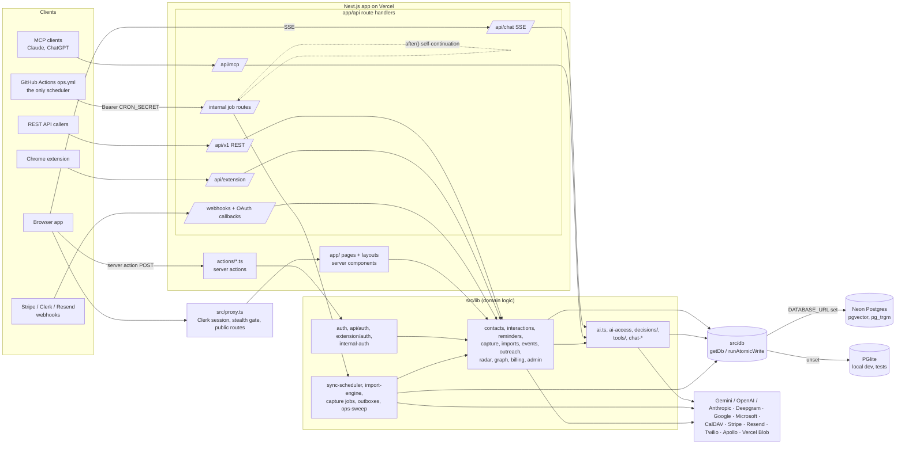

# Orbit code health plan

This plan fixes the findings in [CODE_HEALTH_AUDIT.md](CODE_HEALTH_AUDIT.md) in a safe order. **Nothing here has been started.** Each step waits for approval.

## Principles

1. **Build the safety net before moving anything.** The current tests can't protect a file move (audit §A4), so P0 comes first.
2. **One kind of change per PR.** A PR is a deletion, a mechanical move, or a behaviour change, never a mix. Mechanical PRs must leave the output identical (same `tsc` result, same DDL fingerprint, same smoke results).
3. **Pin behaviour before refactoring it.** Every step lists the tests that must exist and pass *before* the change, and pass unchanged *after* it.
4. **Use ratchets, not big bangs.** New lint rules start at today's count and only go down, so no unrelated PR is ever blocked.
5. **Minimise conflicts with parallel branches.** Many agent branches are in flight. Large moves (P7, P8) land one domain at a time, merge the same day, and announce the new paths. Coordinate with open PRs before touching `schema.ts`, `db/index.ts`, `package.json` or the lockfile.

**Standard verification for every PR (the "full gate"):** `npm run typecheck`, `npm run lint` (warning count ≤ the ratchet), `npm test` (all 3 shards), `npm run test:e2e`, and `npm run build`. Where a step adds to this, it says so.

## Phases at a glance

| Phase | What | Behaviour change? | Size | Depends on |
|---|---|---|---|---|
| **P0** | Safety net: CI gate, toolchain pin, unit runner, characterization tests, ratchets, docs | none | M | — |
| **P1** | Delete dead code, dependencies, scripts and docs | removes unused endpoints only | S–M | P0.4 |
| **P2** | Route every caught failure to `reportError`; mark intentional fallbacks | logging only | S | P0 |
| **P3** | Lint ratchet: autofixes, typed rules, boundary rules, conventions | small (floating promises) | M | P0 |
| **P4** | Consolidate duplicated utilities; fix identity-normalizer drift | **yes, for P4.3** | M | P0.3 |
| **P5** | Validate server action and external inputs; one `ActionResult` | **yes** (malformed input rejected) | L | P0.3, P4.3 |
| **P6** | Fix layering: lib↔actions, outreach domain into lib, cycles | none | M | P0.4, P3.3 |
| **P7** | Regroup `src/lib` into domain folders | none (moves) | L | P0.4, P3, P6 |
| **P8** | Split the oversized files and functions | none (moves/extractions) | L | P0.3, P7 |
| **P9** | Single-source schema DDL | none (generated output identical) | L | P0.3, P8.1 |
| **P10** | Typed env accessor; startup validation gaps; deploy ordering | **yes** (stricter build checks) | M | P0 |
| **P11** | Dependency upgrades and removals | per package | M | P0 |

P0, P2, P10 and P11.1 can run in parallel. P1–P3 are a few days of work each. P7–P9 are the big ones; schedule them for a quiet merge window.

---

## P0. Safety net (do first, no app code changes)

**P0.1 Make CI a real gate.** *(Settings change, needs you.)*
- Require `check`, `smoke suite (PGlite) 1/3`, `2/3`, `3/3` and `browser flows (Playwright)` on `main` in GitHub branch protection.
- `ci.yml` warns that `paths-ignore` would then block docs-only PRs forever. Replace `paths-ignore` with a cheap `changes` job (`dorny/paths-filter`, pinned by SHA like the other actions), so skipped jobs report success.
- Drop the stale `.github/workflows/backup.yml` lines from `ci.yml`.
- **Test:** a docs-only PR goes green; a PR with a deliberately failing smoke can't merge.

**P0.2 Pin the toolchain.**
- Add `"packageManager": "npm@11.x.y"` and `"engines": { "node": "24.x", "npm": ">=11" }`.
- Add `.npmrc` with `engine-strict=true`.
- Bump `@types/node` to `^24`.
- **Test:** `npm ci` on Node 24 succeeds. On Node 22 it fails with a clear engine error rather than the lockfile error. Full gate.

**P0.3 Add a real unit-test runner beside the smokes.**
- **Recommendation:** use `node:test` through `tsx` (`node --import tsx --test 'src/**/*.test.ts'`). It adds no dependency, runs in parallel, has watch mode and `--experimental-test-coverage`, and the smokes already use tsx. (Vitest is the alternative if you want its UI.)
- Add `npm run test:unit`, plus a CI job alongside the smoke shards.
- Don't port the 542 smokes. New tests go to `*.test.ts` next to the code; smokes migrate only when touched.

**P0.4 Write characterization tests for everything later phases move.** These pin today's behaviour, including known quirks, so any refactor diff is visible:

| Target | Test |
|---|---|
| `decideStripeEvent` (`lib/billing-stripe.ts:572`) | Table-driven: recorded Stripe event fixtures → the returned decision (the function is already "decide, then apply", so this is cheap) |
| `prepareChatContext`, `runImportJob`, `saveNoteBatch`, `getDashboardData`, `evaluateOpsConditions` | PGlite-seeded golden tests: seed the demo fixture (`scripts/seed-graph-fixture.ts`) → snapshot the output as JSON with ids normalized |
| Identity helpers: every copy of `isLinkedInProfileUrl`, `normalizeEmail`, the LinkedIn slug/canonical helpers, `isDemoProspect` | One input table run against **every copy**, recording each copy's answer. Where copies disagree, the test documents it and P4.3 resolves it |
| Pure graph layout helpers (`graph-canvas-flow.tsx:296-715`) | Input/output tests once exported |
| `validateEnv` | Fixture env objects per `VERCEL_ENV` → expected errors and warnings |
| **E2E: chat** (send a question with the AI stub, get a streamed answer, open a thread) | New Playwright spec. **Needed before P8.4 touches `ChatPanel`** |
| **E2E: graph** (renders, select a star, inspect panel opens) | New Playwright spec. Needed before P8.5 |
| **E2E: import** (LinkedIn CSV fixture → preview → confirm → contacts appear) | New Playwright spec. Needed before P8.6 and P8.7 |

**P0.5 Add the ratchets.**
- `eslint --max-warnings 49`. This stops the `set-state-in-effect` drift (25 → 32).
- madge in CI with a committed `.madgerc` (`skipTypeImports: true`), failing if value cycles exceed 5 (~12 s).
- Commit a knip config in report-only mode (the scratch config from the audit). It needs `drizzle.config.ts` ignored or P1.4 done first.
- **Path-reading smokes:** list the ~73 smokes that `readFileSync` source paths in a manifest (`scripts/smoke/source-readers.json`). P7 and P8 then know exactly which tests move with each file.

**P0.6 Land the docs.** Zero risk, and the biggest onboarding win. The drafts are at the end of this file; review them, then commit:
- `README.md`: add a developer section (draft below).
- `docs/ARCHITECTURE.md` (with the data model and diagram), `docs/ENVIRONMENT.md`, `docs/DEPLOYMENT.md`.
- `docs/adr/0001…` through `0012…` (the ADR list is below).
- `CONTRIBUTING.md`: where new code goes, action rules, schema-change checklist, PR gate.
- Fix the stale statements: in `DEVELOPMENT.md`, in `.env.example` (`MANAGED_AI_ENABLED`, Stripe price ids, Vercel Cron), in RUNBOOK → Roll back (non-additive drops, frozen env), and in the `internal-auth.ts` header.
- Link `/api/v1/openapi.json` from the docs. The MCP tool list can be generated from `ORBIT_TOOLS` into `docs/MCP.md` by a script.
- **Test:** `smoke-schedules.ts` still parses RUNBOOK; `smoke-env-documented.ts` passes.

---

## P1. Delete dead weight

Every deletion uses the same three checks: `git grep -w <name>` shows zero references outside `docs/`, the knip hit is gone, and the full gate passes. Smokes that exist only to read a deleted file are deleted with it, and `run-smoke.ts --check` must pass so the manifest stays in sync.

| Step | Change | Extra protection |
|---|---|---|
| P1.1 | Remove `linkedom`; **declare `sharp`** at the version Next resolves today (0.35.5) | Avatar upload and capture-photo smokes; `next build` output tracing still excludes sharp on Vercel |
| P1.2 | Delete dead server actions (public endpoints): `createContactsBulk`, `askNetwork` (make the client types come from `lib/chat-stream-protocol`), `saveMeetingDetails`, `renameReminderList`, `setSpokeTo`, `listAgentDrafts`, `getSendCapabilityAction`, `previewEditDiscard`, `addManualInterestListSignupAction` | `smoke-action-user-scope` (AST) still passes; grep the e2e specs |
| P1.3 | Delete the remaining dead lib exports, one domain per commit (list in the audit, §D1) | typecheck |
| P1.4 | **Decision:** remove `drizzle-kit`, `drizzle.config.ts`, `db:generate` and `db:push:DANGEROUS`. That drops 4 advisories and unblocks knip. Keep `checkDrizzleCommand` only if drizzle-kit stays | `db:check`, `db:migrate` on fresh PGlite |
| P1.5 | Fold `MANAGED_AI_ENABLED = true` into the code (delete the dead `false` branches) | `smoke-ai-access`, `smoke-managed-ai-*` |
| P1.6 | **Decisions:** `actions/apple.ts` + iCloud reads in sync; `actions/openrouter.ts` + `/api/openrouter/callback`; `import-revert-button.tsx` + `revertImportAction` (wire up or delete); `route-progress`; `ui/relative-time.tsx` (superseded in P4.5) | Their smokes go with them |
| P1.7 | Scripts: move `migrate-provider-and-upgrade-events.ts`, `report-pricing-v2-accounts.ts`, `reprice-usage.ts` and the four spent backfills to `scripts/archive/`. Exclude `scripts/archive/**` from `tsconfig`. Add a `Ran in production: <date>` header line to every backfill. **First confirm `backfill-encrypt-ics-urls` has run in production** | typecheck |
| P1.8 | Docs: move the dated audits, `orbit_networking_tracker_spec.md`, `docs/superpowers/{plans,specs}` (keep the 6 that code references) and the superseded `ai-evals` dumps to `docs/archive/`, or delete them (git keeps history). Drop the `write-swift` and `animate-expo` vendored skills if no agent uses them | link check (`git grep` for moved paths) |

---

## P2. Make every failure visible

- **P2.1** Replace `console.error` with `reportError(where, err, ctx)` at the 35 files from audit §A5. Start with `subscription-management.ts` (5 sites), `extension/http.ts:247` and `account-deletion.ts:81,93`.
- **P2.2** Add a `bestEffort(where, fn, fallback)` helper (or the `reportAndContinue` that already exists, at warning level) and convert the lib silent catches that return a default. Start with the admin metrics (`account-health.ts:431,470,504`), where a failure currently reads as "0".
  - Intentional silent catches get a one-word marker comment (`// best-effort: <why>`), which a lint rule (`no-restricted-syntax` on `CatchClause` without that comment) can ratchet.
- **P2.3** Add `no-console` to the lint ratchet (it allows `warn` and `error` today; drop the allowlist once P2.1 is done).
- **Tests:** a unit test with a stub report sink proves each converted site reports with its `where` tag. The full gate passes. Behaviour seen by users is unchanged.

---

## P3. Lint and conventions ratchet

**P3.1 Autofix PR.** This PR contains autofixes only, and no other edits.
- Fixes: `consistent-type-imports` (20) and `no-unnecessary-type-assertion` (359), via `eslint --fix`.
- Also fixes `await-thenable` (1), `no-console` (2) and the unused disable directive (1).
- Enables `reportUnusedDisableDirectives: "error"`.
- Add `src/app/.well-known/**/*.ts` to `tsconfig` `include` so typed lint parses those two routes.
- **Test:** `tsc` output is unchanged. A `next build` bundle-size diff of about 0 proves the change is type-level only.

**P3.2 Typed rules.** Enable these as `warn` under the ratchet, fix the findings, then flip them to `error`:
- `no-floating-promises` (17)
- `no-misused-promises` (9)
- `switch-exhaustiveness-check` (23)

Each floating-promise fix is a small behaviour change (an added `void` or `await`, or a `.catch(reportError)`), so review each one.

**P3.3 Boundary rules.** Add these as `error` now, since they have 0 violations today:
- No `@/db`, `node:*`, `@/lib/report-error` or other server-only modules from `src/components/**` and `src/lib/**/use-*`.
- No AI SDK imports outside `lib/ai*.ts`. This replaces `smoke-ai-access.ts`'s regex.

Add these as `warn` under the ratchet:
- `src/lib/**` must not import `@/components/*`.
- Non-client lib and `src/app/api/**` must not import `@/actions/*`.

This is the substitute for `server-only`, which breaks tsx.

**P3.4 Convention rules.** Add these as `warn` under the ratchet:
- `process.env` outside `lib/env.ts` and the owner modules (225).
- `{ ok: false, message }` in actions (~10).

Write the naming conventions into `CONTRIBUTING.md`:
- `get` = one or null; `list` = many or paginated; `load` = page view-model; `fetch` = outbound HTTP only.
- Actions always end in `…Action`; lib writes end in `…ForUser`.

Rename only when a file is already being touched, never as a sweep.

**P3.5 Prettier (decision).** Either adopt it in one mechanical commit with `{ "printWidth": 100, "trailingComma": "es5" }`, add the SHA to `.git-blame-ignore-revs`, and add `prettier --check` to CI; or skip it. **Don't adopt it per file**: that churns every PR. If you adopt it, land it right after a quiet merge point, because every open branch will conflict.

**P3.6 Replace regex smokes with lint.** Convert the ~42 grep-based architecture smokes to `no-restricted-imports` or `no-restricted-syntax` where possible. They then fail in the editor instead of in CI, and they stop reading files by path, which P7 needs.

**The rules to add to `eslint.config.mjs`** (measured counts in comments):

```js
import { defineConfig, globalIgnores } from "eslint/config";
import nextVitals from "eslint-config-next/core-web-vitals";
import nextTs from "eslint-config-next/typescript";

const SERVER_ONLY = [
  { name: "@/db", allowTypeImports: true, message: "Client code must not import the database. Call an action." },
  { name: "@/lib/report-error", message: "Server-only (node:crypto). Use friendlyError on the client." },
];

export default defineConfig([
  ...nextVitals,
  ...nextTs,
  {
    files: ["src/**/*.{ts,tsx}"],
    languageOptions: { parserOptions: { projectService: true, tsconfigRootDir: import.meta.dirname } },
    linterOptions: { reportUnusedDisableDirectives: "error" },                    // 1
    rules: {
      "@typescript-eslint/consistent-type-imports": ["error", { fixStyle: "inline-type-imports" }], // 20, --fix
      "@typescript-eslint/no-unnecessary-type-assertion": "error",                 // 359, --fix
      "@typescript-eslint/await-thenable": "error",                                // 1
      "@typescript-eslint/no-floating-promises": "warn",                           // 17 → error after P3.2
      "@typescript-eslint/no-misused-promises": ["warn", { checksVoidReturn: { attributes: false } }], // 9
      "@typescript-eslint/switch-exhaustiveness-check": ["warn", { considerDefaultExhaustiveForUnions: true }], // 23
      "no-console": ["error", { allow: ["warn", "error"] }],                       // 2
      "no-restricted-imports": ["error", { paths: [
        { name: "@anthropic-ai/sdk", message: "Go through src/lib/ai.ts" },
        { name: "openai", message: "Go through src/lib/ai.ts" },
        { name: "@google/genai", message: "Go through src/lib/ai.ts" },
      ] }],
      // keep the existing set-state-in-effect / refs / no-unused-vars settings
    },
  },
  {
    files: ["src/lib/ai.ts", "src/lib/ai-tools.ts", "src/lib/ai-access.ts", "src/lib/ai-batch.ts", "src/lib/ai-key-check.ts"],
    rules: { "no-restricted-imports": "off" },
  },
  {
    files: ["src/components/**/*.{ts,tsx}", "src/lib/use-*.ts", "src/lib/**/use-*.ts"],
    rules: { "no-restricted-imports": ["error", { paths: SERVER_ONLY, patterns: [
      { group: ["node:*"], message: "Node built-ins are server-only." },
      { group: ["@/db/*"], allowTypeImports: true, message: "Type-only imports from the schema." },
    ] }] },                                                                        // 0 today
  },
  {
    files: ["src/**/*.{ts,tsx}"],
    ignores: ["src/lib/env.ts", "src/lib/app-url.ts", "src/instrumentation*.ts", "src/proxy.ts", "src/db/index.ts"],
    rules: { "no-restricted-syntax": ["warn", {
      selector: "MemberExpression[object.object.name='process'][object.property.name='env'][property.name!=/^NEXT_PUBLIC_/]",
      message: "Read env through src/lib/env.ts",
    }] },                                                                          // 225, ratchet
  },
  {
    files: ["src/actions/**/*.ts"],
    rules: { "no-restricted-syntax": ["warn", {
      selector: "ReturnStatement > ObjectExpression:has(Property[key.name='ok'][value.value=false]):has(Property[key.name='message'])",
      message: "Return ActionResult ({ ok: false, error }) from @/lib/errors",
    }] },
  },
  { files: ["scripts/**/*.ts"], rules: { "no-console": "off" } },
  globalIgnores([".next/**", "out/**", "build/**", "next-env.d.ts", ".claude/**", "extension/**"]),
]);
```

Typed linting roughly doubles lint time (+~75 s). CI already runs lint in parallel with `tsc`, so wall-clock cost is small.

---

## P4. Consolidate duplicated utilities

The method is the same for every cluster:
1. Write the table-driven characterization test against **all** copies (P0.4).
2. Add the shared module with its own unit tests.
3. Point the copies at it one file per commit.
4. Delete the copies.

Where copies disagree, the step becomes a behaviour change and needs a decision.

| Step | Cluster (audit §B7) | Behaviour change? |
|---|---|---|
| P4.1 | `lib/async.ts` (`sleep`, `withTimeout`, `settle`) and `lib/http/retry.ts` (`backoffMs`, `fetchWithRetry`); merge the Graph and Google retry loops | No: the 4 backoff copies are byte-identical |
| P4.2 | `lib/crypto.ts`: `safeEqual`, `sha256Hex`, `signToken` / `verifyToken` (unsubscribe tokens); one unsubscribe-route helper | No. **Test:** tokens minted before the change still verify |
| P4.3 | **Identity normalizers** → `lib/identity/{email,linkedin,domain}.ts`. Fix the drifted `isLinkedInProfileUrl` in `actions/contacts.ts:1236` (adopt the lib semantics: accept regional subdomains); one `normalizeEmail`; one `isDemoProspect` (the stricter "prefix OR flag") | **Yes.** Decision: adopt the lib semantics everywhere. **Tests:** the identity table, `smoke-duplicates*`, the import e2e |
| P4.4 | Admin row coercion: use `admin-metrics.ts`'s `num` / `toDate`; delete 9 copies (one fixes a missing NaN guard in `admin-trends.ts:150`) | Tiny (NaN guard) |
| P4.5 | One `<RelativeTime format="short\|long">` and `lib/dates.ts` (`addDays`, `startOfDay`, `daysBetween` from date-fns) | Display strings may change; snapshot-test the labels first |
| P4.6 | `lib/cursor.ts` (one keyset cursor codec, `escapeLike`) | **No for v1 API cursors.** Keep the v1 format exactly, since external callers hold cursors |
| P4.7 | `lib/create-external-store.ts` for the 7 client stores; reuse `createDismissStore` | No |
| P4.8 | `lib/route-http.ts` (`withRateLimit`, `readJsonBody(req, schema, maxBytes)`) shared by the 13 ad hoc routes and both wrapper families | No: response shapes stay the same, and a route-response unit test proves it |
| P4.9 | OAuth plumbing: Gmail and Outlook refresh and scope checks via `connectors/oauth.ts`; `classifyOAuthFailure` once | No. **Test:** the OAuth callback smokes |

---

## P5. Validate inputs at every boundary

- **P5.1 Split internal options out of public actions.** `createContact` and `updateContact` take only `ContactInput`. Internal callers that need `ContactWriteOptions` call `createContactForUser` and the other lib functions directly. **Test:** an AST smoke asserts that no exported action parameter's type contains `ContactWriteOptions` (or any `*Options` type marked `@internal`).
- **P5.2 Validate every object-parameter action with zod.** Add a tiny `action(schema, handler)` wrapper in `lib/action.ts`. It parses, runs `requireUserId`, maps `UserFacingError` and `PaywallError` to `ActionResult`, and reports everything else.
  - Migrate in this order: `contacts.ts`, `chat-imports.ts`, `meetings.ts`, `capture-jobs.ts`, `opportunities.ts`, then the remaining ~195.
  - **Tests:** a malformed-input test per migrated action (expects `{ ok:false }`, no 500 and no DB write), plus an AST smoke that ratchets the count of object-parameter actions not wrapped with a schema.
- **P5.3 One result type.** Widen `ActionResult<T>` to `{ ok:false; error: string; code?: string }`, and migrate the 7 shapes as their files are touched in P5.2. **Test:** the client callers are typed, so `tsc` finds every consumer.
- **P5.4 External responses.** Add zod schemas for the third-party payloads behind the 46 `res.json() as T` casts (Graph, Gmail, Apollo, connectors), and a `parseAiJson(schema, text)` overload used at the 14 unchecked sites.
  - **Test:** recorded-response fixtures parse.
  - **Behaviour:** a malformed upstream response becomes a reported, handled error instead of a later `TypeError`.
- **P5.5** Add a zod schema for `CaptureMediaFile` in `api/scan/[token]/pages/route.ts:49`, and a `typeof` check for the internal `{ userId }` bodies.

---

## P6. Fix the layering

- **P6.1** Move `loadRecruitersForChat` into `lib/recruiters-chat.ts`, taking `userId`. The action becomes a wrapper around it. **Test:** the `prepareChatContext` golden test (P0.4) is unchanged, and it now also passes when no Clerk session exists.
- **P6.2** Make action→action calls (13) and routes→actions calls (5) call lib directly. For example, `actions/outreach.ts:14` should call `lib/contact-writes`.
- **P6.3** Extract the outreach domain from `actions/outreach.ts` into `lib/outreach/{campaigns,prospects,messages,sequencing,send}.ts`. The action file becomes auth plus dispatch. **Test:** add characterization tests of the follow-up state machine (`scheduleNextFollowUpIfNeeded`, `generateDueFollowUps`) first. Outreach is gated, so the user-facing risk is low.
- **P6.4 Break cycles.**
  - Add `src/db/column-types.ts` with the 7 JSONB types `schema.ts` imports. This is type-only and has zero runtime effect; it clears 80 of madge's 126 cycles.
  - Move `resolvePlan` and `BillingColumns` into `lib/billing/plan-resolve.ts`.
  - Move the brief refresh out of `contact-writes` into its callers, or into an `after()` hook.
  - Fix the two component cycles.
  - Lower the madge ratchet to 0.
- **P6.5** Move the data that lib reads out of components (`components/settings/sections.ts`, `components/layout/app-nav.ts`) into `lib/navigation.ts`. Flip the lib→components lint rule to `error`.
- **P6.6** Move the raw queries in route handlers into lib: `api/extension/contacts` should use the shared contact search, and `process-stalled`'s 431-line orchestration should live in `lib/import-stall.ts`. Then pick **one** contact-search ranking for the picker, extension and v1. That last part is a decision, because rankings differ today.

---

## P7. Regroup `src/lib` into domains

This is mechanical: one domain per PR, done with a codemod, with no edits mixed in.

**Target layout.** Counts are the flat files that move; existing subfolders are folded in.

```
src/lib/
  shared/        utils, dates, ids, errors, format-*, async, crypto, cursor   (~17)
  platform/      auth, internal-auth, rate-limit, env, user-settings, user-data, demo-*, api/  (~34)
  ai/            ai.ts (split in P8.3), ai-*, managed-ai-*, decisions/        (~26)
  chat/          chat-*, tools/, command-palette                              (~41)
  contacts/      contact-*, companies, duplicates, closeness, avatars, relationship-engine/  (~69)
  interactions/  interaction-*, awaiting-reply, follow-up-drafts               (~10)
  capture/       capture-*, meeting-*, speech-*, deepgram-*, dictation          (~46)
  imports/       import-*, linkedin-*, contacts-file, import-adapters/         (~24)
  integrations/  gmail, outlook, google-*, drive, oauth, connectors/, caldav/, email/, cloud-notes/, ingest/  (~35)
  calendar/      calendar-*, ics, apple                                        (~11)
  reminders/     reminder-*, recurrence, cadence, action-items                 (~15)
  dashboard/     getDashboardData (out of reminders.ts)
  search/        search, hybrid-search, keyword-search, memory-*, embedding-*  (~13)
  graph/         graph-*, constellation-*, sky-*, warm-paths                   (~18)
  outreach/      outreach-*, compose-*, recruiter-*, broadcast*                (~28)
  billing/       stripe*, billing-*, plan-*, entitlements, credits/, plans/    (~32)
  admin/, ops/   admin-*, analytics-*, ops-*, health, cron-runs, error-events  (~59)
  marketing/     interest-list-*, waitlist-*, site-*, attribution, legal       (~23)
  client/        use-* hooks, toast, stores, motion, theme (all "use client")  (~38)
```

**Renames that remove ambiguity:**
- `lib/background-jobs.ts` → `lib/client/job-widget-store.ts`
- `lib/jobs/` → `lib/job-postings/`
- `generateDueFollowUps` in outreach → `generateDueCampaignSteps`

**How each PR works:**
1. Run a codemod (TypeScript language-service "move file" via a small ts-morph script) that rewrites every import and every path string in the smokes listed in P0.5's `source-readers.json`.
2. Run the full gate.
3. Diff `next build`'s route and bundle manifest; it should show no size change.
4. Merge the same day.

**Order:** do the leaves first (`shared`, `client`, `marketing`, `graph`) and the high fan-in modules last (`auth` has fan-in 112, `ai` 59).

**Conflicts:** announce each move in the PR title. Open branches rebase with the same codemod script, which gets committed for exactly that purpose.

---

## P8. Split the oversized files and functions

Each step is a pure extraction. Its listed tests must exist (P0.4) and pass unchanged.

| Step | Split | Behaviour test |
|---|---|---|
| P8.1 | `db/index.ts` → `db/client.ts` (`getDb`, `ensureReady`, atomic helpers), `db/migrate/{ddl,scale-ddl,neon-alters,pglite-columns,reconcile,lock}.ts`, `db/migrate/CHANGELOG.md`; `db/index.ts` stays a re-export | **The DDL fingerprint in `schema-ddl.lock.json` must not change.** It hashes the concatenated DDL, so an identical split proves itself. Plus `db:check`, `db:migrate` on fresh PGlite, and a migrate run against a Neon branch |
| P8.2 | `db/schema.ts` → `db/schema/<domain>.ts` + `schema/index.ts` (`export *`); `relations()` stay with their tables | `db:check`, `smoke-schema-ddl`, the relational-query smokes; `tsc` |
| P8.3 | `lib/ai.ts` → `ai/{core,transcribe,note-parse,embeddings,chat,web-search}.ts` | The `smoke-ai-*` suite, `eval:retrieval` on the fixture network |
| P8.4 | `ChatPanel` → `useChatThreads`, `useChatStream` (shared with `floating-ask-bar.tsx:449`), `useChatAttachments`, plus bubble components in their own files | New chat e2e spec; manual check of thread switching and versions |
| P8.5 | `GraphCanvasInner` → pure layout helpers to `lib/graph/` (unit-tested), `useGraphViewport`, `useGraphEmphasis`, `useGraphSelection` | Unit tests for the helpers; graph e2e; `perf:pages` budget unchanged |
| P8.6 | `actions/contacts.ts` and `actions/imports.ts` → one file per sub-domain; the loaders and the LinkedIn refresh go to lib | The import e2e; the contact-profile e2e |
| P8.7 | `runImportJob` (905 lines) → claim, batch, per-row write, mark, continuation stages | The import golden test (P0.4); `smoke-import-*` |
| P8.8 | `lib/reminders.ts` → `reminders/{suggestions,transitions}.ts` and `dashboard/data.ts` | The `getDashboardData` golden test; the dashboard page smokes |
| P8.9 | `prepareChatContext`, `decideStripeEvent`, `evaluateOpsConditions`, `saveNoteBatch` → named stages | Their golden or table tests |
| P8.10 | `lib/tools/definitions.ts` → one file per tool group | MCP and chat tool-list snapshot test (same names, schemas and order) |
| P8.11 | `lib/sync-scheduler.ts` → move the per-provider `sync*` functions behind the connector registry's `sync` hook | Sync smokes; one manual sync per provider on a preview |

Big UI components below the top five (`BulkNotesPanel`, `NetworkGraph`, `ContactTimeline`, `FloatingAskBar`, `RemindersStage`, `MeetingEngine`) follow the same pattern, opportunistically, when a feature touches them.

---

## P9. Single-source the schema DDL

This is the highest-leverage change for schema safety, and it carries the most design risk, so it comes after P8.1 makes the pieces visible.

- **P9.1** Declare each added column once, in `db/migrate/columns.ts` (`{ table, column, type, default, since: SCHEMA_VERSION }`), and **generate** both the Neon `alters` and the PGlite `ensureColumn` calls from that list.
  - **Test:** the generated statements equal today's hand-written lists. Run this as a one-time diff test, then delete the hand-written lists. The DDL fingerprint stays unchanged.
- **P9.2** Extend `smoke-schema-ddl.ts`:
  - Every `schema.ts` column's SQL type must match its DDL type.
  - Every table with a `user_id` column must appear in the `lib/user-data.ts` purge registry. That closes the deletion gap from audit §A2.
- **P9.3 (Decision.)** Keep the integer `SCHEMA_VERSION` (the lock file already makes collisions a git conflict), or move to numbered migration files. **Recommendation:** keep it. P9.1 removes most of the duplication without changing how deploys apply the schema.
- **P9.4** Move the ~720-line changelog out of `index.ts` into `db/migrate/CHANGELOG.md`.

---

## P10. Configuration and deploy ordering

- **P10.1** Add a typed accessor to `lib/env.ts`: a zod schema per domain, exposed as `env.ai.managedKey(provider)`, `env.oauth.google()` and so on. The same schema drives `validateEnv`, `check-env` and the docs smoke, so the three can't drift. Migrate the 225 reads by domain, behind the P3.4 ratchet.
  - **Tests:** `validateEnv` fixture tests (P0.4); `smoke-env-documented` now also covers dynamic reads, root configs and scripts.
- **P10.2** Close the validation gaps in audit §B2 and the appendix. Each is a stricter build rule, so roll them out as warnings first, then errors once the Vercel env is confirmed clean:
  - redirect URIs required when the client id is set;
  - `whsec_` and `re_` prefix checks;
  - a minimum length for `HEALTH_TOKEN`;
  - a `user_` shape check for `ADMIN_USER_IDS`;
  - the managed-AI key warning made unconditional;
  - preview builds refuse placeholder secrets and live keys.
- **P10.3 (Decisions.)** Each of these is a behaviour change:
  - Treat a null `managed_ai_paused` as "not paused", or have the ops sweep alert on null.
  - Make `managedKey()` require `NODE_ENV=development` for the dev AI keys.
  - Have `scripts/migrate.ts` and the backfills refuse a non-local host unless a flag is set, mirroring `SMOKE_ALLOW_REMOTE`.
- **P10.4 Deploy ordering.** Make `db:migrate` safe to run before a build that might fail:
  - **(a)** Move the data-writing backfills out of the build into the post-deploy ops sweep, so the build does schema only.
  - **(b)** Document and enforce "expand, then contract": a `DROP` may only land after one deploy without readers. A smoke can check that each `DROP` names a column absent from the previous release's `schema.ts`.
  - **(c)** Expose a hash of `CRON_SECRET` at `/api/health?token=` so `ops.yml` can detect a mismatch with the GitHub secret.
- **P10.5 Preview continuations.** Have `internalFetch` prefer `VERCEL_URL` on preview deployments (`VERCEL_ENV=preview`), so self-kicks stay on the preview. **Test:** a unit test for `getAppBaseUrl` per `VERCEL_ENV`.

---

## P11. Dependencies

- **P11.1** Merge the open grouped Dependabot PR (#433) after CI passes. Afterwards, merge grouped minor/patch PRs **weekly**. With P0.1 in place, a green grouped PR is safe to merge.
- **P11.2** Do the majors one per PR, each with the full gate plus the extra check listed:

  | Package | Extra check |
  |---|---|
  | `@sentry/nextjs` 11 | Read the `withSentryConfig` options; confirm source maps upload on a preview |
  | `openai` 7 | `smoke-ai-providers`, `smoke-ai-request-options`; one live BYOK call per operation (chat, embeddings, transcription) on a preview |
  | `@anthropic-ai/sdk` 0.135 | Same, including batches |
  | `motion` 14 | Read the migration guide; check the 86 importing files' animations manually (landing, celebration, tour) |
  | `stripe` 23 | **Treat as an API migration.** Pin `apiVersion` explicitly in `lib/stripe.ts` (decision, reversing the current comment), upgrade the webhook endpoint version in the dashboard together with the deploy, and run the upgrade e2e and the `decideStripeEvent` table tests with re-recorded fixtures |

- **P11.3 (Decision.)** Check whether `@clerk/nextjs` 7 needs `@clerk/ui` at runtime. If it is only the theme, vendor `@clerk/ui/themes/shadcn.css` and the theme object, and drop the package. That removes 23 advisories and ~90 MB.
- **P11.4** Vendor `@samasante/liquid-glass` (MIT, 1 file uses it) or replace it. Consider whether `three` is worth 26 MB for one landing globe.
- **P11.5** Vendor `shadcn/tailwind.css` and remove the `shadcn` CLI from devDependencies (7 advisories), or keep it if you still use `npx shadcn add`.
- **P11.6** Align the extension's `lucide-react` with the app's major version.

---

## Decisions needed from you

| # | Question | Recommendation |
|---|---|---|
| 1 | Turn on required status checks on `main` (P0.1)? | Yes |
| 2 | Unit-test runner: `node:test` or Vitest? | `node:test` (no new dependency) |
| 3 | Remove `drizzle-kit` and the `db:push` and `db:generate` scripts? | Yes |
| 4 | iCloud (`actions/apple.ts`), OpenRouter connect, import revert, route progress: wire up or delete? | Delete unless any is on the roadmap |
| 5 | Prettier: one mechanical commit, or skip? | Adopt it, timed after a quiet merge point. Otherwise skip |
| 6 | LinkedIn URL rule: accept regional subdomains everywhere (P4.3)? | Yes (the lib behaviour) |
| 7 | One contact-search ranking for the picker, extension and v1 (P6.6)? | Yes; `hybrid-search` |
| 8 | Null `managed_ai_paused` meaning, dev AI keys outside `next dev`, a remote-DB guard for scripts (P10.3)? | Not paused + alert; require `NODE_ENV=development`; add the guard |
| 9 | Move deploy-time backfills out of the build (P10.4a)? | Yes |
| 10 | Pin Stripe `apiVersion` (P11.2)? | Yes, pin it and bump it deliberately |
| 11 | Drop `@clerk/ui` if it is theme-only (P11.3)? | Yes, if confirmed |
| 12 | Archive or delete `docs/superpowers`, dated audits and the original spec (P1.8)? | Archive under `docs/archive/` |
| 13 | Security flags: is `CSP_ENFORCE` set? Is `MCP_OAUTH_REQUIRE_SCOPES` set? (I can't see Vercel) | Enforce both, or record why not in an ADR |
| 14 | Confirm Vercel scoping: `DATABASE_URL` Production-only, `PRODUCTION_DB_HOST` on all environments, test keys on Preview | Required for P10 to be safe |
| 15 | Has `backfill-encrypt-ics-urls` run in production? Has a restore drill ever been done? | Run both before P1.7 |

---

# Drafts of the missing docs

These drafts were checked against the code at `eb5d69d`. Items marked *(verify)* depend on dashboard settings I can't see.

## Draft: README.md (developer section)

Keep the current product README as it is, and append this section before the closing waitlist link:

````markdown
## For developers

Orbit is a Next.js 16 (App Router) + TypeScript app on Vercel, with Neon Postgres (or a local
PGlite database), Clerk auth, Stripe billing and Gemini / OpenAI / Anthropic for AI.

### Run it locally

Requires **Node 24 and npm 11** (`nvm use`). Older npm fails `npm ci` with a lockfile error.

```bash
nvm use                 # Node 24 from .nvmrc
npm ci
npm run db:setup        # creates the local PGlite database in .data/pglite
npm run dev             # http://localhost:3000, signed in as demo-user with a seeded workspace
```

No env file is needed for this. Add an AI key in **Settings → Integrations → AI provider**
(or `GEMINI_API_KEY` in `.env.local`) to use Capture and Chat. See
[docs/DEVELOPMENT.md](docs/DEVELOPMENT.md) for the other local modes.

### Check your change

```bash
npm run typecheck && npm run lint
npm test                # smoke suite on a throwaway PGlite (about 10 minutes; CI shards it)
npm run test:e2e        # Playwright browser flows with a stub AI server
```

### Docs

| | |
|---|---|
| [Architecture](docs/ARCHITECTURE.md) | layers, request flow, jobs, AI pipeline, data model, diagram |
| [Development](docs/DEVELOPMENT.md) | local setup, demo modes, database commands |
| [Environment](docs/ENVIRONMENT.md) | every env var: required?, default, where it's used |
| [Deployment](docs/DEPLOYMENT.md) | how a merge reaches production, crons, backups, rollback |
| [Runbook](docs/RUNBOOK.md) | alerts, kill switches, restore, secret rotation |
| [Decisions](docs/adr/) | why things are the way they are |
| [Contributing](CONTRIBUTING.md) | where code goes, conventions, the schema-change checklist |
| REST API | `GET /api/v1/openapi.json` on any deployment |

The Chrome extension is a separate project in [`extension/`](extension/README.md).
````

## Draft: docs/ARCHITECTURE.md

````markdown
# Architecture

Orbit is a personal CRM: people are captured from messy input (notes, voice, photos, imports,
calendars, inboxes), stored as contacts with a timeline of interactions, and surfaced again as
follow-ups, briefs and answers to questions about your network.

One Next.js 16 App Router application serves the web app, the marketing site, a REST API, an MCP
server and the Chrome extension's API. It runs on Vercel and stores everything in Postgres.

## Diagram



## Layers

| Layer | Where | Rule |
|---|---|---|
| Edge | `src/proxy.ts` (Next 16's replacement for `middleware.ts`) | Clerk session, stealth/waitlist gate, public-route allowlist. `/api/*` gets a JSON 401, pages redirect |
| Pages | `src/app/**/page.tsx` (server components) | Call `lib/*` loaders; no direct DB queries |
| Server actions | `src/actions/*.ts`, all `"use server"` | **Every export is a public endpoint.** Auth (`requireUserId` or a surface/admin guard) + validate + call lib + `revalidatePath`. No domain logic and no calls to other actions |
| Route handlers | `src/app/api/**/route.ts` | Only for what an action can't do: streaming, uploads, webhooks, OAuth callbacks, token URLs, REST v1, MCP, extension, internal jobs |
| Domain logic | `src/lib/**` | Takes `userId` explicitly; never reads the session (except in the guard modules) |
| Data | `src/db/schema.ts` (Drizzle model), `src/db/index.ts` (driver, migrator, atomic writes) | Every tenant query filters on `user_id` |
| UI | `src/components/**` | Never imports `@/db` values or server-only modules |

Route groups: `(site)` marketing and docs; `(clerk)/(auth|checkout|marketing)`;
`(clerk)/(app)/(main)/{capture,chat,contacts,dashboard,events,find,graph,imports,knowledge,meetings,outreach,radar,recruiters,reminders}`
plus onboarding and settings; `(clerk)/(admin)/admin/*`.

## Request flow

```
browser → proxy.ts → (app)/layout.tsx (onboarding gate, entitlements, surface visibility)
        → page.tsx → lib loaders → getDb() → Neon HTTP | PGlite
client component → server action → requireUserId() → lib (userId passed) → runAtomicWrite → revalidatePath
```

`requireUserId` (`lib/auth.ts`) returns `"demo-user"` in demo mode. Otherwise it reads the Clerk
session, makes sure `user_settings` exists, seeds local demo data on localhost, and enforces
suspension and stealth holds. Layouts don't run for action POSTs, which is why the gate lives here.

## Authentication schemes

| Caller | Mechanism | Code |
|---|---|---|
| Browser | Clerk session | `proxy.ts`, `lib/auth.ts` |
| Local dev without Clerk keys | demo mode: every request is `demo-user` | `lib/demo-account.ts` |
| REST v1, MCP | hashed API keys (`api_keys`, kinds `api` / `mcp_url`); MCP OAuth | `lib/api/auth.ts`, `lib/mcp/oauth.ts` |
| Chrome extension | Clerk session from the extension origin (`EXTENSION_ORIGIN`) | `lib/extension/auth.ts` |
| Schedulers and self-continuation | `Authorization: Bearer $CRON_SECRET` | `lib/internal-auth.ts` |
| Health deep view | `HEALTH_TOKEN` | `lib/internal-auth.ts` |
| Admin | `ADMIN_USER_IDS` allowlist | `lib/admin.ts` |

## Background work

There is **no Vercel Cron**. `.github/workflows/ops.yml` curls internal routes on a schedule (see
[DEPLOYMENT.md](DEPLOYMENT.md#scheduled-jobs)). Long work is stored as DB job rows (`imports` +
`import_job_rows`, `capture_jobs`, `relationship_runs`, `radar_runs`, `email_sends`,
`connector_outbox`, `outbound_webhook_deliveries`). Workers claim rows with a lease, run inside a time
budget (`lib/time-budget.ts`), record a `cron_runs` row, and, when work remains, **POST back to
themselves inside `after()`** (`internalFetch`). The hourly cron is the backstop for a lost kick.

`lib/sync-scheduler.ts` (`runSyncPass`) claims due provider connections and runs Google/Microsoft
calendar and contacts, CalDAV, mailbox activity, the newer manifest connectors
(`lib/connectors/registry.ts`) and event sync. Everything lands through `lib/ingest/{events,people}.ts`.

Naming trap: `lib/background-jobs.ts` is the *browser* job widget, and `lib/jobs/` is *job postings*.

## AI pipeline

- **Access** (`lib/ai-access.ts`): decides between the user's own key and Orbit's managed key, and
  applies credits, entitlements, the managed-pool budget and pause, and the speech quota. It builds
  the SDK clients.
- **Calls** (`lib/ai.ts`): everything goes through `completeJson` / `completeMultimodalJson`, which
  write a `usage_events` row and use `ai_result_cache`. It also handles transcription
  (Deepgram → Whisper → Gemini), OCR, note parsing, embeddings, chat prompts and streaming, and web
  search.
- **Safety** (`lib/ai-security.ts`, `lib/mcp/sanitize.ts`): prompt-injection sanitising, secret
  redaction in streams.
- **Chat** (`app/api/chat/route.ts`, SSE): retrieval (`lib/chat-context.ts`), evidence gathering
  with deadlines (`lib/chat-gather.ts`), a tool loop (`lib/chat-tool-loop.ts`) and hybrid search
  (`lib/hybrid-search.ts`, pgvector + full text).
- **Tools** (`lib/tools/`): one registry shared by in-app chat and the MCP server.
- **Decisions** (`lib/decisions/`): a chain of Jev (TypeSafe classifier) → the account's LLM → a
  deterministic rule, used by capture, duplicates, calendar, notes, recruiters and chat routing.
  `decide()` never throws.
- Only `lib/ai*.ts` may import the provider SDKs.

## Integrations

Gmail and Google Calendar/Contacts/Drive (`lib/gmail.ts`, `lib/connectors/google-*`), Microsoft Graph
(`lib/outlook.ts`, `lib/connectors/microsoft-*`), CalDAV/iCloud (`lib/caldav/`), ICS in and out
(`lib/ics.ts`, `/api/calendar/[token]`), LinkedIn exports (`lib/linkedin-*`, `lib/import-adapters/`),
events (Luma, Eventbrite: `lib/events/`), Stripe (`lib/billing-stripe.ts`, `/api/webhooks/stripe`),
Resend (`lib/email/`), Twilio and Apollo (Outreach, gated), Deepgram (`lib/deepgram*`), and Vercel
Blob (avatars, photos). The provider code is moving from the older per-provider modules to the
`lib/connectors/` registry.

The Chrome extension (`extension/`, Vite MV3) shares only a type-only contract with the app,
`src/lib/extension/contract.ts`, through the `@contract` alias.

## Data model

119 tables in `src/db/schema.ts`. **Tenancy:** 86 tables carry `user_id text` (the Clerk user id).
There is no `users` table and no FK to one, so every query must filter by `user_id`, and every new
table must be added to the account purge registry in `lib/user-data.ts`.

| Domain | Main tables |
|---|---|
| User | `user_settings` (one wide row per user: keys, plan, onboarding, preferences) |
| Contacts | `contacts` (the hub), `companies`, `contact_identities`, `contact_merges`, `duplicate_suggestions`, `tags`, `contact_tags`, `contact_profiles`, `contact_experiences`, `contact_career_moves`, `contact_briefs`, `contact_opportunities`, `contact_signals`, `contact_embeddings`, `memory_chunks` |
| Interactions and capture | `interactions`, `interaction_mentions`, `note_batches`, `capture_photos`, `action_items`, `capture_handoffs`, `capture_jobs`, `ignored_people` |
| Meetings and speech | `meeting_sessions`, `meeting_transcript_segments`, `speech_usage` |
| Reminders | `reminder_lists`, `reminders`, `suggested_reminders` |
| Relationship engine and Radar | `relationship_digests`, `relationship_runs`, `ai_suggestions`, `recommendations`, `radar_runs`, `recommendation_feedback`, `external_sources`, `external_items` |
| Imports | `imports`, `import_job_rows`, `import_files` |
| Calendar | `calendar_subscriptions`, `calendar_sources`, `calendar_events` |
| Connections | `gmail_connections`, `outlook_connections`, `apple_connections`, `cloud_note_sources`, `cloud_note_files`, `connector_connections`, `external_links`, `connector_outbox` |
| Outreach, recruiters, email | `outreach_campaigns` → `outreach_prospects` → `outreach_messages`, `recruiters` (shared, no owner), `user_recruiter_links`, `recruiter_messages`, `agent_send_requests`, `email_sends` |
| Chat and AI accounting | `chat_threads`, `chat_messages`, `usage_events`, `ai_batch_jobs`, `ai_result_cache` |
| Events (conferences) | `events`, `event_aliases`, `event_attendees`, `event_companies`, `target_companies`, `event_provider_connections` |
| Job postings | `job_feed_sources`, `job_postings`, `job_posting_matches` |
| Developer platform | `api_keys`, `api_idempotency_keys`, `webhook_endpoints`, `outbound_webhook_deliveries`, `extension_usage` |
| Billing and credits | `billing_events`, `gate_events`, `credit_grants`, `credit_accounts`, `credit_holds`, `plan_meter_usage`, `plan_upgrade_events`, `stripe_processed_events` |
| Admin and ops | `admin_audit_log`, `cron_runs`, `rate_limit_buckets`, `ops_alert_state`, `webhook_deliveries`, `error_events`, `feedback`, `page_views`, `data_purge_runs`, `site_settings`, `app_surface_flags` |
| Founder finance (admin) | `startup_expenses`, `cash_snapshots`, `acquisition_spend`, `fundraising_rounds`, `fundraising_investors`, `non_dilutive_funding` |
| Marketing | `interest_list_signups`, `waitlist_poll_votes`, `broadcasts`, `broadcast_recipients` |

"Event" means two things: a `NetworkEvent` interaction in `lib/ingest/events.ts`, and a conference
row in `events`.

### How the schema is applied

There are no generated migrations. `schema.ts` is the TypeScript query model. **The database is
built by the hand-written SQL in `src/db/index.ts`**: the `DDL` template, `SCALE_DDL` (generated
`search_tsv` columns, GIN and trigram indexes), the Neon `alters` list and the PGlite `ensureColumn`
calls. Some columns exist only there: `contact_embeddings.embedding_vector` (pgvector) with its HNSW
index, and `contacts.linkedin_slug`.

`reconcileSchema()` compares `schema_migrations` (version and fingerprint) with `SCHEMA_VERSION`. If
they differ, it takes a lease in `schema_migration_lock` and runs the idempotent sweep. It runs in
the Vercel build (`npm run db:migrate`) and lazily at runtime. `scripts/schema-ddl.lock.json` and
`npm run db:check` fail CI when DDL changes without a version bump.

Neon over HTTP has **no interactive transactions**: group writes with `runAtomicWrite` /
`runAtomicBatch` (`db.batch()` on Neon, `db.transaction()` on PGlite).

**Schema-change checklist:** `schema.ts` column → `DDL` → Neon `alters` → PGlite `ensureColumn` →
bump `SCHEMA_VERSION` + changelog → `npm run db:check` (updates the lock) → purge registry if the
table is new → drops only after a release with no readers.

## Local and demo mode

No `DATABASE_URL` means PGlite in `.data/pglite` (single writer: stop `next dev` before running
scripts). No Clerk keys on `next dev` means demo mode, with a seeded workspace (`lib/demo-data/`).
`ORBIT_DEMO_DATA=off` starts empty.

## Testing

- `scripts/smoke-*.ts`: about 540 standalone scripts run by `scripts/run-smoke.ts` against a
  throwaway PGlite. `--check` verifies the manifest; CI runs 3 shards.
- `e2e/*.spec.ts`: Playwright against `next dev` in demo mode with a stub AI server
  (`e2e/ai-stub-server.mjs`).
- `npm run eval:retrieval`: retrieval quality on fixtures. AI evals are in `scripts/eval-ai.ts` and
  `docs/ai-evals/`.

## Decision records

See `docs/adr/`.
````

## ADRs to write (docs/adr/)

Each is short: Context / Decision / Consequences / Revisit when. The decisions already exist in code comments; the ADRs collect them in one place.

| # | Title | Source of truth today |
|---|---|---|
| 0001 | Hand-written idempotent DDL + `SCHEMA_VERSION` instead of drizzle-kit migrations | `smoke-schema-ddl.ts:1-37`, comment above `SCHEMA_VERSION` |
| 0002 | Neon HTTP driver and `runAtomicWrite` / `runAtomicBatch` (no interactive transactions) | `src/db/index.ts` |
| 0003 | PGlite for local dev and tests; demo mode without Clerk | `DEVELOPMENT.md`, `lib/demo-account.ts` |
| 0004 | Tenancy by `user_id` column, without FK or RLS, guarded by smokes | `smoke-action-user-scope.ts`, `lib/user-data.ts` |
| 0005 | GitHub Actions as the scheduler; `after()` self-continuation; leases + time budgets | `ops.yml`, `lib/internal-auth.ts` |
| 0006 | Server actions for app mutations, route handlers only for streaming, webhooks and external APIs | this doc |
| 0007 | BYOK + managed AI keys; credits; the Jev decision chain | `lib/ai-access.ts`, `lib/decisions/engine.ts` |
| 0008 | Custom smoke harness instead of a test framework (and the P0.3 change) | `scripts/run-smoke.ts` |
| 0009 | Migrations run in the Vercel build, before `next build` (and what that implies for rollback) | `vercel.json`, RUNBOOK |
| 0010 | Stripe `apiVersion` unpinned (or pinned, after P11.2) | `lib/stripe.ts:22-27` |
| 0011 | Backups in a private repo (public-repo artifacts are downloadable) | commit `77d28a7` |
| 0012 | Stealth/waitlist host and `app_surface_flags` for gating unreleased surfaces | `lib/site-mode-proxy.ts`, `lib/surfaces.ts` |

## Draft: docs/ENVIRONMENT.md

````markdown
# Environment variables

`.env.example` is the copy-paste template; this page is the reference. `src/lib/env.ts` is the
contract the Vercel build enforces (`npm run check:env`).

## How validation works

| Where | When | Fails on |
|---|---|---|
| `scripts/check-env.ts` (first step of the Vercel build command) | every Vercel build | **Production:** anything in `REQUIRED_IN_PRODUCTION`, every shape rule, the conditional rules and `FORBIDDEN_IN_PRODUCTION`. **Preview:** only `DATABASE_URL`, the two Clerk keys and `ENCRYPTION_SECRET`; everything else warns, and no shape checks run. **Local / CI:** warnings only |
| `src/instrumentation.ts` | each cold start | nothing: it logs `[env]` errors and warnings |
| `/api/health?token=` and the ops sweep | every 10 minutes | raises `config.missing` / `config.alerts_undeliverable` |
| `scripts/smoke-env-documented.ts` | CI | a literal `process.env.X` in `src/` that `.env.example` doesn't mention |

Production shape rules: `DATABASE_URL` is `postgres://`; the Clerk keys are `pk_live_` / `sk_live_`;
`CLERK_JWT_KEY` is PEM; `ENCRYPTION_SECRET` is ≥32 characters and not the placeholder; `CRON_SECRET`
and `ANALYTICS_SALT` are ≥16; `APP_BASE_URL` is https; `STRIPE_SECRET_KEY` is `sk_live_` and needs
`STRIPE_WEBHOOK_SECRET`; `SLACK_BOT_TOKEN` is `xoxb-` and is set together with
`SLACK_ALERT_USER_ID`; `WAITLIST_HOST` needs `WAITLIST_FROM_EMAIL` on another domain.

`NEXT_PUBLIC_*`, `CSP_ENFORCE` and `WAITLIST_HOST` are read **at build time**. On Vercel every value
is frozen per deployment, so **redeploy after changing any variable**.

**Legend.** *Required:* `prod` = the production build fails without it; `expected` = the build
warns; `cond` = required when a related variable is set; `optional`; `dev` = local only;
`forbidden` = the production build fails if it's set. *Envs:* L = local, CI, P = Vercel Preview,
Prod = Vercel Production, GH = GitHub Actions.

## Core and database

| Variable | Required | Default if unset | Envs | Validated |
|---|---|---|---|---|
| `APP_BASE_URL` | prod | `https://$VERCEL_PROJECT_PRODUCTION_URL`, else `$VERCEL_URL`, else `http://localhost:$PORT` | all | presence + https (prod) |
| `ENCRYPTION_SECRET` | prod (also preview) | dev placeholder; **throws** under `NODE_ENV=production` | all | ≥32 characters, not the placeholder (prod only) |
| `DATABASE_URL` | prod, preview | **local PGlite** in `.data/pglite`; `db:migrate` refuses on Vercel | all | `postgres://` |
| `PRODUCTION_DB_HOST` | expected (**set on all environments**) | the guard that stops a preview migrating production is off | P, Prod | presence |
| `ALLOW_DRIZZLE_PUSH` | dev | drizzle-kit push refused | L | — |
| `ORBIT_PGLITE_DIR` | dev | `.data/pglite` | L, CI | — |
| `ORBIT_SIM_DB_LATENCY_MS` | dev | 0 | L | — |
| `VERCEL`, `VERCEL_ENV`, `VERCEL_URL`, `VERCEL_PROJECT_PRODUCTION_URL`, `VERCEL_GIT_*`, `VERCEL_DEPLOYMENT_ID`, `NODE_ENV`, `NEXT_RUNTIME`, `NEXT_PHASE`, `PORT`, `CI` | set by the platform | — | — | — |

## Auth and access

| Variable | Required | Default if unset | Envs | Validated |
|---|---|---|---|---|
| `NEXT_PUBLIC_CLERK_PUBLISHABLE_KEY` | prod, preview | demo mode on `next dev` (every caller is `demo-user`) | all (inlined at build) | `pk_live_` (prod) |
| `CLERK_SECRET_KEY` | prod, preview | demo mode | all | `sk_live_` (prod) |
| `CLERK_WEBHOOK_SIGNING_SECRET` | prod | the Clerk webhook rejects | P, Prod | presence |
| `CLERK_JWT_KEY` | optional | JWKS fetched per cold instance | P, Prod | PEM (prod) |
| `NEXT_PUBLIC_CLERK_SIGN_IN_URL`, `…_SIGN_UP_URL`, `…_AFTER_SIGN_IN_URL`, `…_AFTER_SIGN_UP_URL` | optional | Clerk defaults | all | — |
| `ADMIN_USER_IDS` | prod | `/admin` returns 404 for everyone | Prod | presence |
| `EXTENSION_ORIGIN` | needed for the extension (**Production scope only**; on Preview it locks out preview sign-ins) | Clerk's default origin check | Prod | — |
| `MCP_OAUTH_REQUIRE_SCOPES` | optional (security) | a scope-less MCP OAuth token gets read + write | Prod | — |
| `EXTENSION_DEV_SECRET`, `EXTENSION_DEV_USER_ID` | dev; the secret is **forbidden** in prod | off; `demo-user` | L | forbidden in prod |
| `DEMO_ACCOUNT_USER_ID` | **forbidden** in prod | off | P, L | forbidden in prod |

## AI and speech

| Variable | Required | Default if unset | Envs | Validated |
|---|---|---|---|---|
| `ORBIT_MANAGED_ANTHROPIC_API_KEY`, `ORBIT_MANAGED_OPENAI_API_KEY`, `ORBIT_MANAGED_GEMINI_API_KEY` | needed for included AI on every plan | included AI refused (`managed_unavailable`); ops alert | P, Prod | presence warning, only when Stripe is configured |
| `ORBIT_MANAGED_AI` | kill switch (`off`) | on | P, Prod | — |
| `GEMINI_API_KEY`, `OPENAI_API_KEY`, `ANTHROPIC_API_KEY` | dev | none. **Honoured as managed keys wherever `VERCEL` is unset** (`next dev`, `next start`, tsx scripts) | L | — |
| `TYPESAFE_API_KEY` | dev | none | L | — |
| `ORBIT_JEV` | kill switch (`off`) | on | all | — |
| `ORBIT_DEMO_MANAGED_AI` | dev (`off` = localhost behaves like production) | dev keys used | L | — |
| `ORBIT_AI_RESULT_CACHE` | optional (`off`) | on | all | — |
| `DEEPGRAM_API_KEY` | expected | speech falls back to the user's OpenAI or Gemini key | P, Prod | presence |
| `DEEPGRAM_PROJECT_ID` | expected | nightly usage reconciliation skips | Prod | presence |
| `ORBIT_DEEPGRAM` | kill switch (`off`) | on when a key is present | all | — |

## Billing

| Variable | Required | Default if unset | Envs | Validated |
|---|---|---|---|---|
| `STRIPE_SECRET_KEY` | expected | `/pricing` shows "not on sale yet" | P, Prod | `sk_live_` (prod) |
| `STRIPE_WEBHOOK_SECRET` | cond (when `STRIPE_SECRET_KEY` is set) | the webhook answers 500 | P, Prod | presence |
| `STRIPE_*_PRICE_ID` (4) | **retired**: prices resolve by lookup key since pricing v2 (`scripts/stripe-pricing-v2.ts`) | — | e2e only | — |

## Email and SMS

| Variable | Required | Default if unset | Envs | Validated |
|---|---|---|---|---|
| `RESEND_API_KEY` | prod | mail not sent | P, Prod | presence |
| `RESEND_FROM_EMAIL` | prod | outreach falls back to `outreach@orbit.local` | P, Prod | presence |
| `RESEND_WEBHOOK_SECRET` | expected | bounces never recorded | Prod | presence |
| `CONTACT_INBOX_EMAIL`, `CONTACT_FROM_EMAIL` | optional | `/contact` form hidden; From falls back to `RESEND_FROM_EMAIL` | Prod | — |
| `WAITLIST_HOST`, `WAITLIST_BASE_URL`, `WAITLIST_FROM_EMAIL`, `WAITLIST_REPLY_TO` | optional; `FROM` is cond on `HOST` | waitlist served at `/interest` | Prod | domain separation (prod) |
| `TWILIO_ACCOUNT_SID`, `TWILIO_AUTH_TOKEN`, `TWILIO_FROM_NUMBER` | optional (Outreach, gated) | users bring their own | Prod | — |

## Integrations and storage

| Variable | Required | Default if unset | Envs | Validated |
|---|---|---|---|---|
| `GOOGLE_CLIENT_ID`, `GOOGLE_CLIENT_SECRET` | expected | Google connect unavailable | all | presence |
| `GOOGLE_REDIRECT_URI` | expected (**effectively required when the client id is set**: connect throws without it) | throws at connect | all | presence |
| `NEXT_PUBLIC_GOOGLE_PICKER_API_KEY`, `NEXT_PUBLIC_GOOGLE_APP_ID` | optional | Drive import button off | all | — |
| `MICROSOFT_CLIENT_ID`, `MICROSOFT_CLIENT_SECRET`, `MICROSOFT_REDIRECT_URI` | expected (same redirect caveat) | Outlook unavailable | all | presence |
| `MICROSOFT_TENANT_ID` | optional | `common` | all | — |
| `EVENTBRITE_CLIENT_ID`, `EVENTBRITE_CLIENT_SECRET`, `EVENTBRITE_REDIRECT_URI` | optional | connect unavailable; redirect defaults to `APP_BASE_URL/api/events/eventbrite/callback` | all | — |
| `HUBSPOT_CLIENT_ID`, `HUBSPOT_CLIENT_SECRET` | optional (connector planned) | "not configured" | — | — |
| `APOLLO_API_KEY` | **unused**: no plan includes hosted enrichment | — | — | — |
| `MICROLINK_API_KEY` | optional | free tier, slower LinkedIn photo backfill | Prod | — |
| `BLOB_READ_WRITE_TOKEN` (or `BLOB_STORE_ID` + `VERCEL_OIDC_TOKEN`) | expected | photos stored inline on the row | P, Prod | presence |
| `NEXT_PUBLIC_EXTENSION_URL` | optional | "Add to Chrome" shows as coming soon | all | — |

## Observability and ops

| Variable | Required | Default if unset | Envs | Validated |
|---|---|---|---|---|
| `SENTRY_DSN`, `NEXT_PUBLIC_SENTRY_DSN` | expected | Sentry inert | P, Prod | presence |
| `SENTRY_AUTH_TOKEN`, `SENTRY_ORG`, `SENTRY_PROJECT` | needed for readable stack traces | **no source-map upload, silently** | Vercel build (CI blanks the token) | — |
| `SENTRY_PROJECT_URL` | optional | no admin link | Prod | — |
| `SLACK_OPS_WEBHOOK_URL`, `SLACK_OPS_CRITICAL_WEBHOOK_URL` | expected | alerts only on `/admin/health` | Prod, GH | presence |
| `SLACK_BOT_TOKEN`, `SLACK_ALERT_USER_ID` | expected (both or neither) | webhook fallback | Prod | `xoxb-`, paired |
| `BETTERSTACK_HEARTBEAT_URL` | expected | no dead-scheduler detection | Prod | presence |
| `HEALTH_TOKEN` | expected | deep `/api/health` view off | Prod | presence |
| `ANALYTICS_SALT` | expected | `/api/track` records nothing | Prod | ≥16 |
| `CRON_SECRET` | prod; **must equal the GitHub `ops` secret** | internal routes fail closed on Vercel, open on `next dev` | P, Prod, GH | ≥16 |
| `VERCEL_API_TOKEN`, `VERCEL_PROJECT_ID`, `VERCEL_TEAM_ID`, `NEON_API_KEY`, `NEON_PROJECT_ID`, `ADMIN_<PROVIDER>_DASHBOARD_URL` | optional (admin provider panel) | "unconfigured" / default links | Prod | — |

## Flags and kill switches

| Switch | Effect | Where it lives |
|---|---|---|
| `ORBIT_MANAGED_AI=off` | every plan falls back to the account's own key | env (redeploy) |
| `/admin/billing` included AI on/paused (`site_settings.managed_ai_paused`) | same, without a deploy. **A never-set value reads as paused in production** | DB |
| `ORBIT_DEEPGRAM=off`, `ORBIT_JEV=off`, `ORBIT_AI_RESULT_CACHE=off` | speech fallback / decision model off / no AI answer cache | env |
| `/admin/product` (`app_surface_flags`) | hide a surface or mark it coming soon | DB |
| `SITE_STEALTH=1` | stealth default; the `/admin` switch overrides it once set | env + DB |
| `CSP_ENFORCE=1` | enforce CSP instead of report-only | env (build) |
| `MCP_OAUTH_REQUIRE_SCOPES=1` | refuse scope-less MCP OAuth tokens | env |

## Local development and tests

Nothing is required locally. Knobs: `ORBIT_DEMO_DATA=off`, `ORBIT_DEMO_PERSONA=student|gillings`,
`ORBIT_DEMO_MANAGED_AI=off`, `ORBIT_PGLITE_DIR`, `ORBIT_SIM_DB_LATENCY_MS`, `ORBIT_BENCH=1` (builds
the `*.bench.tsx` routes).

**Careful:** if `.env.local` sets `DATABASE_URL` to a remote database, `npm run db:migrate` and every
`scripts/backfill-*` will write to it. Smoke scripts are fenced: `scripts/smoke/_env.ts` deletes
`DATABASE_URL` unless `SMOKE_ALLOW_REMOTE=1`, and strips provider keys unless
`SMOKE_ALLOW_PROVIDER_KEYS=1`. E2E knobs: `E2E_PORT`, `E2E_AI_STUB_PORT`, `E2E_PGLITE_DIR`;
`GOOGLE_GEMINI_BASE_URL` points the Gemini SDK at the stub.

## Browser extension (`extension/`)

`extension/.env.production` is committed and holds public values only: `VITE_ORBIT_APP_URL`,
`VITE_CLERK_PUBLISHABLE_KEY` (`pk_live_`), `VITE_CLERK_FRONTEND_API`, `VITE_EXTENSION_KEY` (pins the
extension id). `VITE_ORBIT_DEV_SECRET` (dev only) matches the app's `EXTENSION_DEV_SECRET`.
`manifest.config.ts` refuses a production build with localhost or missing values.

## GitHub Actions secrets

- This repo (`ops.yml`): `APP_URL` (must equal `APP_BASE_URL`), `CRON_SECRET` (must equal Vercel's),
  `SLACK_OPS_CRITICAL_WEBHOOK_URL`.
- Private ops repo (backup) *(verify)*: `DATABASE_URL` (direct host, not `-pooler`),
  `BACKUP_AGE_PUBLIC_KEY`, `SLACK_OPS_CRITICAL_WEBHOOK_URL`, `BETTERSTACK_BACKUP_HEARTBEAT_URL`.

## Preview deployments *(verify in Vercel)*

- Scope `DATABASE_URL` to Production only; previews get a Neon branch.
- Set `PRODUCTION_DB_HOST` on all environments.
- Use Clerk and Stripe **test** keys on Preview; the build doesn't check key mode outside production.
- Don't set `EXTENSION_ORIGIN` on Preview.
````

## Draft: docs/DEPLOYMENT.md

````markdown
# Deployment

How code reaches production, what runs on a schedule, and how to back out. Incident steps are in
[RUNBOOK.md](RUNBOOK.md), variables in [ENVIRONMENT.md](ENVIRONMENT.md).

## The path to production

1. **Merge to `main`.** Vercel's Git integration builds every push to `main` as Production. CI
   (`.github/workflows/ci.yml`: typecheck, lint, build, 3 smoke shards, Playwright) runs at the same
   time. *Until required status checks are enabled on `main`, a red CI does not block the deploy:
   check CI before merging.*
2. **Ignored Build Step** (`scripts/vercel-ignore-build.sh`). Production always builds. Other
   branches build previews, except `claude/*` branches without a PR (push again after opening the
   PR, or put `[deploy]` in the commit message).
3. **Build command** (`vercel.json`): `npm run check:env && npm run db:migrate && next build`.
   - `check:env` refuses a production build that is missing a required variable or has a malformed
     one.
   - `db:migrate` (`scripts/migrate.ts`):
     1. Refuses on Vercel without `DATABASE_URL`.
     2. Refuses on a preview if the host equals `PRODUCTION_DB_HOST`.
     3. Takes the `schema_migration_lock` lease (waits 3 minutes, then sweeps anyway) and applies the
        idempotent DDL sweep.
     4. Stamps `schema_migrations` (never lowering it).
     5. Fails the build on any failed statement or a missing declared column.
     6. **Writes data**: a bounded `contact_identities` backfill (2,000 per deploy) and confident
        duplicate merges (100 per account). Both are non-fatal.
   - `next build`: Sentry uploads source maps when `SENTRY_AUTH_TOKEN`, `SENTRY_ORG` and
     `SENTRY_PROJECT` are set.
4. **Alias.** Only a green build is promoted. A failed build leaves the previous deployment live,
   and the ops sweep raises `deploy.drift` once `main` has been ahead for a while.
5. **Verify.** `GET /api/health` should show `sha` equal to main's head, `status: "ok"`, and
   `schema.recorded == schema.expected`.

> **The migration runs before `next build`.** If the build fails, the database is already on the
> new schema while the old code serves (health: `degraded`, `schema.ahead`). Every schema change
> must therefore be safe for the code currently in production: **add first; remove the code; drop
> only in a later deploy.**

## Schema changes

Follow the checklist in [ARCHITECTURE.md](ARCHITECTURE.md#how-the-schema-is-applied). `npm run
db:check` fails when DDL changed without a `SCHEMA_VERSION` bump. Never run `drizzle-kit push`
against a shared database.

## Preview deployments

Previews run the same build command, so **they migrate whatever database they're given**. The
required setup *(verify in Vercel)*:
- `DATABASE_URL` scoped to Production only, with previews on a Neon branch;
- `PRODUCTION_DB_HOST` on all environments;
- test-mode Clerk and Stripe keys on Preview.

Known limits:
- Previews don't record analytics.
- Internal job continuations go to `APP_BASE_URL`, or the production domain when that is unset, so
  long imports stall on a preview.

## Scheduled jobs

`vercel.json` has no crons. `.github/workflows/ops.yml` is the only scheduler. Each step needs the
`APP_URL` and `CRON_SECRET` repository secrets and a 200 from `/api/health`, and it pages
`SLACK_OPS_CRITICAL_WEBHOOK_URL` if health is down.

| Schedule (UTC) | Route | Job |
|---|---|---|
| every 10 min | `POST /api/ops/sweep`, `/api/webhooks/outbound/drain`, `/api/connectors/outbox/drain`, `/api/email/drain`, `/api/credits/notices` | ops sweep and alerts, outbound webhooks, connector write-back, email outbox, credit emails |
| every 15 min | `POST /api/sync/run` | provider sync (calendars, contacts, mailbox activity, events) |
| :07 hourly | `GET /api/imports/process-stalled` | stalled-import backstop, housekeeping, purges, Clerk orphan sweep |
| :23 hourly | `POST /api/jobs/feed/sweep` | job-postings feed |
| :37 hourly | `POST /api/work-history/sweep` | work-history research |
| :53 hourly | `POST /api/radar/feeds/sweep` | Radar news feeds |
| :29 and :59 | `POST /api/cloud-notes/run` | cloud notes scan |
| :13 hourly, Sun and Mon | `POST /api/radar/digest` | Radar Monday email |
| 04:17 daily | `POST /api/radar/run` | Radar nightly pass |
| 05:41 daily | `POST /api/ops/speech-usage` | Deepgram usage reconciliation |

GitHub schedules can lag 5–30 minutes. On a public repo they are **disabled after 60 days without a
commit**. Better Stack's heartbeat (pinged by the sweep) catches that; see RUNBOOK → Scheduled
workflows were disabled.

## Backups

A daily `age`-encrypted `pg_dump` runs from the **private ops repository** (06:00 UTC, 90-day
artifacts; Better Stack alerts after 36 hours without a heartbeat) *(verify)*. Restore steps are in
RUNBOOK → Restore the database. Take a manual backup before any risky migration. **Run the restore
drill and record it in RUNBOOK; it hasn't been run yet.**

## Rolling back

Vercel → Deployments → last good → **Promote to Production**. Before you do:

- **Pick a deployment newer than the last dropped table or column.** Old code selects every column
  in its own `schema.ts`, and the sweep has dropped tables (`guest_profiles` in v170) and columns.
- **Rotated secrets roll back too.** A deployment keeps the env values it was built with. Re-check
  `CRON_SECRET`, the webhook secrets and the managed AI keys if any were rotated since.
- Data written by the newer build's migration (the identity backfill, duplicate merges) stays.

Afterwards health reads `degraded` / `schema.ahead`, and `deploy.drift` stays open until you fix
forward. A 503 `schema_mismatch` means the database is **behind** the code; investigate that
immediately.

## Sentry

Server and edge: `release = VERCEL_GIT_COMMIT_SHA`, `environment = VERCEL_ENV`. Browser: the
environment comes from `NEXT_PUBLIC_VERCEL_ENV`, which needs Vercel's "Automatically expose System
Environment Variables" setting. Source maps upload during the Vercel build; CI disables the upload.

## Browser extension

The extension isn't deployed by Vercel (`.vercelignore`). CI (`extension.yml`) only typechecks and
builds it. To release:
1. Bump `extension/package.json` `version`.
2. `npm run ext:zip` builds `extension/release/orbit-<version>.zip` from `extension/.env.production`.
3. Upload it to the Chrome Web Store by hand.
4. Make sure Vercel Production has `EXTENSION_ORIGIN=chrome-extension://<pinned id>`.

## Where secrets live

| Store | Holds |
|---|---|
| Vercel (Production / Preview) | app runtime and build variables |
| GitHub, this repo | `APP_URL`, `CRON_SECRET`, `SLACK_OPS_CRITICAL_WEBHOOK_URL` |
| GitHub, private ops repo | backup `DATABASE_URL`, `BACKUP_AGE_PUBLIC_KEY`, Slack and Better Stack URLs |
| Password manager | the age private key |

Rotating `CRON_SECRET` means updating Vercel **and** GitHub, then redeploying (RUNBOOK → Rotate a
secret).

## Not verifiable from the repository

Vercel env scoping and the preview database wiring; branch protection; the Vercel Node and install
settings; system env var exposure; the private ops repo; Better Stack monitors; Sentry alert rules;
Neon `statement_timeout` and the PITR window; the Clerk `orbit:*` scopes; and the state of
`MCP_OAUTH_REQUIRE_SCOPES` and `CSP_ENFORCE`.
````
