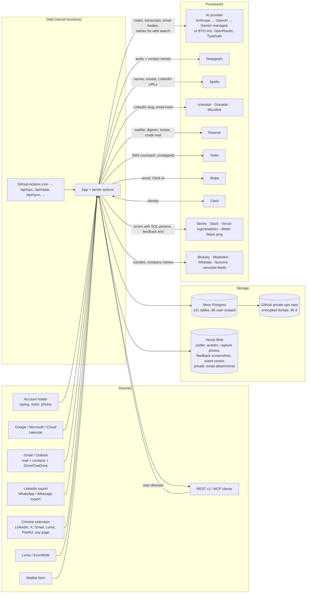

# Orbit privacy audit (Phase 1: audit only)

| | |
|---|---|
| Date | 2026-10-17 |
| Commit audited | `bf1b4ae` (`main`) |
| Scope | How Orbit collects, stores, shares, retains, exports and deletes personal data. Covers two groups: **account holders**, and **people in their networks**, who never signed up. |
| Status | Draft engineering audit. **Not legal advice.** Items marked ⚖️ need a lawyer's opinion. |
| Companion | [`PRIVACY_PLAN.md`](PRIVACY_PLAN.md): the fix plan and draft policy language. |

## How to read the evidence column

| Tag | Meaning |
|---|---|
| **V** | **Verified.** Run in this audit against a seeded, throwaway PGlite database (or, for the scrubber, the real function), using the probes in [`privacy/`](privacy/README.md). Synthetic data only; no production access. |
| **S** | **Verified by an existing smoke test**, run in this audit. All 15 privacy-relevant smoke scripts pass: `smoke-purge`, `-purge-selective`, `-purge-resume`, `-delete-partial`, `-account-deletion`, `-delete-my-account`, `-data-export`, `-export-limit`, `-contact-delete`, `-interaction-delete`, `-disconnect-cleanup`, `-outlook-disconnect-purge`, `-disconnect-categories`, `-settings-export`, `-admin-export`. |
| **I** | **Inferred from reading the code.** Not executed. |
| **U** | **Could not be verified** from the repo. It depends on dashboards, environment variables, vendors or the private ops repo. |

Nothing here claims that deletion or export works at a vendor (Stripe, Clerk, Deepgram, Apollo,
Resend, Twilio, AI providers). No vendor was called; only the call sites were exercised with
stubs.

---

## 1. Executive summary

Orbit's privacy engineering is well above average for an early-stage product.
- Deletion runs from one registry, with a resumable ledger.
- Export reuses the same registry, so the two cannot drift.
- Credentials use correct AES-256-GCM.
- Analytics use a daily-salted visitor hash.
- Sentry has PII defaults off and no session replay.
- Audio is never stored.
- The schema-derived `smoke-purge` test catches unpurged tables.

The verified account-deletion probe confirms the core promise: after deletion, **no user-scoped
table (`user_id`) holds any of the deleted user's data**, and a bystander's data is untouched.

The gaps are at the edges of that core:

1. **Two of the three deletion paths do not cancel billing** (V). The Clerk `user.deleted` webhook,
   admin hard-delete and the orphan sweep purge everything, *including the only link to the
   Stripe customer*, but never cancel the subscription. The privacy page says Clerk-side
   deletion "does the same deletion".
2. **Deleted data can come back, or never fully leave** (V):
   - "Undo merge" re-inserts embeddings, recommendations and AI briefs the user had deleted.
   - Deleting a contact leaves search passages that still quote them.
   - Reverting an import leaves orphaned search passages and the raw import payload.
3. **Account deletion leaves the person's waitlist record** (email, name, referral graph,
   campaign tags) and broadcast history. The policy says "every table holding your data is
   cleared" (V).
4. **Personal data leaks into error tooling** (V for the scrubber, I for the flow). Failed
   database writes carry their bound parameters (note text, names, phone numbers) into Vercel
   logs, Sentry, `error_events`, and the Slack fallback. The scrubber removes emails only.
5. **The legal pages have drifted from the product**, in both directions (I):
   - The export is under-claimed.
   - Google disconnect is mis-described.
   - The extension, cookies, Twilio, Resend and backups are missing or wrong.
   - The "never trains on your content" promise is unenforceable when a user brings a
     free-tier Gemini key.
6. **People in a user's network have no way in** (I). There is no privacy contact address, no
   removal request path, and no notice. Yet Orbit enriches strangers through Apollo and web
   search, and pools recruiter details across accounts.

---

## 2. Data inventory

"Forever" means no automated purge: the data stays until the user deletes it (selectively or with
the account). Retention citations are in §5.3.

### 2.1 About account holders

| # | Data | Enters (file:function) | Stored | Shared with | Why | Kept |
|---|---|---|---|---|---|---|
| H1 | Identity: Clerk id, email, first/last name, avatar URL | `src/app/api/webhooks/clerk/route.ts:85-109` (user.created / updated) | Clerk; `user_settings` mirror | Clerk; Stripe (`customer_email`, `src/actions/billing.ts:117-128`); Sentry (Clerk id only, `src/lib/report-error.ts:66`) | Auth; showing a person in admin | Until account deletion. Survives a partial "delete data" (`src/lib/user-data.ts:770-849`) |
| H2 | Terms acceptance (`terms_accepted_at`, `terms_version`) | Clerk `legal_accepted_at` (`route.ts:98-105`) or onboarding checkbox (`src/actions/onboarding.ts:21-24`) | `user_settings` | none | Record of consent | Until account deletion |
| H3 | Sign-up attribution: referrer host, UTM, landing path | `orbit_attr` cookie (`src/proxy.ts:99-108`, 90 days), copied at sign-up (`src/lib/attribution-capture.ts:25-38`) | Cookie; `user_settings.signup_*` | none | Marketing attribution | Until account deletion |
| H4 | Billing state, Stripe customer id, credit ledger | `src/app/api/webhooks/stripe/route.ts`; `src/actions/billing.ts` | `user_settings`; `billing_events`, `credit_grants` (anonymised on deletion, kept forever); `credit_accounts`, `credit_holds`, `plan_meter_usage`; **Stripe customer (never deleted)** | Stripe | Billing; accounting | Stripe: indefinitely (U). Orbit ledger: forever, anonymised |
| H5 | Credentials: BYO AI keys (Gemini, OpenAI, Anthropic, OpenRouter, TypeSafe), Apollo, Resend, Twilio; Google/Microsoft OAuth tokens; iCloud app password; Luma key; Eventbrite tokens; connector tokens; webhook secrets | Settings actions (`src/actions/settings.ts:360,395-406`), OAuth callbacks | `user_settings.*_encrypted`, `*_connections.*_encrypted`, `webhook_endpoints.secret_encrypted`; AES-256-GCM (`src/lib/crypto.ts`) | The respective provider | Run integrations | BYO keys survive partial delete; everything purged on account deletion (V) |
| H6 | Self-description: goals, career profile (LinkedIn positions, job applications, job-seeker preferences), sender bio, signature, target companies, social links | Settings; LinkedIn import `applyLinkedInYou` (`src/actions/imports.ts:199`) | `user_settings`, `user_goals`, `target_companies` | AI provider (in prompts) | Personalise drafts and suggestions | Forever |
| H7 | Usage telemetry: page views with user id, city/region/country, device; feature usage; gate prompts; speech seconds; extension rate window; rate-limit keys | `src/app/api/track/route.ts:172-220`; `src/lib/page-views.ts`; usage/gate writers | `page_views`, `usage_events`, `gate_events`, `speech_usage`, `extension_usage`, `rate_limit_buckets` | Vercel Web Analytics and Speed Insights (redacted URL, `src/lib/analytics-redact.ts`) | Product analytics; abuse control | page_views 180 d; usage_events 180 d; rate-limit buckets 2 d; **gate_events and speech_usage forever** |
| H8 | Errors | `src/lib/report-error.ts:87-100`; `src/lib/error-events.ts:171-186`; `src/lib/request-errors.ts:23-47` | Vercel runtime logs (~1 h on Hobby); `error_events` (30 d); Sentry (U); Slack (fallback) | Sentry, Slack, Vercel | Debugging | See finding F-06 |
| H9 | Feedback text and screenshots | `src/actions/feedback.ts:32` → `src/lib/feedback-submission.ts:215` | `feedback`, `feedback_screenshots`; **public** Blob `feedback/<id>/<i>` (random suffix) | **Slack DM** of the first 200 chars (`src/lib/feedback-notify.ts:29-35`) | Support | **Forever** |
| H10 | Waitlist: email, name, referrer, UTM, referral chain (`referred_by_id`, `referral_slug`, `share_token`), poll votes, broadcasts received | `src/lib/interest-list-join.ts:178`; `src/actions/waitlist-poll.ts:49-55` (`wp_voter` cookie, 1 year) | `interest_list_signups`, `waitlist_poll_votes`, `broadcast_recipients` (global, not user-scoped) | Resend; Vercel BotID | Waitlist; marketing broadcasts | **Forever, and survives account deletion (V)** |
| H11 | Contact-form messages | `src/lib/contact-message-submit.ts:23` | Not stored; relayed by email | Resend → operator inbox | Support | Mailbox retention (U) |
| H12 | Chat questions and answers | `src/app/api/chat/route.ts`; `src/actions/chat.ts:362` | `chat_threads`, `chat_messages` | AI provider | Assistant | Forever (until thread or account deleted) |

### 2.2 About people in a user's network (third parties who never consented)

| # | Data | Enters | Stored | Shared with | Why | Kept |
|---|---|---|---|---|---|---|
| N1 | Contact record: name, email, phone, company, title, LinkedIn, school, location, notes, AI summary | Every source below | `contacts`, `companies`, `contact_profiles`, `contact_experiences`, `contact_career_moves`, `contact_identities`, `contact_tags` | AI provider; embeddings provider; avatar services (N10) | The CRM | Forever |
| N2 | Free-text notes and timeline | Capture (`src/actions/capture.ts:157,183`; `src/app/api/capture/jobs/route.ts:75`); REST `/api/v1/notes`; MCP `add_note`/`log_interaction` | `note_batches.source_text` (forever), `capture_jobs.input_text/source_text` (30 d after terminal), `interactions.raw_notes`, `action_items`, `reminders`, `contact_opportunities` | AI provider; TypeSafe (BYO only) | Extract people and follow-ups | Forever (except capture_jobs) |
| N3 | Derived AI data: briefs, relationship digests, embeddings **with plaintext passages**, closeness, recommendations, signals, suggestions, cached answers | Background jobs; `src/lib/memory-chunks.ts`; `src/lib/ai-result-cache.ts` | `contact_briefs`, `relationship_digests`, `memory_chunks.content`, `contact_embeddings.content`, `recommendations`, `contact_signals`, `ai_suggestions`, `ai_result_cache` (90 d; research 14 d), **`contact_merges.deleted` (JSON copies)** | AI and embeddings providers | Search, chat, Radar | Forever, except the cache |
| N4 | Voice and meeting audio of **everyone on a call**, plus diarized transcripts | `src/app/api/speech/token/route.ts:36` (browser → Deepgram); `src/app/api/capture/meetings/[id]/{segments,chunks}/route.ts` | Audio: **not stored** (browser IndexedDB outbox until upload). Transcripts: `meeting_transcript_segments.text`, `meeting_sessions.attendees/digest` | Deepgram (`mip_opt_out=true`, `src/lib/deepgram-params.ts:117`) plus contact-name keyterms; fallback Whisper/Gemini; AI for the digest | Meeting notes | Saved transcripts forever; unsaved or discarded 30 d |
| N5 | Photos of business cards, whiteboards and handwritten notes | `src/actions/capture.ts:71`; `src/app/api/scan/[token]/pages/route.ts:36,111` | `capture_photos`; **public** Blob `capture-photos/<id>.jpg` (random suffix), re-encoded so EXIF is stripped | AI vision | Capture | Saved: forever; unsaved: 24 h |
| N6 | Email: recruiter bodies; email-activity headers (From/To/Cc/Date); event confirmation mail; sent mail | Gmail recruiter scan (`src/lib/gmail.ts:950`, `format=full`), Outlook (`src/lib/outlook.ts:769`); email activity (`src/lib/email-activity-server.ts:119`); compose/send | `recruiters` (**global**), `user_recruiter_links`, `recruiter_messages`, `interactions`, `email_sends` (bodies, to/cc/bcc), private Blob `email-attachments/<userId>/` | AI provider (bodies, often via **batch APIs** that hold data for up to 24 h, `src/lib/ai-batch.ts`); Google/Microsoft | Recruiter CRM; activity log | email_sends forever; attachments 7 d / 2 d |
| N7 | Calendar events: title, description, attendees (name, email, RSVP), organiser | `src/lib/connectors/google-calendar.ts`, `microsoft-calendar.ts`, `src/lib/caldav/client.ts`; ICS (`src/actions/calendar.ts:68`) | `calendar_events` (2 d back to 14 d ahead, swept after 24 h); past meetings become `interactions` (first 500 chars of description) | AI (classification, talking points) | Meeting prep | Window rolls; derived interactions forever |
| N8 | Event rosters: name, email, **phone**, company, title, LinkedIn, X handle | Luma (`src/lib/events/connectors/luma.ts:189`), Eventbrite (`.../eventbrite.ts:140`), extension, CSV | `event_attendees`, `events`, `event_companies`; Blob `event-covers/<eventId>` (deterministic path) | none | Event follow-up | Forever. **`phone` is written but never read** (`src/lib/events/store.ts:361-378`) |
| N9 | Imports, raw: full LinkedIn message threads, WhatsApp/iMessage transcripts, contact rows; **raw LinkedIn export CSVs** (many never parsed) | `src/actions/imports.ts:307,919,1778`; `src/actions/chat-imports.ts:60,78`; `src/lib/imports/linkedin-export-files.ts:4-5,61` | `import_job_rows.payload` and `revert_snapshot`; `import_files` (gzipped CSVs in Postgres) | AI (timeline backfill, **on by default**, `src/db/schema.ts:511-525`) | Import; undo | **Forever** |
| N10 | Photos and identifiers sent to avatar lookups | `src/lib/contact-avatar.ts:279,336,593` | `contacts.profile_image_url`; Blob `avatars/<contactId>.jpg`; **shared** `linkedin_avatars` + Blob `avatars-shared/` (cross-account) | unavatar.io (LinkedIn slug), Gravatar (sha256 of email), Microlink (profile URL), Google People, Graph, Apollo | Faces in the UI | Shared photo pruned once no contact has the slug |
| N11 | Enrichment of contacts **and strangers** | Apollo (`src/lib/apollo.ts:412,485,515`), prospects (`src/actions/outreach.ts:417`); web research (`src/lib/web-research.ts:267`); work-history sweep (hourly, on by default); Radar social (`src/lib/radar/signals/social.ts:32,65`) | `contact_experiences`, `contact_career_moves`, `outreach_prospects`, `contact_signals`, `ai_result_cache` | Apollo; AI providers' **hosted web search** (name + employer + LinkedIn URL, `src/lib/ai.ts:2760-2880`); Bluesky; Mastodon | Keep records current; prospecting | Forever (cache 14 d) |
| N12 | Shared recruiter directory: name, firm, email, phone, LinkedIn, specialty | Recruiter scans of many users' mailboxes | `recruiters` (global); contact fields pooled only with `recruiter_sharing` opt-in (`src/lib/recruiters.ts:383-385`) | Other Orbit users | Crowd directory | Until no user links remain |
| N13 | Data pushed out by the user's own integrations | REST/MCP/webhooks (`src/lib/webhooks/`, `src/lib/mcp/`) | `outbound_webhook_deliveries.payload` (forever), `connector_outbox.payload` (forever), `api_idempotency_keys.response_body` (24 h), `agent_send_requests` (forever) | User's Zapier URLs; MCP clients (Claude, ChatGPT, etc.) | Customer-directed | See column |
| N14 | Extension page captures: profile fields plus a **page text blob**; LinkedIn posts; guest lists; Gmail participants | `extension/src/inject/adapters/*`; `src/app/api/extension/*/route.ts` | `contacts`, `interactions`, `contact_signals`, `event_attendees`, `ai_result_cache` (page text, 7 d) | AI provider | One-click save | Forever (cache 7 d) |
| N15 | Outreach prospects and messages (feature not shipped, `src/lib/plans/plan-config.ts:73`) | `src/lib/outreach-send.ts` | `outreach_*` | Resend (user or platform key); **Twilio (user or platform fallback, `:50-59`)** | Cold outreach | Forever |

### 2.3 Collected but never used (data minimisation)

- `event_attendees.phone`: written from Luma, Eventbrite and CSV, with no reader (I).
- Raw LinkedIn CSVs with role `stored` ("kept, not read (yet)"), held gzipped in `import_files` (I).
- `user_settings.inbound_log_token*`: no inbound-mail route is wired up (I).
- `apple_connections.scopes`: always null (I).
- `import_job_rows.payload` after an import finishes: only the undo path reads it, and undo
  expires after 7 days, but the payload (full message threads) is kept forever (I).
- `contact_merges.deleted`: full JSON copies of AI briefs, embeddings and recommendations, kept
  forever "in case of unmerge" (V, finding F-02).

### 2.4 Places personal data is copied that a user would not expect

| Copy | Content | Evidence |
|---|---|---|
| `memory_chunks.content`, `contact_embeddings.content` | Plaintext passages of notes beside the vectors; exported and searchable | V (export) |
| `contact_merges.loser_snapshot` / `.deleted` | Whole archived contact plus derived AI rows | V |
| `import_job_rows.payload`, `import_files` | Full message threads, chat transcripts, raw CSVs | V (payload survives revert) / I |
| `ai_result_cache` | Extension page text, research dossiers on strangers, drafts | I |
| AI batch files at OpenAI / Anthropic / Gemini | Recruiter email bodies; on failure or staleness, never cleaned up (`src/lib/ai-batch.ts:398-430`) | I |
| Vercel logs, Sentry, `error_events.message`, Slack | Bound SQL parameters in `DrizzleQueryError` messages | V (scrubber) |
| Slack DM | First 200 chars of every feedback message | I |
| Deepgram, Whisper or Gemini | Up to 300 contact names as transcription vocabulary on every request | I |
| Deepgram usage records | `shortform:<speechTagId>` and `meeting:<sessionId>` labels (disclosed) | I |
| Wikidata, Google s2 favicons, `org_brand_colors` | Company and school names from contacts (global table) | I |
| GitHub (private ops repo) | Daily encrypted full-database dumps, 90-day artifacts (`docs/RUNBOOK.md:215-237`) | U |
| `page_views` | User id plus city-level location, including from a session **expired up to 7 days** (`src/app/api/track/route.ts:172-190`) | I |
| `admin_audit_log.detail` | Email of an admin-deleted account, kept forever (`src/lib/admin-operations.ts:517-523,577-583`) | I |

---

## 3. Data-flow map

### 3.1 Sub-processors and recipients

| Vendor | Role | Personal data received | Whose key | Data-limiting config in code | On /privacy? |
|---|---|---|---|---|---|
| Clerk | Auth, sessions, invitations, MCP OAuth server | Holder identity, invitee emails | Orbit | none | Yes |
| Cloudflare Turnstile (via Clerk) | Bot challenge on sign-in | IP, browser signals | Clerk | none | **No** |
| Stripe | Payments | Holder email, Clerk id | Orbit | Ids only in metadata | Yes |
| Neon | Primary database | Everything | Orbit | DB-level encryption (U) | Yes |
| Vercel (hosting, logs, Blob, Web Analytics, Speed Insights, BotID) | Hosting and storage | Everything in transit; Blob objects; redacted URLs | Orbit | `redactUrlForVendor`; BotID same-origin proxy | Partly (**BotID missing**) |
| GitHub (Actions plus private ops repo) | Cron driver; **database backups** | Full DB dump (encrypted with `age`) | Orbit | Encrypted artifacts, 90 d | **No** |
| Anthropic, OpenAI, Google Gemini | AI (managed order Anthropic → OpenAI → Gemini, `src/lib/managed-ai-policy.ts:117`) or BYO | Notes, contacts, transcripts, email bodies, images, web-search queries | Orbit or user | **No OpenAI `store:false`; no zero-retention headers; no Gemini tier check** | Yes, but see M-12 and M-13 |
| OpenRouter | BYO AI | Same as above | User | `data_collection: "deny"` (`src/lib/ai-access.ts:429-432`) | Yes |
| TypeSafe (Jev) | BYO decision model | Duplicate records, recruiter senders, calendar events, notes | User | none | Yes |
| Deepgram | Speech to text | Audio of everyone on a call, contact-name keyterms | Orbit | `mip_opt_out=true`, 30 s grant tokens | Yes |
| Apollo | Enrichment and prospect search | Names, emails, LinkedIn URLs of contacts **and strangers** | User (hosted path exists, gated off) | Hosted enrichment cap 0 | Yes |
| Resend | Email | Waitlist, broadcasts, credit notices, **Radar digest (contains contact names)**, invites, contact form, outreach | Orbit (user's key for outreach) | List-Unsubscribe on marketing mail | Partly (**scope wrong**) |
| Twilio | SMS (outreach, unshipped) | Third-party phone numbers plus body | User, **or Orbit's env fallback** (`src/lib/outreach-send.ts:41,50-59`) | STOP footer; error 21610 handling | **Wrong** ("account you connect") |
| Sentry | Errors and 10 % traces | Clerk id, exception text (incl. SQL params), scrubbed URLs, span URLs | Orbit | `sendDefaultPii:false`, scrubber, no replay | Yes; activation U (no DSN as of 2026-09-15) |
| Slack | Ops alerts, feedback DMs, error fallback | Feedback text, Clerk ids, raw error messages, request paths | Orbit | none on these paths | Yes |
| Better Stack | Uptime ping | none | Orbit | GET ping only | Yes |
| Google APIs, Microsoft Graph, Apple iCloud, Eventbrite, Luma | Integrations | User's own account data | User's OAuth or key | Per-feature scopes | Yes |
| unavatar.io, Gravatar, Microlink | Contact photos | LinkedIn slug, sha256(email), LinkedIn URL | Orbit / none | Hash only for Gravatar | Yes |
| Wikidata, Google s2 favicons | Brand colours | Company and school names | none | none | **No** |
| Bluesky API, Mastodon instances | Radar | Contacts' public handles | none | none | Yes |
| MCP clients, user webhooks | Customer-directed export | Whatever the user's token can read | User | SSRF guard | Yes |

---

## 4. Findings

Severity is product and engineering risk, not a legal conclusion.
- **High** contradicts a current promise or risks material harm.
- **Medium** is a real gap with limited blast radius.
- **Low** is hygiene.

| ID | Title | Sev. | Evidence | Affected files | Real-world impact |
|---|---|---|---|---|---|
| **F-01** | Clerk webhook, admin hard-delete and orphan sweep purge data but never cancel the Stripe subscription, and erase the only link to it | **High** | **V**: `probe-account-deletion` [2]. Signed `user.deleted` → HTTP 200, zero outbound calls, `stripe_customer_id` gone. I: admin path | `src/app/api/webhooks/clerk/route.ts:115-126`; `src/lib/admin-operations.ts:~571-596`; `src/lib/clerk-orphan-sweep.ts`; `src/lib/account-deletion.ts:32-52` (only correct path) | A person who deletes via Clerk's account modal (opened by `UserButton`; whether Clerk shows "Delete account" is a dashboard setting, **U**) keeps being charged with no account to cancel from. Contradicts /privacy "does the same deletion". |
| **F-02** | "Undo merge" resurrects AI-derived data the user deleted; merge archives keep lasting JSON copies | **High** | **V**: `probe-selective-deletion` S4. After an insights purge, unmerge brought back the loser's `contact_embeddings`, `recommendations` and `contact_briefs` (1 each); 2 merge archives still held derived rows | `src/lib/contact-merge.ts:290-525,694-899`; `src/lib/user-data.ts:243-294` | "Delete AI suggestions and search index" is not durable, and AI briefs about a person persist in `contact_merges.deleted` for the life of the account. No time limit on unmerge. |
| **F-03** | Deleting a contact leaves search passages quoting them, dangling ids, and unscrubbed free text, and the UI does not say so | **High** | **V**: S1. After `deleteContactForUser`, the id survives in `memory_chunks.contact_ids`, `ai_suggestions.related_contact_ids`, `capture_jobs.seed_contact_id`, `email_sends.contact_ids`, `import_job_rows.contact_id`. A group-note passage naming the person survives in `memory_chunks.content` | `src/lib/contact-delete.ts:14-109` ("Free text is deliberately not scrubbed"); `src/lib/memory-backfill.ts:343` (`pruneOrphanedMemoryChunks` never called) | Chat and search can still quote a person the user deleted, for example after a removal request from that person. Free-text survival is a defensible design choice but is undisclosed. |
| **F-04** | Reverting an import leaves orphaned search passages and the raw import payload | Med | **V**: S3. Interaction deleted, its `memory_chunks` row left (orphan), `import_job_rows.payload` naming the person left | `src/lib/import-revert.ts:216-262`; `src/actions/imports.ts:683,1964`; `src/lib/imports/import-undo.ts:328-372` | Undoing an import does not remove what it brought in from search, and keeps full message threads of people the user just removed. |
| **F-05** | Account deletion leaves undisclosed records in global tables | **High** | **V**: `probe-account-deletion` [1]. Survivors outside documented exceptions: `interest_list_signups` (email, names, UTM, referral slug and tokens), `broadcast_recipients` (email), `waitlist_poll_votes` (`voter_key`), `page_views` (`visitor_hash`, `session_id`, city; `user_id` nulled as documented), `rate_limit_buckets` (key, ≤2 d). I: `admin_audit_log.detail.email` | `src/lib/user-data.ts` (no global-table step); `src/lib/admin-operations.ts:517-523,577-583` | Contradicts "every table holding your data is cleared". Most users joined via the waitlist, so most deleted accounts leave an email, name and referral graph behind, still eligible for broadcasts. |
| **F-06** | Personal data flows into logs, Sentry, `error_events` and Slack via database error messages | **High** | **V**: `probe-log-scrub`. The real `scrubSentryEvent` removed the email but kept name, phone and note prose. Non-string `extra` untouched. I: the flow | `node_modules/drizzle-orm/errors.js:10-13`; `src/lib/report-error.ts:74-100`; `src/lib/sentry-scrub.ts`; `src/lib/error-events.ts:171-186`; `src/lib/request-errors.ts:36-47`; console warns at `src/lib/contact-writes.ts:1244,1371`, `src/lib/memory-backfill.ts:226,247,277`, `src/lib/note-batch-save.ts:484` | Third parties' sensitive notes land in a vendor (Sentry) and in Slack, outside the deletion and export boundary. |
| **F-07** | "Never trains on your content" and provider-retention claims are not enforced in code | **High** ⚖️ | I | `src/lib/ai.ts:2830` (OpenAI Responses without `store:false`); `src/lib/ai-key-check.ts` (no Gemini tier check); `src/lib/meeting-digest.ts:34` ("BYO keys include free tiers"); `src/lib/ai-batch.ts:398-430` (no cleanup on failure) | A user who pastes a free-tier Gemini key sends their network to a tier whose terms may allow training. The policy promises "its own or anyone else's". Failed batches leave email bodies at the provider. |
| **F-08** | No route for non-users (people in a network) to ask what Orbit holds or request removal | **High** ⚖️ | I | `src/app/(site)/(docs)/contact/page.tsx:28-79` (form may be disabled); `src/app/(site)/(docs)/terms/page.tsx:206-213`; no privacy email anywhere | People enriched via Apollo or web search, pooled in the recruiter directory, or recorded on calls have no notice and no channel. Likely relevant to GDPR Art. 14 and CCPA requests. |
| **F-09** | Legal pages contradict or omit actual behaviour (24 mismatches, §6) | **High** | I | `src/app/(site)/(docs)/privacy/page.tsx`, `terms/page.tsx`, `src/lib/legal.ts`, `contact/page.tsx`, `extension/` | Users and regulators are told wrong things, in both directions. |
| **F-10** | Export omits 17 tables holding the user's data | Med | **V**: `probe-export` E3. Omitted: `contact_opportunities`, `credit_accounts/grants/holds`, `plan_meter_usage`, `cloud_note_sources`, `embedding_failures`, `job_posting_matches`, `interest_list_signups`, `broadcast_recipients`, `waitlist_poll_votes`, `recruiters` (rows the user created), `linkedin_avatars`, `admin_audit_log` (entries about the user), `webhook_deliveries`, `data_purge_runs`, `rate_limit_buckets` | `src/lib/user-data.ts:243-732`; `src/lib/data-export.ts:17` | Access requests are incomplete; AI-derived "opportunities" and the credit ledger are missing. |
| **F-11** | Export timeout fails silently on very large accounts | Low | **V** (partial): 20k contacts / 60k interactions / 60k passages = 169 MB in 42 s on PGlite. Neon over HTTP **U** | `src/app/api/export/route.ts:7`; `src/lib/data-export.ts:107-118` (OFFSET paging) | Past `maxDuration=300` the download ends as truncated, invalid JSON with no error. |
| **F-12** | Disconnecting an integration leaves grants alive and keeps synced data, with little user choice | Med | S (`smoke-disconnect-cleanup` passes for Google) / I | `src/actions/outlook.ts:216-235`; `src/lib/apple.ts:276-280`; `src/lib/events/connections.ts:334-342`; `src/lib/data-categories.ts:216-222`; `src/lib/admin-operations.ts:391-414`; `src/lib/connectors/connections.ts:411` (unused) | "Also delete what was imported" deletes only recruiter data. Luma and Eventbrite rosters stay. The admin disconnect skips the Google revoke. Generic connectors have no disconnect. |
| **F-13** | Backups can resurrect deleted accounts; no deletion-replay procedure | Med ⚖️ | U / I | `docs/RUNBOOK.md:215-266`; `src/lib/user-data.ts:882` (ledger pruned at 30 d < 90 d backups) | A restore from a 60-day-old dump would bring back deleted people, and the ledger needed to redo the deletions is already gone. The restore drill has never been run. |
| **F-14** | Large classes of data have no retention limit | Med | I | §5.3 | Indefinite retention of: transcripts, raw imports, sent-mail bodies, chat, feedback screenshots, waitlist, webhook payloads, `gate_events`, `speech_usage`, failed purge runs. No inactive-account policy. |
| **F-15** | Consent gaps | Med ⚖️ | I | `src/components/capture/meeting-nudge.tsx:59-64,89-90`; `src/components/capture/voice-capture.tsx:68-69`; `src/components/settings/ai-settings.tsx:146,252,398`; `src/components/landing/waitlist-form.tsx:55-77`; `extension/src/panel/views/GrantAccessView.tsx`; sign-up | Gaps: - The meeting nudge starts recording with no consent reminder. - Switching to a BYO key gives no "your data now goes to X" notice. - The waitlist form has no privacy link. - The extension says page text goes "nowhere except your own Orbit account" but it goes to an AI provider. - There is no age gate, and many users are students. |
| **F-16** | OAuth scopes broader than the features need; Connect bundles purposes | Med | I | `src/lib/google-scopes.ts:34-53`; `src/lib/microsoft-scopes.ts:21-129`; `src/lib/sync-scheduler.ts:1076` | Unnecessary scopes: - `gmail.readonly` gates metadata-only email activity (`gmail.metadata` would do). - `drive.readonly` reads the first lines of docs. - `Files.Read` covers the whole OneDrive. - Connect asks for contacts and calendar together. Hurts Google verification and Limited Use posture. |
| **F-17** | Photos of notes and feedback screenshots are public Blob objects | Med | I | `src/lib/capture-photos.ts:119-122`; `src/lib/feedback-submission.ts:215-218`; `src/lib/events/cover.ts:90-96` | A leaked URL is a permanent, unauthenticated link to a photo of someone's notes or business card. Private Blob is already used for email attachments. |
| **F-18** | MCP and API tokens can read more than their scope implies | Med | I | `src/lib/mcp/oauth.ts:22-30,69,263-275`; `src/lib/api/auth.ts:112-119`; `src/lib/tools/definitions.ts:167-248` | Issues: - An OAuth token with no `orbit:*` scope gets read+write unless `MCP_OAUTH_REQUIRE_SCOPES=1` (**U** whether set). - There is no in-app list or revoke for connected assistants. - API keys never expire. - `read` returns contact notes and interaction text. |
| **F-19** | Admin access to user content lacks step-up and full audit coverage | Med | I | `src/lib/admin.ts:25-81`; `src/lib/admin-operations.ts:111-215`; `src/lib/admin-user-detail.ts:730-952`; `src/app/api/feedback/screenshots/[shotId]/route.ts:51` | Gaps: - No MFA or step-up. - The 7-day impersonation link. - Contact notes are fully readable. - Contact list, search and feedback-screenshot views are not individually audited. - The denylist applies only where `assertRevealable` is called. |
| **F-20** | Encryption is correct but not rotatable | Low | I | `src/lib/crypto.ts:3-57` | Fixed scrypt salt, no key id or keyring, tag length not pinned, secret reused for HMACs. Rotating the key would silently disconnect every integration. Legacy plaintext ICS URLs remain until `scripts/backfill-encrypt-ics-urls.ts` runs (**U**). |
| **F-21** | Marketing and notification email compliance gaps | Med ⚖️ | I | `src/lib/interest-list-email.ts`, `src/lib/broadcasts.ts:23-29,189-198`, `src/lib/radar/digest.ts`, `src/lib/credits/notices.ts`, `src/lib/outreach-send.ts:104-112,186-209`, `src/app/api/webhooks/resend/route.ts` | Gaps: - No postal address in any email (CAN-SPAM, for commercial mail). - Broadcasts exceed the "only about your place" promise. - The digest is on by default. - Outreach (unshipped) has no List-Unsubscribe, no bounce suppression, and no own SMS opt-out list. - No consent record beyond the signup row. |
| **F-22** | Page views attributed to an account from an expired session; city-level location tied to `user_id` | Low | I | `src/app/api/track/route.ts:172-194` | Goes beyond "while you are signed in". |
| **F-23** | Category "AI suggestions and search index" does not delete AI briefs | Low | I | `src/lib/user-data.ts:243-294` (no `contact_briefs` delete; digests only blanked) | AI summaries about people survive the category whose name implies they go. |
| **F-24** | Cookies set beyond those disclosed; no consent mechanism | Low ⚖️ | I | `src/proxy.ts:102-108`; `src/lib/tz-cookie.ts:14`; `src/actions/waitlist-poll.ts:49-55`; OAuth state cookies | `orbit_attr` (90 d, marketing attribution, copied onto the account), `wp_voter` (1 y) and `orbit-tz` (1 y) are undisclosed or understated. EU and UK rules on non-essential cookies need review. |
| **F-25** | Clerk webhook has no idempotency | Low | I | `src/app/api/webhooks/clerk/route.ts` | Retries create duplicate `data_purge_runs`. Harmless today. |

---

## 5. Deletion, disconnection, retention: detail

### 5.1 Account deletion: verified results

`privacy/probe-account-deletion.ts` seeded rows in 120 of 121 tables for user A, and in 106 for
users B and C (some global tables take one row). Every text value carried the owner's id.

| Path | Vendor calls observed | Tables still holding the user's id or email afterwards | Bystander B |
|---|---|---|---|
| Settings → Delete account (`deleteOwnAccount`) | `stripe.cancelSubscriptions(cus_…)` then `clerk.deleteUser(…)`, in that order (stubbed deps) | 11 tables, listed below | untouched |
| Clerk `user.deleted` webhook (real route, signed event) | **none**; `stripe_customer_id` deleted | same 11 tables | untouched |

The 11 surviving tables:
- **Documented exceptions:** `admin_audit_log`, `webhook_deliveries`, `data_purge_runs` (30 d).
- **Anonymisation, documented:** `billing_events` and `credit_grants` (user id nulled; the hits
  were seeded marker text in `detail`, so real contents need checking); `page_views` (user id
  nulled; hash, session and city remain).
- **Disclosed shared pool:** `linkedin_avatars`. In real use it is keyed by a contact's LinkedIn
  slug, not the account; the seeder wrote the user id there. It is pruned once no contact
  references the slug (P:549).
- **Undocumented:** `interest_list_signups`, `broadcast_recipients`, `waitlist_poll_votes`,
  `rate_limit_buckets` (≤2 d).

All 86 `user_id` tables were cleared (V, and S via `smoke-purge`, which derives its table list
from the schema). Cancellation failure aborts the whole deletion before anything is purged
(S: `smoke-delete-my-account`).

**Vendor-side (I/U):**
- **Stripe:** subscriptions are cancelled; the **customer object, with email and payment
  method, is never deleted** (no `customers.del` anywhere).
- **Clerk:** user deleted.
- **Google:** grant revoked, best-effort with a 5 s timeout.
- **Outlook, Apple, Luma, Eventbrite:** no revoke API is called (documented).
- **AI providers:** in-flight batch jobs cancelled; nothing else to delete.
- **Deepgram, Apollo, Resend, Twilio:** no deletion call exists. Deepgram relies on
  `mip_opt_out`; Resend keeps logs of sent mail (U).

### 5.2 Selective deletion: verified results

| Action | Removes | Leaves | Evidence |
|---|---|---|---|
| Delete one contact | 26 of 31 tables referencing the id; cascades (interactions, reminders, embeddings, primary-subject passages, briefs, digests, signals, recommendations, tags, identities, merge rows as winner, chat attachments) | Ids in 5 tables; group-note passages in `memory_chunks.content`; free text in notes, chat, transcripts, email bodies, capture jobs | V (S1), S (`smoke-contact-delete`) |
| Delete one interaction | The row, its search passages, action items, mentions | Source `note_batches.source_text`; reminders (source nulled) | V (S2), S |
| Revert or undo an import | Created contacts, imported interactions | **Orphan passages**; `import_job_rows.payload`; `import_files` | V (S3) |
| Delete category "insights" | Embeddings, passages, recommendations, signals, suggestions, cache, batches | `contact_briefs`; digest rows (text blanked); **copies in `contact_merges.deleted`, restored by unmerge** | V (S4) |
| Delete one note batch | The batch and its photos | Interactions, meeting sessions and capture jobs created from it (detached only) | I |
| Disconnect Gmail or Outlook with "also delete" | Connection, Google calendar sources, recruiter category | Contacts, interactions, email activity, `email_sends`, AI data from that mailbox | S / I |

### 5.3 Retention today

| Data | Current | Source |
|---|---|---|
| Vercel runtime logs | ~1 h (Hobby) | `docs/error-reporting-2026-09-15.md:8` |
| Sentry events | **U** (project setting) | — |
| `error_events` | 30 d | `src/app/api/imports/process-stalled/route.ts:100,205` |
| `page_views`, `usage_events` | 180 d | `src/lib/page-views.ts:102`; `src/lib/event-prune.ts:64` |
| `rate_limit_buckets` | 2 d | `src/lib/rate-limit.ts:378` |
| `ai_result_cache` | 90 d (research 14 d) | `src/lib/ai-result-cache.ts:24,30` |
| Unsaved capture photos | 24 h | `src/lib/capture-photos.ts:33` |
| Email attachments | 7 d after send; 2 d unsent | `src/lib/email/config.ts:42-43` |
| Unfinished or discarded meetings | 30 d | `src/lib/meeting-sessions.ts:40` |
| Saved meeting transcripts | **forever** | — |
| `capture_jobs` | 30 d after terminal | `src/lib/capture-jobs.ts:46` |
| `capture_handoffs` | 10 min | `src/lib/scan-handoff.ts:52` |
| `data_purge_runs` | 30 d (done), **forever (failed)** | `src/lib/user-data.ts:882,1008` |
| Feedback and screenshots | **forever** | — |
| `import_job_rows`, `import_files` | **forever** | — |
| `email_sends` bodies | **forever** | — |
| Chat | **forever** | — |
| `ai_batch_jobs`, `outbound_webhook_deliveries`, `connector_outbox`, `agent_send_requests` | **forever** | — |
| `gate_events`, `speech_usage`, `cron_runs` | **forever** | — |
| `webhook_deliveries`, `admin_audit_log` | **forever** (by design) | `src/lib/user-data.ts:166-176` |
| Waitlist, poll votes, broadcast recipients | **forever** | — |
| Abandoned or inactive accounts | **no policy** | — |
| Clerk orphans (account gone at Clerk) | purged by hourly sweep, at most 25 per run | `src/lib/clerk-orphan-sweep.ts:21-75` |
| Backups | daily `age`-encrypted dumps, 90 d; Neon PITR (U) | `docs/RUNBOOK.md:215-266` |

---

## 6. Policy versus behaviour

Each row pairs what a page says with what the code does. Line numbers are in
`src/app/(site)/(docs)/privacy/page.tsx` (P) and `.../terms/page.tsx` (T) unless stated.

| # | Says | Does | Evidence |
|---|---|---|---|
| M-1 | P:527 "Deleting your account from Clerk's own account page does the same deletion through our account webhook." P:31 "cancels any subscription." | The webhook path does not cancel Stripe, and destroys the customer link. | V |
| M-2 | P:553-559 "every table holding your data is cleared … What remains: Stripe's … accounting record … audit log … operational counters." | The waitlist row (email, name, referral graph), broadcast history and poll votes also remain. The admin audit log keeps the email, not just an id. | V / I |
| M-3 | P:30-31 "Deletion is real deletion." Settings: "remove some or all of it for good." | Unmerge resurrects deleted AI data; contact deletion leaves passages quoting the person; import revert leaves orphans. | V |
| M-4 | P:511-514 and `contact/page.tsx:92-96`: export "does not yet include capture text and photos, meeting transcripts, chat history, events, companies, goals, outreach or recruiter records." | The export includes **all** of those (16 categories, 81 datasets). It omits other things instead (F-10). | V |
| M-5 | P:284-286: to revoke Google, "remove Orbit from your Google Account's third-party access page." | The code revokes the Google grant on disconnect (`src/lib/oauth-revoke.ts`), and the dialog says so. | I / S |
| M-6 | P:242-244: "Each feature asks Google only for the permission it needs, at the moment you turn it on." | Settings Connect requests contacts **and** calendar together (`src/lib/google-scopes.ts:53`), and grants accumulate (`include_granted_scopes`). | I |
| M-7 | Google Limited Use scope table (`src/lib/legal.ts:63-117`). | It omits the email-activity purpose (gmail.readonly used to log who you email). | I |
| M-8 | P:183-190: extension reads LinkedIn profiles and Luma/Partiful guest lists. | It also reads X posts, Gmail participants and **any page** via the generic adapter. The extension has no privacy-policy link. | I |
| M-9 | Extension consent screen: "never sends the page text anywhere except your own Orbit account". | Page text goes to the AI provider, and is cached 7 days. | I |
| M-10 | P:28 "its traffic analytics set no cookies"; P:439-448 "one first-party cookie, `orbit_attr` … holds no personal information". | `orbit_attr` is copied onto the account at sign-up. `wp_voter` (1 y), `orbit-tz` (1 y) and OAuth state cookies are undisclosed. | I |
| M-11 | P:207-210 and P:478-486: page views "Linked to your account while you are signed in." | They are also linked from a session **expired up to 7 days**, with city-level location. | I |
| M-12 | P:236-237 "does not use your content to train AI models, its own or anyone else's." T:216 "our own models". | BYO free-tier Gemini keys are accepted. There is no OpenAI `store:false` and no tier check. The Terms are narrower than the Policy. | I ⚖️ |
| M-13 | `contact/page.tsx:113-121`: included AI runs "on Orbit's own account with that vendor" you choose. P:29 "You choose the provider." | Included AI uses a fixed order, Anthropic → OpenAI (→ Gemini), not the user's choice (`src/lib/managed-ai-policy.ts:117`). | I |
| M-14 | P:78 Twilio "through the Twilio account you connect". | Falls back to Orbit's Twilio env on paid tiers (`src/lib/outreach-send.ts:41,50-59`). | I |
| M-15 | P:78 Resend: "the waitlist confirmation and outreach campaigns". | Also credit notices, the Radar digest (contains contact names), broadcasts, invites and the contact form. | I |
| M-16 | Sub-processor list "verified against the code on 2026-10-13". | It omits GitHub (backups), Cloudflare Turnstile, Vercel BotID, Wikidata and Google s2 favicons. | I |
| M-17 | `interest/privacy/page.tsx:53` and `interest-hero.tsx:367`: "We'll only email you about your place in line." | The operator can send free-form broadcasts to the waitlist (`src/lib/broadcasts.ts:23-29`). | I |
| M-18 | T:228-231 integrations: "Microsoft (Outlook contacts)". | Also calendar, mail read, mail send and OneDrive. | I |
| M-19 | P:65 Deepgram: the "zero-retention flag". | The flag sent is `mip_opt_out=true`, the model-improvement opt-out. Whether it equals zero retention is Deepgram's to confirm. | U ⚖️ |
| M-20 | P:137-139: audio "is not kept". | True server-side (V-adjacent: no audio column). The browser IndexedDB outbox holds chunks until upload. | I |
| M-21 | `src/app/api/scan/[token]/pages/route.ts:23` comment: "images are transcribed and dropped … nothing written down." | `:111` stores them via `storeCapturePhotos`. P:121-127 is accurate. | I |
| M-22 | P:621-624 transfers: "most often the United States". | No transfer mechanism (SCCs, DPF, adequacy) named. No DPA offer. | ⚖️ |
| M-23 | P:646-648 / T:510-513: contact "through the /contact page". | There is no email or postal address, the form can be disabled, and there is no request path for non-users. | I ⚖️ |
| M-24 | P:630-632 / T:126-130: 13+ and age of digital consent. | No age gate or date of birth; student-heavy audience; no parental-consent path. | I ⚖️ |

---

## 7. What already works

Each item is verified (V/S) or carefully inferred (I).

- **One deletion registry, used for delete, partial delete and export.** All 86 `user_id` tables
  are purged on account deletion. A bystander account loses nothing (V, S).
- **`smoke-purge` derives its table list from the schema.** A new unpurged table fails CI. It has
  already caught five real misses (S).
- **Deletion is resumable** (`data_purge_runs` plus nightly resume) and ordered so a failure
  leaves a safe state. A Stripe cancellation failure blocks the deletion (S).
- **Blob objects behind avatars, capture photos, feedback screenshots, event covers and email
  attachments** are deleted with their rows (I).
- **Export:**
  - Covers the 16 claimed categories (more than /privacy admits) as streamed, machine-readable
    JSON (`orbit-export/2`).
  - Owner-only: the session is the only input.
  - Rate-limited to 5 per hour.
  - No cross-user leakage.
  - No credential, hash or vector columns.
  - 20k contacts in 42 s on PGlite (V).
- **Deleting an interaction removes its search passages** (V).
- **AES-256-GCM is implemented correctly:** random 12-byte IV, auth tag stored and checked. Key
  and token columns are encrypted. BYO keys never reach the client (I).
- **Google grants are revoked** on disconnect and on deletion (I, S).
- **Analytics visitor id** is `sha256(daily salt, IP, UA)`. IP is never stored. It fails closed
  without a salt. Vercel Analytics URLs are redacted (I).
- **Sentry:** `sendDefaultPii: false`, no session replay, Clerk id only, and URL and token
  scrubbing (I).
- **Vendor data limits:**
  - Audio is not stored.
  - Deepgram requests opt out of model improvement.
  - OpenRouter requests deny data collection.
  - Capture images are re-encoded, stripping EXIF and GPS (I).
- **The recruiter directory pools contact details only on opt-in.** Withdrawal re-derives shared
  fields (I).
- **Admin console:**
  - A written reason is required for actions.
  - `account.view`, `contact.view`, mutations and exports are audited.
  - A hard denylist blocks chat, raw note text, transcripts and photos (I).
- **Marketing mail and digests** carry one-click List-Unsubscribe (I).

---

## 8. What could not be verified

| Item | Why | How to verify |
|---|---|---|
| Whether Clerk's account modal lets users delete themselves | Clerk dashboard setting | Clerk → User & authentication → "Allow users to delete their accounts" |
| Clerk "require express legal consent" enabled | Clerk dashboard | Same |
| Sentry active (DSN set), its retention and data-scrubbing settings | Vercel env, Sentry project | Vercel env and Sentry → Settings → Security & Privacy |
| `MCP_OAUTH_REQUIRE_SCOPES`, `ORBIT_MANAGED_AI` pause state, managed Gemini tier | Vercel env, Google Cloud billing | Vercel env; Google AI Studio project tier |
| Vendor-side deletion and retention (Stripe customer, Clerk, Deepgram, Apollo, Resend logs, Twilio logs, OpenAI/Anthropic/Gemini abuse-monitoring windows) | No vendor calls allowed in this audit | Vendor DPAs and dashboards; a test account in each sandbox |
| Real Vercel Blob deletion | Blob not configured locally | Staging run with `BLOB_READ_WRITE_TOKEN` |
| Export time on Neon over HTTP for a large account | No Neon access | Staging account seeded with `scripts/seed-scale.ts` |
| Backup contents, encryption, retention and restore | Private ops repo; drill never run (`docs/RUNBOOK.md:251-253`) | Run the restore drill |
| Whether `scripts/backfill-encrypt-ics-urls.ts` and the recruiter-clean backfill ran in production | Production | Query production counts (operator only) |
| Google and Microsoft consent-screen text and verification status | Cloud consoles | Google Cloud OAuth consent screen; Entra app registration |
| Chrome Web Store listing and privacy-practices disclosures | Store dashboard | Developer dashboard |
| Contents of `billing_events.detail` in production | Seeded rows used synthetic markers | Read the writers (`recordBillingEvent`) and sample staging rows |
