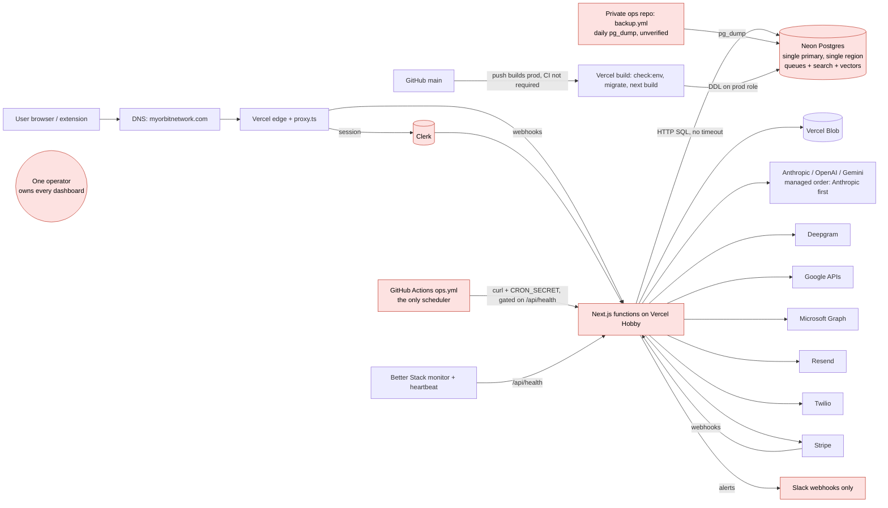

# Orbit reliability audit

**Date:** 2026-10-17 · **Commit audited:** `eb5d69d` (origin/main) · **Scope:** uptime, stability and durability of the application and database · **Companion:** [`RELIABILITY_PLAN.md`](RELIABILITY_PLAN.md) (the fixes) and [`reliability/`](reliability/README.md) (the local test harness and raw results)

No application code, infrastructure or production system was changed. I ran nothing against production. Every test in §5 ran on a local Postgres 16 + pgvector loaded with synthetic data, through a local stand-in for Neon's HTTP endpoint. No secrets appear in this document.

## How to read the evidence labels

| Label | Meaning |
|---|---|
| **TESTED** | Reproduced locally with the harness in `reliability/`: the real app code against a real Postgres with fake data. The raw output is in `reliability/results/`. |
| **SOURCE** | Read at the cited lines, not executed. |
| **GITHUB** | Read from the GitHub API (read-only): check runs, deployments, branch rules. |
| **INFERRED** | Reasoned from verified pieces. The gap is named. |
| **UNKNOWN** | Only visible in a dashboard I cannot reach (Vercel, Neon, Clerk, Stripe, Google Cloud, Better Stack, Slack) or in the private ops repository. |

I treated the 2026-09-15 production-readiness audit (`docs/production-readiness-audit-2026-09-15.md`) as a baseline and re-checked each of its reliability items. Most are fixed; §3 notes the ones that are not.

---

## Executive summary

Orbit's application code is unusually defensive for a one-person product:
- tenant-scoped everywhere;
- database-backed rate limits that hold under a burst (TESTED);
- deadlines on every AI call (TESTED);
- a careful email outbox;
- a resumable account purge;
- a migration lease that serialises concurrent builds (TESTED);
- a restore procedure that works as documented (TESTED on fake data).

The risks are concentrated in **how changes reach the database** and **what happens around the code**: backups, deploy gates, alerting, the scheduler, and one operator.

The worst finding came from testing, not reading. **Every schema change drops and rebuilds the `contacts.search_tsv` column, rewriting the whole contacts table while the live site serves.** That has happened 24 times since Sep 15.
- On 600k fake contacts it stalled search for 25.7 s and produced errors.
- With the `statement_timeout = '20s'` that `docs/RUNBOOK.md` asks you to set (and that the ops sweep alerts on if it is missing), the deploy **failed halfway**. Production was left with no `search_tsv` column, every contact keyword search errored, and every later deploy failed the same way until someone changed a database setting by hand.

The second most important gap is that **nothing in this repository proves a backup exists**:
- The backup workflow lives in a private repository.
- The restore drill log says "_not yet run_".
- As of September, the database was on Neon's free tier with about 6 hours of point-in-time recovery, so the realistic recovery point is up to 24 hours of lost writes.

---

## 1. Architecture map

### 1.1 Components in the request path

| Layer | What | Where it runs | Instances / scaling | Evidence |
|---|---|---|---|---|
| DNS / TLS / CDN | `myorbitnetwork.com`; `clerk.myorbitnetwork.com` for Clerk; a separate `WAITLIST_HOST` domain | Vercel edge network; certificates issued by Vercel and Clerk | Managed | SOURCE (`ops.yml:26`, `extension/.env.production`); registrar, DNSSEC and renewal UNKNOWN |
| Proxy (middleware) | `src/proxy.ts`: Clerk session check, stealth mode (DB read, 1.5 s timeout, 10 s cache), JSON 401 for `/api/*` | Vercel, in front of every request | Scales with traffic | SOURCE |
| App | Next.js 16 App Router: pages, server actions, ~45 route-handler groups | Vercel serverless functions (Fluid Compute) on **Hobby**. No region is pinned in code (`next.config.ts`, `vercel.json`) | Autoscaled by Vercel; `maxDuration` 10–300 s per route (38 routes set one) | SOURCE; plan as of the Sep audit (VERIFIED then), still described as Hobby in `ops.yml:4-9` |
| Background work | No worker fleet. HTTP routes are called by: (a) the GitHub Actions scheduler `.github/workflows/ops.yml` (10 cron lines); (b) self-continuation (`internalFetch`, 10 s timeout); (c) `after()` callbacks; (d) browser pollers | GitHub-hosted runners call Vercel functions | One run per schedule (per-schedule concurrency group) | SOURCE |
| Queues | Postgres tables: `imports`/`import_job_rows`, `capture_jobs`, `email_sends`, `outbound_webhook_deliveries`, `connector_outbox`, `data_purge_runs`, `*_connections.next_sync_at`, `cloud_note_sources`, Radar lease columns | Neon | Same database as everything else | SOURCE |
| Cache | No Redis. In-process caches only (embedding LRU 500, flag caches 10–30 s, brand colours), the `ai_result_cache` table, and the client router cache | Per function instance | Losing any of them is survivable (rebuildable) | SOURCE |
| Database | Neon Postgres over the **HTTP** driver (`@neondatabase/serverless` `neon()`, stateless, no pool). pgvector + pg_trgm. **121 tables, 435 indexes, 56 foreign keys** (TESTED by migrating a fresh DB) | Neon, single project/branch. Region, plan, compute size and PITR window UNKNOWN (free tier with ~6 h PITR as of `docs/superpowers/plans/2026-09-10-production-readiness.md:60,122`) | One primary. Read replicas not used. No connection pool to exhaust | SOURCE + TESTED |
| Search / vector | Inside Postgres: `search_tsv` generated column + GIN, trigram GIN, HNSW on `contact_embeddings` and `memory_chunks` | Neon | Rebuildable from source rows | SOURCE |
| Object storage | Vercel Blob (avatars, capture photos, attachments). Falls back to **inline base64 in Postgres** when `BLOB_READ_WRITE_TOKEN` is unset | Vercel | Managed | SOURCE (`contact-avatar.ts:563-568`, `capture-photos.ts:24-27`) |
| Backups | Daily `pg_dump` → `age` → 90-day GitHub artifact, in a **private ops repository** | GitHub Actions (private repo) | — | Runbook only; UNKNOWN whether it succeeds |

### 1.2 Third-party dependencies

| Dependency | Used for | Critical path? |
|---|---|---|
| **Clerk** | Authentication for every signed-in request; `user.*` webhooks | **Yes**: no degraded mode |
| **Neon** | All data | **Yes** |
| **Vercel** | Hosting, CDN, Blob, Analytics, Speed Insights | **Yes** |
| **GitHub Actions** | The only scheduler (sync, drains, sweeps, Radar, alerting) | Yes, for anything on a clock |
| Anthropic, OpenAI, Gemini, OpenRouter | Chat, capture parsing, summaries, embeddings (OpenAI only for managed), Whisper; BYOK and Orbit-managed keys | AI features only (should degrade gracefully) |
| Deepgram | Speech-to-text (Orbit key) | Voice and meetings; kill switch `ORBIT_DEEPGRAM=off` |
| Google (Gmail, Calendar, People, Drive, OAuth) | Data sources, person-to-person email send | Sync and imports |
| Microsoft Graph (Outlook mail/calendar/contacts, OneDrive, OAuth) | Data sources, email send | Sync and imports |
| Apple CalDAV, ICS feeds, Eventbrite | Calendar sources | Sync |
| Stripe | Checkout, subscriptions, webhooks | Billing only |
| Resend | System email, hosted outreach, bounce webhooks | Email only |
| Twilio | SMS outreach | Outreach only |
| Apollo, unavatar, Microlink | Enrichment, avatars | Cosmetic |
| RSS feeds, job-feed CDN | Radar news, internship feed | Background only |
| Sentry, Slack webhooks, Better Stack | Errors, alerts, uptime/heartbeat | Observability |

### 1.3 Dependency graph

### 1.4 Single points of failure

| # | SPOF | What fails with it |
|---|---|---|
| S1 | **Neon primary** (one compute, one region; queues and search live in it too) | Everything signed-in, every queue, every job |
| S2 | **Clerk** | Every signed-in page and API within about a minute (session tokens are short-lived) |
| S3 | **Vercel project on Hobby** (one region; commercial use against Hobby terms) | Everything; also a suspension risk |
| S4 | **GitHub Actions scheduler** (public repo: 60-day auto-disable, 5–30 min lag) | All sync, drains, sweeps, Radar, retention, and the alerting sweep itself |
| S5 | **The one operator** and their accounts (Vercel, Neon, Clerk, Stripe, Google Cloud, Better Stack, Slack, private ops repo with the backup age key) | Any incident that needs a human |
| S6 | **`ENCRYPTION_SECRET`** (one key, no versioning) | Every stored OAuth token and BYOK key |
| S7 | **Orbit's Google and Microsoft OAuth client credentials** | Every connected account at once (see R-09) |
| S8 | **Slack** as the only alert sink | All alerting |
| S9 | **The build-time migration** (on the production role, in the build) | The database schema, at every deploy |

### 1.5 Deploy path, commit to production

1. Push to `main` (directly, or by merging a PR). **No required status checks and no required reviews** (GITHUB: `rules/branches/main` has only `deletion` and `non_fast_forward`; `ci.yml:25-27`).
2. In parallel:
   - **GitHub CI** runs typecheck, lint, build, 542 smoke scripts on PGlite in 3 shards, and 7 Playwright specs in demo mode.
   - **The Vercel git integration** builds `npm run check:env && npm run db:migrate && next build` (`vercel.json:3`). Vercel does not wait for CI.
3. `db:migrate` runs `reconcileSchema` **against the production database, with the production role, before `next build`**. Then it backfills `contact_identities` (2,000 per run) and merges confident duplicates (up to 100 per account) (`scripts/migrate.ts:74-91`).
4. If the build succeeds, Vercel atomically aliases the new deployment. There is no canary, no post-deploy check and no automated rollback.
5. Rollback is manual: Vercel → Promote a previous deployment (`docs/RUNBOOK.md` "Roll back"). Health then reports `degraded` (schema ahead), by design.

### 1.6 Things I could not find (findings in themselves)

- **No infrastructure-as-code.** Vercel env and project settings, Neon project/role/branch settings, Clerk, Stripe webhooks, Google/Microsoft OAuth apps, Better Stack monitors and Slack webhooks exist only in dashboards. Nothing records what production is configured as, and drift is invisible.
- **No staging environment.** The documented 14-step acceptance run on a preview with its own Neon branch "has not been done" (`docs/launch-changelog-2026-09-17.md:191`). Nothing in CI touches real Postgres or pgvector.
- **The backup workflow is not in this repository** (moved to a private ops repo, commit `77d28a7`).
- **No incident process documents:** no on-call, severity definitions, postmortem template or incident log.

---

## 2. Reliability targets (proposed)

These are sized for a single operator on Vercel and Neon, and measurable with the tooling in Phase 4 of the plan. Treat them as proposals to approve or adjust.

### 2.1 Critical user journeys and SLOs (28-day rolling window)

| Journey | SLI (what is measured) | Proposed SLO now | After Phases 1–3 | Critical-path dependencies |
|---|---|---|---|---|
| Sign in and load the app shell | Share of synthetic sign-in + dashboard loads returning 200 within 5 s, from outside | 99.5% | 99.9% | Vercel, Clerk, Neon |
| Main views (dashboard, contacts list, contact profile, search) | Share of server responses that are non-5xx and under 2 s (p95 under 1.5 s) | 99.5% | 99.9% | Vercel, Neon |
| Capture save (note → contacts/interactions) | Share of acknowledged saves fully persisted. **Durability target: 100% of acknowledged saves.** | 99.5% success | 99.9% | Neon (AI parsing is a separate step) |
| Connect a data source (OAuth) | Share of OAuth callbacks that end connected or with a clear user-facing reason | 99% | 99.5% | Google/Microsoft, Neon |
| Sync freshness | Share of due connections synced within 2 h of `next_sync_at` | 95% | 99% | GitHub scheduler, providers, Neon |
| AI insights (chat answer, capture parse, brief) | Share of requests returning an answer or an explicit "AI unavailable" message within 45 s; p95 time to first token under 8 s | 97% | 99% (with failover) | AI providers; **must never block non-AI pages** |
| Person-to-person email | Share of scheduled sends delivered within 15 min of their time, with **zero duplicates** | 99% | 99.5% | Gmail/Outlook, scheduler |
| Imports | Share that complete, or fail with a message, within 24 h | 99% | 99.5% | Neon, scheduler |

**Must degrade gracefully, never take down browsing:** AI (chat, briefs, Radar, summaries), embeddings (search falls back to keyword), avatars and enrichment, Deepgram (falls back to Whisper or Gemini), Resend and Twilio, Stripe (only checkout is affected), the scheduler (only background freshness is affected). Today this is largely true in code: dashboard AI sits behind `<Suspense>`, and AI failures stay inside AI features. The exceptions are calls with no timeout (Resend, and the database itself), which can hold a function until it is killed.

### 2.2 Data loss and recovery

| Target | Proposed | Today (best evidence) |
|---|---|---|
| **RPO** (maximum acceptable data loss) | **≤ 15 minutes** for the database (needs Neon PITR on a paid plan) | **Up to 24 h**, if the private daily dump works (UNKNOWN). Otherwise "since the PITR window" (~6 h on free, if still on free), or everything |
| **RTO, full database** (restore and verify) | **≤ 2 h** | Unknown: never drilled in production. Local rehearsal: 3.4 GB took 2.4 min to dump and 6.0 min to restore on a fast disk (TESTED); Neon over the network will be slower |
| **RTO, single-account or table recovery** (accidental delete) | ≤ 4 h, via a PITR branch and a selective copy | No procedure |
| **RTO, bad deploy** | ≤ 10 min (promote the previous deployment) | About 5 min if someone is watching. Longer when the deploy also broke the schema (R-01) |
| **RTO, provider outage** | Degraded feature, no full outage | Holds for most providers. Clerk and Neon are total outages |

### 2.3 Error budget policy

- A 99.5% monthly SLO allows about **3.6 h** of failure per 28 days; 99.9% allows about **40 min**.
- Measure each SLI weekly from the synthetic checks and the error and latency data added in Phase 4. Show "budget remaining" on `/admin/health`.
- **More than 50% of a journey's budget spent:** every change touching that journey needs a PR with green CI and a written rollback.
- **Budget exhausted:** freeze feature work on that journey until the cause is fixed and a postmortem is written. Exception: security fixes.
- **Durability has no budget.** Any loss of acknowledged user data is a Sev-1 incident with a postmortem, whatever the SLO arithmetic says.

---

## 3. Findings, sorted by risk

Severity reflects impact × likelihood. "Likelihood" is per year at today's pace of change unless stated.

| ID | Title | Area | Severity | Likelihood | User / data impact | Evidence | Affected files / resources |
|---|---|---|---|---|---|---|---|
| **R-01** | Every schema change drops and re-adds `contacts.search_tsv` (full-table rewrite under ACCESS EXCLUSIVE) and drops and rebuilds the trigram index. With the runbook's 20 s `statement_timeout`, the deploy fails halfway, leaves production without search, and blocks every later deploy | database | **Critical** | **High** (24 schema bumps on `main` since Sep 15; even editing a SQL comment in the DDL changes the fingerprint and triggers it) | Search stalls for tens of seconds, or **all contact keyword search breaks until manual DB intervention**; deploys blocked meanwhile | **TESTED** (§5 T1/T2); SOURCE `src/db/index.ts:2875-2882, 3268-3297` | `src/db/index.ts` (`SCALE_DDL`, `applyScaleSchema`) |
| **R-02** | No backup or restore is verifiable from the repo; the restore has never been drilled; Neon PITR was ~6 h (free tier) and up to 24 h of loss was an "accepted risk" | database | **Critical** | Medium (needing a restore); impact is total | Up to 24 h of every user's writes lost, or everything if the private dump is failing | SOURCE `docs/RUNBOOK.md` (drill log "_not yet run_"); plan docs; UNKNOWN: private `backup.yml`, Neon plan | Private ops repo; Neon project settings |
| **R-03** | CI does not gate production. Red commits have shipped; direct pushes to `main`; follow-up pushes cancel CI on `main` | deploy | **High** | **High** (15 of the last 100 `main` CI runs failed; b2dc4af shipped to Production on 2026-10-14 with smoke shard 2/3 failing) | Regressions reach users with no gate | **GITHUB** (check runs + deployments for b2dc4af; branch rules) | GitHub branch rules; Vercel git integration; `ci.yml:25-27,53-55` |
| **R-04** | Migrations are unsafe by construction: run in the build on the production role, statement by statement with no transaction, no `lock_timeout`, **0 of 397 `CREATE INDEX` use `CONCURRENTLY`**, destructive drops in the same release that removes the readers (`DROP TABLE guest_profiles`, v170), data backfills and duplicate merges on every build even if `next build` then fails, and whole-table data statements re-run on every sweep | database / deploy | **High** | High | Write stalls on large tables at deploy; partial schemas (TESTED); irreversible drops break an instant rollback | **TESTED** (partial migration, T2); SOURCE `index.ts:3243-3260, 4604, 4714, 4720, 4421-4427, 4303, 4551`; `scripts/migrate.ts:74-91` | `src/db/index.ts`, `scripts/migrate.ts`, `vercel.json` |
| **R-05** | Nothing tests real Postgres before production: no staging; CI uses PGlite without pgvector; the first time new DDL meets production-sized data is the production build | deploy | **High** | High | R-01 and R-04 class bugs ship undetected | SOURCE `scripts/smoke/_env.ts:36-37`, `index.ts:4045-4050`; `docs/launch-changelog-2026-09-17.md:191` | `.github/workflows/ci.yml` |
| **R-06** | A preview build can migrate production: `checkMigrationTarget` allows it when `PRODUCTION_DB_HOST` is unset (warning only), and matches host strings exactly (pooler vs direct host). A higher version from a preview then masks `main`'s DDL | database | **High** | Low–Medium (depends on Vercel env scoping, UNKNOWN). Has happened before (#184, `index.ts:4755-4762`) | Unreviewed DDL and data merges on production | SOURCE `src/lib/env.ts:49, 72-77, 299-336`; `index.ts:3377` | Vercel env; `src/lib/env.ts` |
| **R-07** | Storage growth with no alerting: embeddings stored twice (jsonb + vector, **~24 KB per row**: 60k rows = 1.44 GB incl. a 469 MB HNSW index); base64 avatars and photos inline when Blob is unset; 13 append-only tables never pruned (`webhook_deliveries`, `cron_runs`, `email_sends`, `admin_audit_log`, `import_job_rows`, …); no DB-size condition | database | **High** | Medium (High if still on Neon free: 0.5 GB) | Neon storage limit → writes fail → total outage for writes | **TESTED** (sizes, §5 T6); SOURCE (prune inventory) | `src/db/index.ts`, `src/lib/embedding-*.ts`, `process-stalled/route.ts:204-232` |
| **R-08** | No client-side timeout or retry on database calls: a stalled Neon connection holds each request **300.8 s** (Node's default), so functions are killed at `maxDuration`. A transient 5xx or a dropped connection fails the request on the first attempt | app / database | **High** | Medium (Neon compute wake-ups, proxy blips) | Hung pages and "function timed out" instead of an error or a retry; scheduler skips (R-11) | **TESTED** (§5 T3); SOURCE `index.ts:4831` | `src/db/index.ts` |
| **R-09** | Orbit-managed AI does not fail over on a provider outage. Only quota or pool exhaustion moves to the next provider; 5xx, 529 "overloaded" and timeouts fail every managed call | dependency | **High** | High (provider incidents are routine) | All included-AI accounts lose AI while OpenAI and Gemini keys sit unused | SOURCE `src/lib/ai-access.ts:485-512`, `managed-ai-policy.ts:117,293`; TESTED that each call is bounded (45 s, 3 attempts) | `src/lib/ai-access.ts` |
| **R-10** | OAuth `invalid_client` is classified as "user must reconnect". When Orbit's own Microsoft secret expires (Azure caps secrets at 24 months) or the Google secret rotates, **every** connection flips to `needs_reauth`, and reconnecting fails too. No expiry tracking; the alert is `info` | dependency | **High** | Medium (certain eventually for Microsoft) | All Outlook (or Gmail) syncs stop; users are told to do something that cannot work | SOURCE `src/lib/errors.ts:556-561` (contradicts its own comment at :535-536); `gmail.ts:224`, `outlook.ts:222,425-431` | `src/lib/errors.ts` |
| **R-11** | The scheduler is a single point of failure, and fragile: one un-retried health probe gates every job in a tick; a failing step in the 10-min job skips the later drains (implicit `success()`); 60-day auto-disable on a public repo; 5–30 min lag; the "scheduler missed" alerts run on the same scheduler; a down probe posts to the critical channel about 17 times an hour | ops / dependency | **High** | High (blips), Medium (disable) | Background work silently stops or is delayed: sync, email retries, scheduled sends, retention, alerting | SOURCE `.github/workflows/ops.yml:128-154, 159-231` | `.github/workflows/ops.yml` |
| **R-12** | Alerting reaches one Slack workspace and no phone. If the main webhook fails, the critical post is never attempted. One failed read aborts the whole sweep (`Promise.all`). The heartbeat stays green even when every Slack delivery fails | observability | **High** | Medium | Real outages unseen for hours | SOURCE `src/lib/ops-notify.ts:7-10,46-55`, `ops-sweep.ts:79,513,533` | `src/lib/ops-*.ts`; Better Stack (UNKNOWN) |
| **R-13** | Bus factor of one: every control plane, the private backup repo and its age key sit with one person; no incident process; Vercel Hobby used commercially (terms risk, 1 h logs) | organisation | **High** | Medium | An incident while unavailable means no recovery; account suspension means a full outage | GITHUB (582/627 commits by one author); SOURCE (`ops.yml` comments); INFERRED (terms) | Every dashboard |
| **R-14** | Clerk is a hard dependency with no degraded mode; `CLERK_JWT_KEY` (networkless verification) is not required | dependency | **High** | Low–Medium | Total outage of the signed-in product during a Clerk incident | SOURCE `src/proxy.ts:48-53,143-178`, `env.ts:20-67`; INFERRED (token refresh) | `src/proxy.ts`, Vercel env |
| **R-15** | Sync claims double-claim under concurrency: `UPDATE … WHERE id IN (SELECT … LIMIT n)` with no `SKIP LOCKED` and no outer predicate. **Six concurrent claims handed out about 3× more claims than rows, in every round** | app | Medium | Medium (scheduler tick + self-continuation + post-OAuth kick overlap) | Duplicate provider calls and quota burn; racing cursor writes (`markSyncResult` is unguarded) | **TESTED** (§5 T4); SOURCE `provider-connections.ts:99-132`; same shape in `connectors/connections.ts:88`, `calendar-sync.ts:421`, `radar/run.ts:512`, `cloud-notes/scan.ts:222` | listed files |
| **R-16** | Duplicate or late email: (a) the outbox resends after a hard kill for mailboxes without read scope (`failureKind` is null, not `ambiguous`); (b) outreach Resend/Twilio sends have no claim and no idempotency key (a double click double-sends); (c) scheduled sends have no maximum lateness (after a scheduler outage, "Mon 9:00" goes out days late) | app | Medium | Medium | Duplicate emails to a user's contacts (reputational) | SOURCE `email/outbox.ts:271-309, 425-434`; `actions/outreach.ts:1294-1336` | `src/lib/email/`, `src/actions/outreach.ts` |
| **R-17** | Multi-step writes that are not atomic: capture save writes `note_batches` as `saved` first, then ~15 sequential writes (a crash leaves a half-saved batch); a Clerk `user.updated` retried after `user.deleted` recreates the deleted user's row (email, name) | database | Medium | Low–Medium | Half-written captures; PII resurrected after deletion | SOURCE `src/lib/note-batch-save.ts:184-667`; `user-settings.ts:34`, `clerk-orphan-sweep.ts:11,44` | listed files |
| **R-18** | Hard delete everywhere, with no trash or undo for contacts and interactions | database | Medium | Medium (user error) | An accidental bulk delete is recoverable only by a full-database restore (R-02) | SOURCE (no `deleted_at` anywhere) | schema |
| **R-19** | Observability gaps: no database metrics (size, connections, locks, slow queries); no synthetic user journeys; no status page; Vercel logs kept 1 h with no drain; 5xx rate and latency exist only in Sentry (alert rules UNKNOWN); 5 jobs unwatched (`email.drain`, `connectors.outbox`, `credits.notices`, `cloud-notes.run`, `speech-usage`); no backlog alerts on outboxes; no alert when Stripe or Clerk webhooks stop arriving | observability | Medium | High (something will fail quietly) | Silent failures, slow detection | SOURCE `ops-sweep.ts:80-140`, `request-errors.ts:23-33` | `src/lib/ops-*.ts` |
| **R-20** | One `ENCRYPTION_SECRET` with a static salt, no key id and no rotation; `decryptOrNull` turns a wrong key into "not set" silently | security / durability | Medium | Low | A leak cannot be contained; a mistyped env var silently disables every saved key | SOURCE `src/lib/crypto.ts:13-57` | `src/lib/crypto.ts` |
| **R-21** | Missing timeouts and retries on outbound calls: Resend has no timeout (8 call sites); Microsoft Graph calendar/contacts connectors have no 429 retry; Google 5xx is not retried, while the Google retry path can wait ~150 s against a 60 s budget; `.docx` inflation is unbounded (zip bomb in a shared Fluid instance) | app / dependency | Medium | Medium | Hung functions, failed syncs, memory exhaustion | SOURCE `outreach-send.ts:159`, `connectors/microsoft-*.ts`, `google-fetch.ts:33-38`, `cloud-files.ts:260-295` | listed files |
| **R-22** | No global kill switch for third-party syncs, Gmail/Outlook scans, or AI on users' own keys; environment-variable switches need a redeploy | deploy | Medium | Medium | During a provider or cost incident the only lever is disabling the whole scheduler | SOURCE `api/sync/run`, `sync-scheduler.ts` | — |
| **R-23** | No post-deploy verification, canary or automated rollback; the shallow health check cannot see broken pages; no version-skew protection (`deploymentId`, `NEXT_SERVER_ACTIONS_ENCRYPTION_KEY`) | deploy | Medium | Medium | Bad releases are found by users; "Failed to find Server Action" after each deploy | SOURCE `next.config.ts`, `health.ts` | `next.config.ts` |
| **R-24** | Import resilience: `stall_resumes` never resets on progress (long imports are marked failed while moving); no progress guard on self-continuation (a pre-loop phase over 270 s loops forever, invisibly); a lost continuation waits ~1.5 h | app | Medium | Low–Medium | Large imports fail or wedge | SOURCE `import-stall.ts:31-110`, `import-engine.ts:247-255, 626-645` | listed files |
| **R-25** | Runtime reconcile: `schemaIsCurrent` returns false on **any** error, so a flapping DB at cold start can run the full DDL sweep, including R-01's rewrite, inside a 60 s user request | database | Medium | Low | R-01 triggered outside a deploy | SOURCE `index.ts:3346-3348, 5034-5038, 5168-5180` | `src/db/index.ts` |
| **R-26** | Supply chain: no Dependabot PR has ever been merged (#403, #408, #417, #433); the lockfile is valid only for npm 11 (**`npm ci` fails under npm 10 / Node 22**); Vercel's install command is not pinned | deploy | Medium | Medium | A security patch is never taken, or a build breaks on a toolchain change | **TESTED** (npm ci on Node 22 vs 24); GITHUB | `package-lock.json`, `vercel.json` |
| **R-27** | Outbound webhooks: the enqueue runs in `after()` (an event is lost if the function is recycled); the drain has no claim (overlapping drains double-deliver) | app | Low | Low | Lost or duplicate integration events (receivers can dedupe) | SOURCE `webhooks/dispatch.ts:427`, `api/http.ts:155` | `src/lib/webhooks/` |
| **R-28** | Small items: health JSON printed in public Actions logs (`ops.yml:132`); route-group-level error boundaries only; unbounded `brand-colors.ts:325` map; no hysteresis on `errors.burst`; deep `degraded` almost always on (`needsReauth` counts); `ai.provider_outage` window is 24 h with no rate; Apollo retries a credit-spending POST; credits settled in `after()`; a "day" is UTC | various | Low | — | Noise and small leaks | SOURCE | various |

### Status of the 2026-09-15 audit's reliability items

| Item | Status |
|---|---|
| A1 no working backups | Moved to a private repo; **unverifiable**; restore never drilled → R-02 |
| A5 rollback pages and stops jobs | **Fixed** (`health.ts:127-136`; version never goes down, `index.ts:3448`) |
| A6 timeline backfill spend | **Fixed** (daily bucket of 300) |
| B1 expired session → HTML 200 | **Fixed** (`proxy.ts:155-164`) |
| B2 Stripe fallback/order/dedupe | **Fixed**, with a small race left (`billing-stripe.ts:560-570`, `user-settings.ts:272-279`) |
| B3 purge not resumable | **Fixed** (`data_purge_runs`, `purge.stuck`) |
| B5 OAuth retry/classification | **Partly**: Google fixed; Microsoft Graph still has no retry; the new pattern over-matches `invalid_client` → R-10 |
| B6 alert blind spots | **Mostly fixed**; new gaps in R-12 and R-19 |
| B7 migration hardening | **Partly**: `linkedin_slug` guarded, fingerprint added, push guard fixed; **`search_tsv` has the same unguarded pattern** → R-01; no pgvector CI → R-05 |
| B8 chat ignores disconnect | **Fixed** (`api/chat/route.ts:210,243-247`) |
| B13 sync concurrency | **Fixed** (20 per run, 4 at a time); a new claim race → R-15 |
| B14 shared quotas | **Partly** (avatars shared; Apollo and Google project quotas are not) |

---

## 4. Failure scenario walkthroughs

"Detected" means an alert reaches a human. "Mitigated" means the system limits the damage by itself.

| # | Scenario | What actually happens, step by step | User impact | Data loss | Recovery time | Detected / mitigated |
|---|---|---|---|---|---|---|
| 1 | **Primary database failure** (Neon compute down or unreachable) | (1) Every signed-in page and API that reads the DB fails. If Neon answers with an error, it fails at once (TESTED: 1 attempt, no retry). If the connection stalls, it hangs until `maxDuration` (60 s pages, 300 s jobs; TESTED: 300.8 s). (2) `/api/health` returns 503 within 4 s (TESTED). (3) Better Stack alerts (if configured, UNKNOWN). The `ops.yml` probe fails and posts to `#orbit-ops-critical` on every schedule line, about 17 times an hour. (4) Every scheduled job skips. (5) Proxy stealth checks fall back to cached values; marketing pages still render. (6) The offline capture queue in the browser holds unsent captures. | Product unusable | Writes in flight are lost; queued work is durable (in the DB) | Neon's own restart or failover (managed; no replica control on free). No read-only mode | Detected (Slack, about 10 min) / not mitigated |
| 2 | **Accidental deletion or corrupted migration** | (1) Hard delete; no trash (R-18). (2) Nothing detects it: no invariant or row-count checks; health checks only the schema version. (3) Recovery: Neon PITR branch, if the window still covers it (~6 h on free); otherwise the daily dump (if it works, UNKNOWN). The procedure has never been run in production. A local rehearsal of 3.4 GB took 8.5 min of dump + restore (TESTED), plus downloading the artifact, finding the age key, verification, and the `DATABASE_URL` switch. (4) A migration that dropped a column or table (as v170 did) cannot be undone by rolling back. | Missing data, or a broken feature | Up to 24 h of writes (dump), or up to the PITR window | Estimated 2–6 h, first time, by one person | **Not detected / not mitigated** |
| 3 | **Region or AZ outage** | Vercel functions and Neon both run in one region (region not pinned in repo; Neon region UNKNOWN). Neon replicates storage across AZs (INFERRED from Neon's architecture), so an AZ loss is the provider's problem; a regional loss takes down both. No DR region, no restore-elsewhere plan. | Full outage | None, if Neon storage survives; otherwise up to the last good backup | Provider-dependent (hours) | Detected (uptime) / not mitigated |
| 4 | **Deploy with a bug** | (1) Pushed to `main`; Vercel builds it whether or not CI passes (R-03, GITHUB: b2dc4af). (2) If the deploy changes `SCHEMA_VERSION`, R-01's rewrite runs against live traffic (TESTED: 25.7 s search stalls and errors), and with a 20 s role timeout leaves search broken and blocks the fix-forward deploy (TESTED). (3) No post-deploy check; health stays green for page-level bugs. (4) Found by Sentry (if alert rules exist) or by users. (5) Promote the previous deployment: about 1–5 min; schema-ahead is handled. Dropped tables or columns, and the data merges the build ran, are not undone. | Feature broken until rollback | Possible (destructive DDL, merges) | 5–30 min if watched | Partly detected (Sentry) / partly mitigated (instant rollback) |
| 5 | **Cache or queue outage** | No separate cache or queue service. Queues are DB tables, so they fail with scenario 1; caches are per-instance and rebuildable. **The scheduler is the real "queue outage":** if GitHub Actions stops (outage, 60-day disable, missing secret): after 1 h there is no sync, no outbound webhooks, no email retries or scheduled sends, no credit notices, no cloud-notes, no import or purge recovery; after 7 days, add Radar digests, retention prunes and the orphan sweep, and **no alerts at all**, because the sweep that raises them is itself scheduled. Only the Better Stack heartbeat (if configured) notices. | Background freshness lost; interactive use fine | None (work is durable), but scheduled emails go out arbitrarily late (R-16c) | Minutes once someone re-enables it | Detected only by the heartbeat (UNKNOWN) / not mitigated |
| 6a | **Clerk outage** | Every signed-in request is redirected or gets 401 within about a minute; webhooks queue at Svix and retry. | Signed-in product down | None | Clerk's | Detected only indirectly (Sentry, user reports); health does not check Clerk |
| 6b | **Anthropic outage** (first in the managed order) | Managed calls fail after 3 SDK attempts in about 1 s (5xx/529) or 45 s (hang) (TESTED). **No failover to OpenAI** (R-09). BYOK Anthropic users fail too. Non-AI pages unaffected. `ai.provider_outage` warning after ≥2 accounts, on a 24 h window. | AI features down for all included-AI users | None | Anthropic's | Detected late (warning) / not mitigated |
| 6c | **OpenAI outage** | Managed embeddings and Whisper are OpenAI-only: search falls back to keyword, embeddings back up (`embedding.backlog`), transcription falls to Deepgram. Chat unaffected while Anthropic is up. | Degraded search | None | OpenAI's | Detected / mitigated (keyword fallback) |
| 6d | **Gemini / OpenRouter outage** | BYOK users of that provider only. | Partial | None | — | Partly detected / not mitigated |
| 6e | **Deepgram outage** | Live captions fail; chunk transcription falls back to the user's AI provider; kill switch `ORBIT_DEEPGRAM=off` (redeploy). | Degraded voice | None (client outbox) | Minutes with the switch | Not alerted directly / mitigated |
| 6f | **Google or Microsoft API outage** | Sync fails, then backs off 1 h → 24 h with jitter. **After 6 consecutive failures (about 2.5 days) the connection is disarmed and needs manual re-arming**, so a long outage silently disarms everyone. Microsoft Graph connectors don't retry 429s. Email sends go to the outbox and retry 5 times. | Stale data | None | Provider's, plus manual re-arm for long outages | `sync.failing` / `calendar.disarmed` (info) / partly mitigated |
| 6g | **Resend outage** | No timeout: each send holds its function until `maxDuration` (R-21). System emails (credit notices, digests) are released and retried next run; hosted outreach fails visibly. | Emails delayed | Possible lost system emails | Resend's | `resend.rejected` only on rejections, not on hangs |
| 6h | **Stripe outage** | Checkout and portal fail; Stripe retries webhooks for 3 days; verify-on-return covers a delayed webhook. | Can't upgrade | None | Stripe's | Partly (`stripe.checkout_error`) / mitigated |
| 6i | **Sentry or Slack outage** | Alerting blind. A Slack failure leaves the heartbeat green (R-12). | None directly | None | — | **Not detected** |
| 7 | **Expired credential or certificate** | TLS: auto-renewed by Vercel and Clerk (low risk). Domain renewal: UNKNOWN. **Orbit's Microsoft OAuth secret expiring: every Outlook connection marked `needs_reauth`, reconnects fail** (R-10). Managed AI key revoked: `ai.managed_failing` critical (good). `CRON_SECRET` mismatch: 401s, then cron alerts (good). Webhook signing secret rolled: `webhook.invalid_streak` (good). Slack webhook revoked: silent (R-12). | Varies; Microsoft-wide for the OAuth secret | None | Minutes to rotate, once someone knows; days if misread as user error | Mixed |
| 8 | **Traffic spike or viral load** | Vercel autoscales functions. There is no DB pool to exhaust (HTTP driver), but the Neon compute size is fixed or capped (plan UNKNOWN), so CPU saturation raises latency, then requests stall into function timeouts (no client timeout, R-08). Rate limits are per user and per IP and atomic (TESTED: exactly 50 of 300). Hobby usage limits can pause the project (INFERRED). Managed AI pools cap spend. Not load-tested against a staging deployment (none exists). | Slowdown, then timeouts | None | Self-recovers when load drops | Detected only via Sentry / `perf.slow` / health latency (not alerted) |
| 9 | **Runaway cost or token use** | Managed AI: credit holds, per-provider pool caps, spend-spike, runway and pool alerts (**solid**). BYOK: only rate limits; `/api/research` keeps spending after the tab closes; embedding chains can multiply per user (no per-user lease). Deepgram: monthly caps plus daily reconciliation. Apollo: per user, no global cap. Vercel Hobby overage: project pause (INFERRED). | Users' own bills; Orbit's pools | None | — | Managed: detected and mitigated; BYOK: neither |
| 10 | **Disk full** | Neon storage limit reached, so writes fail (INFERRED from Neon plan limits). Growth drivers (R-07): duplicated embeddings at ~24 KB/row (TESTED), inline base64 when Blob is unset, 13 never-pruned tables. **No DB-size metric or alert anywhere.** | All writes fail: captures, syncs, sign-up | Writes rejected during the event | Upgrade the plan or prune; minutes to hours | **Not detected / not mitigated** |
| 11 | **Compromised or leaked credential** | `DATABASE_URL` (owner-level role, can DROP): full read and destroy; rotate the Neon password, update Vercel and the private backup repo, redeploy. No runbook. `ENCRYPTION_SECRET`: **cannot be rotated** without a re-encryption tool (R-20). `CRON_SECRET`: can trigger jobs (idempotent; low harm). OAuth client secret: rotate in Google/Microsoft, but rotation itself triggers R-10. | Potentially every user's data and connected accounts | Possible exfiltration | Hours; days for the encryption key | Not detected / not mitigated |
| 12 | **The sole engineer is unavailable** | Automated work continues and alerts go to a Slack nobody reads. The scheduler disables itself after 60 days without a commit. The OpenAI prepaid pool depleting is a critical alert nobody acts on, so included AI stops. Any incident above stays open. Nobody else can reach Vercel, Neon, Clerk, Stripe, or the backup repo and its key. | Outage of indefinite length | Whatever the incident causes | Until they return | — |

---

## 5. Staging resilience tests (run locally; there is no staging)

**There is no staging environment** (a finding in itself, R-05). Previews share or (if configured) branch the production database, and nothing representative exists to load-test. All tests below ran on a local Postgres 16.15 + pgvector 0.6.0 with synthetic data. The app's real code reached that database through `reliability/lib/neon-shim.mjs`, a local stand-in for Neon's HTTP SQL endpoint with fault injection.

Dataset (`reliability/seed-bulk.sql`): 300 accounts, 600k contacts, 1.8M interactions, 1M usage events, 200k reminders, 200k error events, 60k 1536-dim embeddings. **3.4 GB.** This is meant to be about 10× a plausible current footprint; the real size is UNKNOWN.

| # | Test | Expected | Actual | Verdict |
|---|---|---|---|---|
| T0 | Production migration (`scripts/migrate.ts`, unmodified) on an empty Postgres + pgvector | Schema v170 applied, coverage check passes | Applied in 3.8 s; 121 tables, 435 indexes, 56 FKs; coverage passes | ✅ |
| T1 | **Next deploy's schema sweep on 600k contacts under live traffic** (`tests/migration-under-load.sh`) | No user-visible errors; short pauses at most | Migration took 43.6 s. **Worst search latency 25.7 s; 2 searches failed with `column "search_tsv" does not exist`**; 3 seconds with a request over 1 s | ❌ R-01 |
| T2 | **Same, with `statement_timeout = '20s'` on the role** (`docs/RUNBOOK.md:262`) | Either succeed, or fail without changing anything | **Build failed after dropping `search_tsv`; re-adding it hit the timeout. Production left with no `search_tsv` and no `contacts_search_gin`; 297 search errors in ~10 s. The fix-forward deploy failed identically. Recovery needed the timeout removed *and* pooled sessions recycled (in the test, a shim restart), then a 39 s migration** | ❌❌ R-01, R-04 |
| T3 | **DB faults** (`tests/db-faults.mts`): latency, 503, dropped connection, hang | Bounded failure, a retry on transient errors, health goes down quickly | Latency 3 s: query 3.0 s, health OK. Latency 5 s: health `down` at 4.0 s ✅. 503: query fails in 2 ms, **1 attempt, no retry**. Dropped: fails in 3 ms, no retry. **Hang: app query pending 300.8 s** (Node fetch default); health `down` at 4.0 s ✅ | ❌ R-08 (query), ✅ (health) |
| T4 | **Sync claim race** (`tests/claim-race.mts`): 6 concurrent `claimDueConnections(limit 20)` over 40 due rows, 150 rounds | Each row claimed at most once per round (40 per round) | **17,660 claims in 150 rounds (≈118 per round vs 40 rows); double claims in 150 of 150 rounds** | ❌ R-15 |
| T5 | **Rate limiter burst** (`tests/rate-limit-burst.mts`): 300 simultaneous `consumeBucket` calls, limit 50 | Exactly 50 admitted | 50 admitted, 250 limited, 0 errors, 0.9 s | ✅ |
| T6 | **Restore drill** (`tests/restore-drill.sh`): the RUNBOOK procedure (pg_dump -Fc → age → decrypt → pg_restore --clean --if-exists --no-owner --no-privileges into a new DB) | Identical data, app accepts it | Dump 141 s, encrypt 5 s, decrypt 3 s, **restore 363 s**; 789 MB encrypted. **All 121 tables' row counts match**; contact and vector content checksums match; 435 indexes, 185 constraints, extensions and schema version match; 0 pg_restore errors; the app's migration reports "already current". Storage note: 60k embeddings = 1.44 GB (jsonb 541 MB + vector 352 MB + HNSW 469 MB) | ✅ procedure works (on fake data, locally) |
| T7 | **Concurrent builds** (two `migrate.ts` at once after a version bump) | One sweeps, the other waits and no-ops | A applied; B reported "already current"; version recorded once | ✅ |
| T8 | **Slow or failing LLM provider** (`tests/llm-faults.mts`): clients built as `ai-access.ts` builds them, with the app's `aiSignal()` | Bounded wait; clear failure | Hang: aborted at 45.0 s ✅. 529 and 500: 3 attempts, failed in about 1.2 s ✅. Slow 20 s: succeeded ✅. Failover to another provider: **not present** (source, R-09) | ✅ bounded / ❌ no failover |
| T9 | Dependency install on a different toolchain | `npm ci` reproducible | **Fails on Node 22 / npm 10** ("Missing: utf-8-validate@5.0.10 from lock file"); clean on Node 24 / npm 11 | ⚠️ R-26 |
| — | Kill app instances mid-request | — | **Not run.** Serverless instances can't be killed locally in a representative way. Covered by code review of leases and claims (capture jobs, email outbox, purge: solid; email resend window R-16a; import counters R-24) | n/a |
| — | Force a database failover / exhaust the connection pool | — | **Not applicable / not run.** No replica to fail over to locally; the HTTP driver has no client-side pool. The DB-outage shape was covered by T3 | n/a |
| — | Burst load test against HTTP endpoints | — | **Not run.** No representative staging; a local `next start` on PGlite would measure PGlite, not Neon. T5 covers the limiter; a k6 plan is in RELIABILITY_PLAN P5.1 | n/a |

**Caveats.** The shim is not Neon: it has no proxy-side timeouts, no autosuspend and no network hop, and its pool keeps sessions open like any pooler. Neon's computes are smaller than this machine, so on Neon R-01's rewrite will take longer per row, and a 20 s timeout will be hit at **fewer** than 600k contacts (INFERRED). The real threshold depends on production's contact count and compute size, both UNKNOWN.

---

## 6. What is already solid

- **Tenancy and auth gates**: unchanged since the September audit's verification.
- **Rate limiting**: in Postgres, atomic upsert, fails closed. TESTED exact under a burst (T5).
- **Migration lease**: the lease row is the right primitive for a sessionless driver. TESTED with concurrent builds (T7). The version never goes down; the build fails on any failed statement, and `schemaCoverage` checks the live schema against `schema.ts`.
- **Rollback semantics**: a schema-ahead state is `degraded` (200), not down. The scheduler keeps running.
- **AI call deadlines**: 45 s per call covering the SDK's own retries. TESTED (T8). Embedding backoff with jitter. Credit holds, per-provider pools, spend alerts, kill switches for managed AI.
- **Email outbox**: a lease on the DB clock, ownership-guarded settles, a Sent-folder check before retrying an ambiguous send, a unique idempotency key at enqueue.
- **Connector outbox claim** (`FOR UPDATE SKIP LOCKED` + repeated predicate): the reference pattern the R-15 fix should copy. Also capture-job claims with heartbeats, and the work-history claim.
- **Account purge**: a resumable ledger plus the `purge.stuck` alert.
- **Stripe**: signature verification, `stripe_processed_events` primary-key dedupe, keyed bookings and grants, verify-on-return, stale-event check.
- **Health endpoint**: never hangs (4 s cap, 10 s `maxDuration`). TESTED (T3).
- **Ops sweep design**: a pure evaluator with persisted state, persist-before-deliver, reminders by severity, `cron_runs` started-row ledger, and the workflow failing loudly when unconfigured.
- **Restore procedure**: it works as written (T6, on fake data).
- **Supply chain basics**: full-integrity lockfile from the npm registry, Actions pinned by SHA, Dependabot configured, CI uses no secrets and only `pull_request` triggers. No committed secrets in 627 commits of history (scanned for common key formats; only deliberate test fakes).
- **The `drizzle-kit push` guard** fails closed.

---

## 7. What I could not verify, and why

| Item | Why | How to close it |
|---|---|---|
| Whether the private `backup.yml` succeeds, its last run, where the age key lives | Private repository outside this session's access | Private repo → Actions → `backup` history; then plan item P1.2 |
| Neon plan, region, compute size, autosuspend, **PITR window**, storage used vs limit, protected branches, role ownership, the role's `statement_timeout` | Dashboard only | Neon console → Settings / Branches / Monitoring; `SHOW statement_timeout` as the app role; `GET /api/health?token=…` |
| Production table sizes (decides how bad R-01 is today) | No production access, by design | `SELECT relname, n_live_tup FROM pg_stat_user_tables ORDER BY 2 DESC` in the Neon SQL editor (read-only) |
| Vercel plan today, function region, env var scoping (`DATABASE_URL` production-only? `PRODUCTION_DB_HOST` set? previews on their own Neon branch?), install command, deployment protection | Dashboard only | Vercel → Settings → Environment Variables / Functions / General |
| Better Stack: monitor interval, confirmation, heartbeats (including "orbit backup"), escalation to phone | Dashboard only | Better Stack → Monitors / Heartbeats / On-call |
| Sentry alert rules and quota | Dashboard only | Sentry → Alerts |
| Whether GitHub and Vercel secrets for alerting are set today (`SLACK_*`, `BETTERSTACK_HEARTBEAT_URL`, `SENTRY_DSN`) | Dashboard only. The ops workflow's last 10 runs were green (GITHUB), so `APP_URL` and `CRON_SECRET` are set | Vercel env + GitHub secrets pages |
| OAuth client secret expiry dates (Microsoft, Google) | Azure portal / Google Cloud console | Record them (plan P2.4) |
| Domain registrar, auto-renew, DNSSEC | Registrar account | Registrar dashboard |
| Real behaviour under production load | No staging; no production testing by rule | Plan P3.4 + P5.1 |
| Whether Vercel keeps an inline route running after the caller disconnects at 10 s (continuations) | Platform behaviour | Check `cron_runs` for continuation runs in production |
