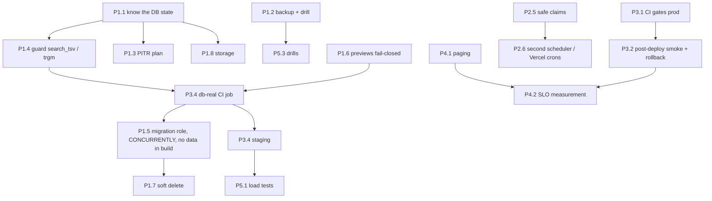

# Orbit reliability plan

**Date:** 2026-10-17 · **Based on:** [`RELIABILITY_AUDIT.md`](RELIABILITY_AUDIT.md) (finding IDs `R-xx`) · **Status:** proposal, awaiting approval. Nothing here has been implemented.

Each item lists the approach, what changes, effort (**S** ≤ ½ day · **M** 1–3 days · **L** a week or more), cost impact, regression risk, how to verify it worked, and what keeps it working. Prices are list prices as I last knew them; confirm them on the vendor's page before deciding.

---

## Implementation status (updated 2026-10-17)

Approved and implemented on branch `claude/youthful-johnson-s3u52r`, one commit per item, each
verified by the test named. **Not yet deployed or merged**: nothing below protects production until it ships.

| Item | Status | Verified by |
|---|---|---|
| **P1.4** `search_tsv` / trigram guards (R-01) | ✅ done | 600k-contact sweep under traffic: 0 errors with and without `statement_timeout=20s` (was 25.7 s stalls, and a failed deploy that left search broken); `smoke-search-tsv-guard` |
| **P1.6** previews fail closed, pooler-aware host match (R-06) | ✅ done | `smoke-migration-guards` |
| **P2.4** Orbit's OAuth client refused ≠ user must reconnect (R-10) | ✅ done (expiry-date alert not built) | `smoke-oauth-refresh-rejection` |
| **P2.5** race-free claims (R-15) | ✅ done for 5 claim sites; `markSyncResult` ownership guard and outbound-webhook drain claim **not** done | `claim-race`: 17,660 → 6,000 claims for 6,000 rows |
| **P2.1** DB deadline and read retry (R-08) | ✅ done | `db-faults`: hang 300.8 s → 8.0 s (override); `smoke-neon-fetch` |
| **P2.6 step 1** scheduler workflow; **P3.1 step 4** no CI cancel on `main` | ✅ done | `smoke-schedules`; YAML parsed. Not run on GitHub |
| **P2.7** email/outreach duplicate sends (R-16a, b) | ✅ done; scheduled-send max lateness (R-16c) **not** done (needs a product decision on expiry UX) | `smoke-email-sends`, `smoke-outreach-guards` |
| **P2.2** managed AI failover (R-09) | ✅ done | `smoke-ai-access` (failover, safeguard when all providers fail, ageing out) |
| **P2.8** Resend deadline, `.docx` zip-bomb cap (R-21) | ✅ partly: Resend and `.docx` done; Graph connector retries, Google 5xx retry, `request.signal` on research **not** done | `smoke-resilience-limits` |
| **P4.1** alert delivery and sweep failure (R-12) | ✅ code done; phone paging (Better Stack on-call) is a dashboard decision (D6) | `smoke-ops-notify`, `smoke-ops-sweep` |
| **P1.8** retention + `db.storage` alert (R-07) | ✅ partly: pruning of 3 logs and the alert done; embedding double-storage, Blob requirement, other 10 tables **not** done | `smoke-log-retention`, `smoke-ops-alerts` |
| **P3.4 step 1** real-Postgres CI job (R-05) | ✅ done | Steps replayed locally in 63 s; the gate fails on the pre-fix code. Not yet run on GitHub |
| **P4.4** runbooks | ✅ partly: search-broken, storage-full, DB-unreachable, PITR written into `docs/RUNBOOK.md`; provider-outage, leaked-credential, scheduler-stopped still only in Appendix A below | — |
| **P1.5** migration safety (R-04), partly | ✅ `MIGRATION_DATABASE_URL`; data backfills/merges moved out of the build into the hourly housekeeping; CI guard against unreviewed `DROP`s (`smoke-ddl-contract`). **Not done:** `CONCURRENTLY` for new indexes on big tables, removing DDL rights from the app role (needs the role set up first, see RUNBOOK → Migration role), runtime-never-sweeps, apply-once migrations (D7) | `smoke-migration-guards`, `smoke-ddl-contract` (fails on a planted DROP); real-Postgres run: build via the migration URL touched 0 identity rows (was +2,000 per build) |
| **P2.10** kill switches (R-22), partly | ✅ four database-backed switches (background sync, email drain, webhook drain, work-history sweep) via `/admin/product`, no deploy. **Not done:** a switch for Gmail/Outlook scans and BYOK background AI generally; an alert for a switch left off >24 h | `smoke-job-kill-switches`: each stands down when hidden, resumes when shown, auth unchanged |
| **P2.3** Clerk | ✅ `CLERK_JWT_KEY` now an expected production variable (warns). Clerk health probe **not** done | `smoke-env` |

**Needs you (dashboards or decisions, cannot be done from code):** P1.1 read the real database state; P1.2 prove a backup exists
and drill a restore; P1.3 / D1 Neon plan and PITR; D2 Vercel Pro; P3.1 steps 1-3 branch rules requiring CI and promote-after-CI;
set `PRODUCTION_DB_HOST` and `DB_STORAGE_LIMIT_GB` on Vercel; D6 paging; D12 a second person.

**Deliberately not started, and why:** P1.5 (migration role, `CONCURRENTLY`, data work out of the build) and P1.7 (soft delete)
change the data and permission model and want their own review; P2.9 (atomic capture save), P2.10 (kill switches), P2.11
(key rotation) and P2.12 (import counters) are each a contained change but touch the capture, admin and crypto paths and
should be reviewed separately; P3.2 (post-deploy smoke and rollback) needs a test account and Vercel credentials.

---

## Do this week (quick wins, in order)

Together these are about 3 days of work, and they remove the scenarios most likely to cause an outage or permanent data loss.

| # | Action | Fixes | Effort | Why now |
|---|---|---|---|---|
| 1 | **Read four numbers before the next schema change** (15 min, read-only): `SELECT count(*) FROM contacts`; `SHOW statement_timeout` as the app role; Neon plan + PITR window + storage used; Vercel → is `PRODUCTION_DB_HOST` set, and is `DATABASE_URL` Production-only | R-01, R-02, R-06, R-07 | S | They decide how urgent R-01 is today, and whether a preview can migrate production |
| 2 | **Guard the `search_tsv` and trigram rebuilds** (P1.4) and ship it **before any other change that bumps `SCHEMA_VERSION`** | R-01 | S | Every schema bump currently rewrites `contacts` under live traffic. With the runbook's 20 s timeout, the next one can leave search broken (TESTED) |
| 3 | **Prove a backup exists and restore it once**: check the private `backup` workflow's last run, download the newest artifact, restore it into a new Neon branch, compare counts, and log it in the runbook (P1.2) | R-02 | S | No restore has ever been run |
| 4 | **Turn on Neon PITR on a paid plan** (decision D1) | R-02 | S | Moves RPO from up to 24 h to minutes |
| 5 | **Require CI before production**: required status checks on `main`, no direct pushes (P3.1, step 1) | R-03 | S | 15 of the last 100 `main` CI runs were red, and red commits shipped |
| 6 | **Stop `invalid_client` from marking users as needing reconnect** (P2.4), and write down the Microsoft and Google client-secret expiry dates | R-10 | S | One expiring secret would disconnect every Outlook user at once |
| 7 | **Harden the scheduler workflow**: retry the health probe 3× with backoff; add `!cancelled() &&` to every step's `if:`; send the "down" page once per outage (P2.6, step 1) | R-11 | S | One DB blip currently skips every job in that tick, and one failing step skips the email drain |
| 8 | **Make `PRODUCTION_DB_HOST` required and fail-closed for previews** (P1.6) | R-06 | S | Previews must never migrate production |
| 9 | **Phone paging for critical alerts**: Better Stack on-call (or Slack mobile overrides) for `#orbit-ops-critical` and the uptime monitor; a second person on the escalation if there is one (P4.1) | R-12 | S | Today a Slack post is the only signal |

---

## Phase 1: Protect the data now

### P1.1 Know the database's real state (fixes R-02, R-07; prerequisite for everything below)
- **Approach:** Read-only checks in the Neon console and SQL editor:
  - plan, region, compute size, autosuspend, PITR window, storage used vs limit;
  - `pg_stat_user_tables` row counts and `pg_total_relation_size` per table;
  - `SHOW statement_timeout` as the app role;
  - which role owns the schema;
  - whether the `main` branch is protected.
  Record all of it in a new `docs/INFRASTRUCTURE.md`, the first piece of "configuration as documentation" (P3.6).
- **Effort:** S · **Cost:** $0 · **Regression risk:** none (read-only).
- **Verify:** the doc exists, with dates.
- **Keep it working:** revisit at each quarterly restore drill (P5.3).

### P1.2 A tested backup and restore, with real monitoring (fixes R-02)
- **Approach:**
  1. In the private ops repo, confirm `backup.yml` runs daily and pages on failure, and that the age private key is stored in at least two places that are not the operator's laptop (password manager + offline copy).
  2. **First production restore drill:** download the newest artifact, `age -d`, then `pg_restore` into a **new Neon branch**, following `docs/RUNBOOK.md`. Compare the row counts of every table with production using the query in `reliability/tests/restore-drill.sh`. Point one preview at the branch and sign in. Delete the branch. Record date, artifact, timings and who did it in the runbook's drill log.
  3. **A PITR drill too:** create a branch from a point 1 hour ago in Neon and check counts. This is the faster path for "I deleted something this morning".
  4. **Make backup freshness visible inside the app.** The backup job writes one row (`backup_runs`: started, finished, size, artifact id, sha256) through a small authenticated route, or the ops sweep reads the private repo's latest run through the GitHub API with a read-only token. Add a `backup.stale` ops condition (critical after 30 h) alongside the Better Stack heartbeat, so a broken heartbeat config does not hide a broken backup.
  5. **Automate the restore check weekly:** a scheduled job in the private repo restores the newest dump into a throwaway Neon branch (Neon API), runs the count comparison, posts the result, and deletes the branch.
- **Change:** private `backup.yml`; new `restore-verify.yml` there; `src/lib/ops-alerts.ts`/`ops-sweep.ts` (new condition); `docs/RUNBOOK.md` drill log.
- **Effort:** M · **Cost:** Neon branch compute for minutes a week (cents) · **Regression risk:** low.
- **Verify:** the drill log has a dated row; `backup.stale` opens when the backup job is disabled for a day in a test.
- **Keep it working:** `backup.stale` (critical), the weekly `restore.verify` result, and a quarterly manual drill (P5.3).

### P1.3 Point-in-time recovery on a paid Neon plan (fixes R-02; decision D1)
- **Approach:** Upgrade the Neon project to a plan with a restore window of ≥ 7 days. Set the history retention and write it in `docs/INFRASTRUCTURE.md`. Keep the daily dump as an independent copy outside Neon.
- **Effort:** S · **Cost:** about $19+/month usage-based (verify current Neon pricing) · **Regression risk:** none.
- **Verify:** create a branch at "now minus 3 days" successfully.
- **Keep it working:** the deep health or ops sweep reads the restore window through the Neon API (`admin-providers.ts` already has a Neon panel) and warns if it drops below 7 days.

### P1.4 Stop rewriting `contacts` on every schema change (fixes R-01)
- **Approach:**
  1. Guard `search_tsv` exactly as `linkedin_slug` already is (`applyScaleSchema`, `src/db/index.ts:3268-3275`). Read the stored generation expression with `pg_get_expr(adbin, adrelid)` and run the DROP + ADD **only** when it differs from the declared one. Filter the DROP out of `SCALE_DDL` otherwise.
  2. Guard the `contacts_name_trgm` DROP/CREATE the same way: compare `pg_get_indexdef`. Stop swallowing its failure. A failed index statement must go into `failed` so the build fails loudly and the version is not recorded.
  3. Same for the HNSW creation in `migratePgvector`.
  4. When the expression genuinely changes, use expand/contract instead of drop/re-add: add `search_tsv_v2` (nullable, filled by a batched backfill or a trigger), build its GIN with `CREATE INDEX CONCURRENTLY`, switch readers in the next release, drop the old column one release later.
- **Change:** `src/db/index.ts` (`SCALE_DDL`, `applyScaleSchema`, `migratePgvector`); a smoke test asserting that a second sweep on an already-migrated DB issues no `DROP COLUMN` and no `DROP INDEX`.
- **Effort:** S (guards) / M (expand/contract helper) · **Cost:** $0 · **Regression risk:** low. The guard is the pattern already shipped for `linkedin_slug`.
- **Verify:** re-run `reliability/tests/migration-under-load.sh orbit_rel` and `… orbit_rel 20s`. Expected: 0 errors, worst latency under 1 s, migrate exit 0, `search_tsv` present.
- **Keep it working:** the CI job in P3.4 runs exactly these two tests on every PR that touches `src/db/index.ts`.

### P1.5 Make migrations safe by construction (fixes R-04, R-25)
- **Approach:**
  1. **A dedicated migration connection:** `MIGRATION_DATABASE_URL` for a migration role with its own `ALTER ROLE … SET lock_timeout = '5s'` and `statement_timeout = '15min'`. The app role keeps `20s`, and the build stops inheriting it. That separates R-01's timeout trap from the app's runaway-query protection.
  2. **Least privilege:** the runtime role gets DML only, with no DDL and no `DROP`. Only the migration role owns the schema (also limits R-20/R-11 blast radius).
  3. **`CREATE INDEX CONCURRENTLY`** for any new index on a table that can be large (contacts, interactions, memory_chunks, embeddings, usage_events). Run them outside the statement loop (they cannot run in a transaction or batch). Mark the index valid only after `pg_index.indisvalid`.
  4. **Expand/contract rule, enforced:** no `DROP TABLE` or `DROP COLUMN` in the same release that removes its readers. A smoke script fails CI when a newly added `DROP` statement appears without a `-- contract-of: <release>` marker that names an earlier release. Write it into the comment above `SCHEMA_VERSION`.
  5. **Move data work out of the build:** the contact-identity backfill, duplicate merges and the whole-table `UPDATE`/`DELETE` statements in `alters` (`index.ts:4303, 4421-4427, 4551, 4556, …`) become one-shot, versioned data migrations recorded in a `data_migrations` table. They run once, from `process-stalled`, in batches, never in `scripts/migrate.ts`.
  6. **Runtime never sweeps:** in production, `reconcileSchema` at request time only *checks*. If the schema is behind, health reports it and the request proceeds; DDL is build-only. This removes R-25.
  7. **Long-term (decision D7):** replace "re-run the whole DDL list when the fingerprint changes" with numbered, apply-once migrations (the lease, fingerprint and coverage check can stay). Every statement then runs exactly once, with no re-execution of 400+ statements on each bump.
- **Change:** `src/db/index.ts`, `scripts/migrate.ts`, `src/lib/env.ts` (new variable), Neon roles, `docs/RUNBOOK.md`.
- **Effort:** M for steps 1–6 · L for step 7 · **Cost:** $0 · **Regression risk:** Medium. Role changes can break a missed write path, so roll out on a Neon branch with the full smoke suite first (P3.4).
- **Verify:** on the seeded local DB, a migration adding an index to `contacts` under traffic shows no stall over 1 s; the runtime role cannot `DROP TABLE` (expect permission denied); a build with a bare `DROP COLUMN` fails CI.
- **Keep it working:** the P3.4 CI job; deep health asserts that the runtime role lacks DDL privileges.

### P1.6 Previews can never touch production (fixes R-06)
- **Approach:**
  - Move `PRODUCTION_DB_HOST` to `REQUIRED_IN_PRODUCTION` and `REQUIRED_IN_PREVIEW`, so `checkMigrationTarget` fails closed when it is unset.
  - Compare normalised Neon endpoint ids (strip `-pooler`) instead of raw hostnames.
  - Give previews their own Neon branch through the Vercel–Neon integration.
  - Refuse a preview build whose recorded version on the target DB is higher than `main`'s.
- **Change:** `src/lib/env.ts`, Vercel env.
- **Effort:** S · **Cost:** a preview branch, cents a day · **Regression risk:** low (a missing variable fails the build visibly).
- **Verify:** extend the existing `smoke-*env*` tests with pooler vs direct host cases; a preview build with production's URL is refused.
- **Keep it working:** the smoke test.

### P1.7 Undo for destructive user actions (fixes R-18)
- **Approach:** A soft-delete "trash" for contacts (with their interactions and reminders): `deleted_at` + a 30-day purge job, an "Undo" toast and a Trash view. Bulk deletes go through it. Account deletion stays a hard purge, as the privacy policy promises; the trash window must be disclosed (decision D8).
- **Effort:** M · **Cost:** $0 · **Regression risk:** Medium (every read must filter `deleted_at IS NULL`). Use a view or a query helper, plus a smoke test that greps for unfiltered reads.
- **Verify:** delete 100 contacts, undo, then compare `behavior-golden` output.
- **Keep it working:** the smoke test.

### P1.8 Storage growth under control (fixes R-07)
- **Approach:**
  1. **Embeddings stored twice:** stop writing the jsonb `embedding` once `embedding_vector` is populated, then (expand/contract) drop the jsonb column and keep `vector` as the source. This about halves the dominant table: 541 MB of 1.44 GB in the test was the jsonb copy.
  2. Make `BLOB_READ_WRITE_TOKEN` required in production and migrate any inline base64 avatars and photos to Blob (`scripts/migrate-avatars-to-blob.ts` exists).
  3. Add retention for the 13 unpruned tables (`webhook_deliveries` 30 d, `cron_runs` 90 d, `outbound_webhook_deliveries` delivered 30 d, `connector_outbox` done 30 d, `email_sends` bodies 180 d, `gate_events`/`extension_usage`/`speech_usage` 180 d, `embedding_failures` 30 d, `stripe_processed_events` 400 d, `relationship_runs` 90 d, `import_job_rows` 30 d after the import finishes; `admin_audit_log` stays, by policy). Give each prune its own `try` (today one throw skips the rest).
  4. Add a **`db.storage` ops condition**: `pg_database_size()` vs a configured plan limit, warning at 70% and critical at 85%, plus the largest-table growth over 7 days on `/admin/health`.
- **Effort:** M · **Cost:** $0 (may avoid a plan step-up) · **Regression risk:** Low–Medium (the jsonb drop is a contract step).
- **Verify:** `pg_total_relation_size` per table before and after on a branch; the condition opens on a test DB with a tiny limit.
- **Keep it working:** `db.storage`.

---

## Phase 2: Remove single points of failure, degrade gracefully

### P2.1 Database client timeout and a bounded retry (fixes R-08)
- **Approach:**
  - Create the client as `neon(url, { fetchOptions: { signal } })` with a per-query signal of `AbortSignal.timeout(DB_QUERY_TIMEOUT_MS)`, about 15 s for pages and longer for job routes. The simplest way is a `fetchFunction` wrapper set through `neonConfig.fetchFunction`.
  - Retry **once**, with jittered 200–600 ms backoff, only on connection errors or 5xx, and only for read-only statements. Never retry `db.batch` or writes.
  - Record `db.timeout` and `db.retry` error events.
- **Change:** `src/db/index.ts` (`ensureReady`).
- **Effort:** S · **Cost:** $0 · **Regression risk:** Low–Medium. A too-short timeout would break slow legitimate queries; start at 25 s and tighten.
- **Verify:** `reliability/tests/db-faults.mts`. Expected: a hang fails at the timeout, not at 300 s; a 503 makes 2 attempts on a read and 1 on a write.
- **Keep it working:** db-faults becomes a CI test (P3.4); a `db.timeouts_burst` ops condition.

### P2.2 Managed AI fails over on an outage (fixes R-09)
- **Approach:**
  - In `runOnGrant`, treat `5xx`, `529/overloaded`, timeouts and `model_unavailable` on a **managed** grant as a provider failure.
  - Record a short shared breaker: a `site_settings` or `rate_limit_buckets` row such as `managed_ai_breaker:<provider>` that opens for 2–5 min after N failures in 60 s.
  - Retry the same request once on the next provider in `MANAGED_PROVIDER_ORDER`, where the operation has a mapped model.
  - Embeddings stay OpenAI-only; their failure degrades search to keyword, which already happens.
- **Change:** `src/lib/ai-access.ts`, `src/lib/managed-ai-policy.ts`; a helper taking a function so the retry can rebuild the call for another provider (the "ponytail" note at `ai-access.ts:496`).
- **Effort:** M · **Cost:** spend shifts to OpenAI during outages (pool caps already bound it) · **Regression risk:** Medium (prompts and outputs differ across providers; keep the JSON-schema operations validated).
- **Verify:** extend `reliability/tests/llm-faults.mts`: Anthropic returns 529, the call succeeds on the fake OpenAI, the breaker opens, and later calls go straight to OpenAI.
- **Keep it working:** an `ai.managed_failover` info event; a warning when the breaker is open for more than 15 min.

### P2.3 Clerk dependency (fixes R-14)
- **Approach:**
  - Make `CLERK_JWT_KEY` required in production, so session verification needs no Clerk network call.
  - Add a Clerk health check to the deep health probe, and a `clerk.unreachable` condition.
  - Write a runbook entry (Appendix A).
  - A true degraded mode (read-only access when Clerk's frontend API is down) is not realistic without changing auth providers. Accept the risk explicitly (decision D9).
- **Effort:** S · **Cost:** $0 · **Regression risk:** low.
- **Verify:** check:env fails without the key; the deep probe shows Clerk status.
- **Keep it working:** the condition.

### P2.4 OAuth client-secret failures are Orbit's, not the user's (fixes R-10)
- **Approach:**
  - Split `isRefreshRejection`. `invalid_client` and `unauthorized_client` become a new `OAuthClientConfigError`. It does **not** touch the user's connection row. It opens a critical `oauth.client_invalid:<provider>` alert and pauses that provider's sync (with jitter) until the condition clears.
  - Add `MICROSOFT_CLIENT_SECRET_EXPIRES_AT` and `GOOGLE_CLIENT_SECRET_ROTATED_AT` to env, and an ops condition that warns at 45 days before expiry and goes critical at 14.
  - Add a one-off script that re-arms connections wrongly marked `needs_reauth` after a client-secret incident.
- **Change:** `src/lib/errors.ts`, `gmail.ts`, `outlook.ts`, `ops-alerts.ts`, `env.ts`, `.env.example`.
- **Effort:** S · **Cost:** $0 · **Regression risk:** low (this only narrows what marks users).
- **Verify:** smoke cases: a 401 `invalid_client` body leaves the connection `active` and opens the alert; `invalid_grant` still marks `needs_reauth`.
- **Keep it working:** the expiry condition.

### P2.5 Claims that cannot double-claim (fixes R-15, R-27)
- **Approach:** Copy the connector-outbox pattern (`src/lib/connectors/outbox.ts:12-60`) into `claimDueConnections` and every other claim of the same shape: `FOR UPDATE SKIP LOCKED` in the subquery, **and** the claim predicate repeated on the outer `UPDATE`. Guard `markSyncResult` on `sync_started_at` (ownership). Give the outbound-webhook drain the same claim. Enqueue webhooks synchronously, not in `after()`.
- **Change:** `provider-connections.ts`, `connectors/connections.ts`, `calendar-sync.ts`, `radar/run.ts`, `cloud-notes/scan.ts`, `webhooks/dispatch.ts`, `api/http.ts`, `v1/*`.
- **Effort:** S–M · **Cost:** $0 · **Regression risk:** low.
- **Verify:** `reliability/tests/claim-race.mts`. Expected: `roundsWithDoubleClaim: 0`, `totalClaimed` = 40 × rounds.
- **Keep it working:** claim-race runs in CI (P3.4) against every claim function, as one parameterised test.

### P2.6 A scheduler that is not a single point of failure (fixes R-11)
- **Approach:**
  1. **Now:**
     - In `ops.yml`, retry the probe 3× (5 s, 15 s, 30 s).
     - Add `!cancelled() &&` to every step's `if:` so one failing step doesn't skip the rest.
     - Page once per outage (a cache key or the existing alert state) instead of on every schedule line.
     - Fix the public-log print (`ops.yml:132`).
  2. **Next:** add the missing jobs to the sweep's `cron_runs` watch list: `email.drain`, `connectors.outbox`, `credits.notices`, `cloud-notes.run`, `speech-usage`.
  3. **Then (decision D2):** move schedules to Vercel Pro crons (removes the 60-day rule and GitHub lag), **or** add a second independent caller (Better Stack or cron-job.org on the same routes; safe once P2.5 makes claims idempotent).
  4. Keep the Better Stack heartbeat as the external dead-man switch. Ping it only when the sweep **and** at least one Slack delivery succeeded, or send a second heartbeat for delivery.
- **Effort:** S (1) / S (2) / S–M (3) · **Cost:** $0, or Vercel Pro $20/user/month · **Regression risk:** low.
- **Verify:** in a fork, point `APP_URL` at a URL that fails twice and then succeeds; jobs still run, and one forced-failing step does not skip the email drain.
- **Keep it working:** the heartbeat, plus the new `cron.missed`-style conditions per job.

### P2.7 No duplicate or stale email (fixes R-16)
- **Approach:**
  - **Email outbox:** set `failure_kind = 'ambiguous'` *before* calling the provider and clear it on a definite outcome. With no read scope, a reclaimed ambiguous send goes to "may have sent" (user decides) instead of resending.
  - **Outreach:** atomically claim the message (`UPDATE … SET status='sending' WHERE id=… AND status='pending' RETURNING`) and pass an idempotency key to Resend (`Idempotency-Key` header).
  - **Twilio:** the claim only.
  - **Scheduled sends:** add `max_lateness` (default 2 h). Past that, mark `expired` and notify the user instead of sending.
- **Change:** `src/lib/email/outbox.ts`, `src/actions/outreach.ts`, `src/lib/outreach-send.ts`.
- **Effort:** M · **Cost:** $0 · **Regression risk:** Medium (core send path); cover with smoke cases for kill-between-send-and-settle.
- **Verify:** a smoke test that simulates a crash after `provider.send` makes zero second sends; double-invoking the outreach action sends once.
- **Keep it working:** an `email.duplicate_suspect` error event when two sends to the same Message-ID are recorded.

### P2.8 Timeouts and retries everywhere else (fixes R-21)
- **Approach:**
  - Wrap Resend in `AbortSignal.timeout(15s)`, either with a custom `fetch` or by racing the call.
  - Route the Microsoft Graph calendar and contacts connectors through `graphFetchWithRetry`.
  - Retry Google 5xx with jitter, and cap the total retry time at the caller's remaining budget (`time-budget.ts`).
  - In `docxToText`, check the zip entry's declared uncompressed size and stream-inflate with a byte cap of 20 MB.
  - Pass `request.signal` into `/api/research` and web search.
- **Effort:** M · **Cost:** $0 · **Regression risk:** low.
- **Verify:** unit smokes with a fake server (pattern of `llm-faults.mts`).
- **Keep it working:** a lint rule or smoke test that flags `new Resend(` and bare `fetch(` to provider hosts without a `signal`.

### P2.9 Atomic capture save and webhook ordering (fixes R-17)
- **Approach:**
  - Make `saveNoteBatch` idempotent end to end. Add a unique `(user_id, source_hash)` (or client-generated `capture_id`) on `note_batches`, write `status='saving'` first, and set `saved` only after the last write. A retry resumes from the stored progress, using upserts keyed on the batch id.
  - **Clerk:** ignore `user.updated` for a user with a completed `data_purge_runs` row, or one that Clerk reports as deleted.
- **Effort:** M · **Cost:** $0 · **Regression risk:** Medium (capture is the core loop); behind the existing capture smoke suite.
- **Verify:** a smoke test kills the save after N writes, retries, and checks no duplicates and a complete batch.
- **Keep it working:** a `capture.half_saved` ops condition (batches in `saving` for more than 10 min).

### P2.10 Kill switches that don't need a deploy (fixes R-22)
- **Approach:** Add database-backed switches (the `app_surface_flags`/`site_settings` mechanism already caches for 10–30 s), each checked at the start of its route or job:
  - `sync.google`, `sync.microsoft`, `sync.apple`;
  - `scan.gmail`, `scan.outlook`;
  - `ai.byok_background` (work-history, Radar AI, timeline and embeddings on users' keys);
  - `email.outbound`;
  - `webhooks.outbound`.

  Add them to `/admin/product` with a reason field written to the audit log.
- **Effort:** S–M · **Cost:** $0 · **Regression risk:** low.
- **Verify:** flip each one on staging and watch its cron row report `skipped: disabled`.
- **Keep it working:** a warning when any switch has been off for more than 24 h, so one is never forgotten off.

### P2.11 Encryption key rotation (fixes R-20)
- **Approach:**
  - Use versioned ciphertext `v2:<kid>:iv:tag:data` with `ENCRYPTION_KEYS` (a JSON map of kid → secret) and `ENCRYPTION_PRIMARY_KID`. Decrypt by kid; on read, re-encrypt with the primary key.
  - Write a `scripts/reencrypt.ts` batch job.
  - `decryptOrNull` records a throttled `crypto.decrypt_failed` error event instead of silently returning null.
  - Use a random per-deployment salt only together with key versioning (keep `orbit-salt` for v1).
- **Effort:** M · **Cost:** $0 · **Regression risk:** Medium (every token read); dual-read makes it safe to roll out.
- **Verify:** round-trip smokes across v1/v2; rotating the primary key on a branch and running the re-encrypt leaves zero v1 rows.
- **Keep it working:** a `crypto.decrypt_failed` ops condition.

### P2.12 Import resilience (fixes R-24)
- **Approach:**
  - Reset `stall_resumes` when `processed_rows` advanced since the last resume.
  - Count self-continuations, and fail with a message after N continuations with zero progress.
  - Exclude the pre-loop phase from the per-chunk budget, or checkpoint it.
  - Retry a failed continuation kick once, with jitter.
- **Effort:** S–M · **Cost:** $0 · **Regression risk:** low.
- **Verify:** smoke cases for each.
- **Keep it working:** `import.wedged` keyed on progress, not `updated_at`.

---

## Phase 3: Deployment safety and rollback

### P3.1 CI gates production (fixes R-03)
- **Approach:**
  1. Branch rules on `main`: require PRs and the `check`, the three `smoke` shards and `e2e` status checks. Block direct pushes, with an admin bypass for emergencies that is logged.
  2. Drop or narrow `paths-ignore` so required checks always report. A docs-only change still gets a cheap "skipped" success job.
  3. Make Vercel wait for CI. Disable automatic production deploys from git and promote from a GitHub Action after CI is green on the merge commit (`vercel deploy --prebuilt --prod`, or Vercel's "promote" API on the already-built preview). Vercel's Deployment Checks feature also works if the plan has it.
  4. Change `cancel-in-progress` to `${{ github.ref != 'refs/heads/main' }}` so `main` always gets a verdict per commit.
- **Effort:** S (1, 2, 4) / M (3) · **Cost:** $0 · **Regression risk:** low (slower path to production, by design).
- **Verify:** a PR with a failing smoke cannot merge; a red `main` commit is not promoted.
- **Keep it working:** branch rules are configuration. Snapshot them in `docs/INFRASTRUCTURE.md` and check them in the quarterly review.

### P3.2 Post-deploy verification and automated rollback (fixes R-23)
- **Approach:**
  - A workflow triggered by the deployment's success status runs a **production smoke**: `/api/health` (expected sha), the public pages, and a synthetic signed-in journey with a dedicated test account (sign in → dashboard → contact list → search → open a contact), using Playwright with a stored session.
  - On failure, `vercel rollback` (or promote the previous deployment) and page.
  - Add `deploymentId` in `next.config.ts` and a stable `NEXT_SERVER_ACTIONS_ENCRYPTION_KEY`, so server actions from open tabs survive deploys. Vercel Skew Protection needs Pro (decision D2).
- **Effort:** M · **Cost:** $0 (Pro for skew protection) · **Regression risk:** low.
- **Verify:** deploy a deliberately broken preview to a test alias and watch the rollback.
- **Keep it working:** the same journey runs every 10 min as a synthetic monitor (P4.2).

### P3.3 Decouple data changes from deploys (fixes R-04)
Covered by P1.5 step 5: no data writes in `scripts/migrate.ts`. Additionally, for every release that contains DDL, write the rollback in the PR description: what an instant rollback leaves behind and whether it is safe. Add it as a PR template section for `src/db/**`.
- **Effort:** S · **Regression risk:** none.

### P3.4 A staging that tests real Postgres (fixes R-05)
- **Approach:**
  1. **CI job `db-real`** on PRs touching `src/db/**`, `scripts/migrate.ts` or claim and queue code:
     - a `pgvector/pgvector:pg17` service container (match production's major version);
     - the `reliability/` shim;
     - run `scripts/migrate.ts` twice (fresh, then with a bumped fingerprint);
     - run `reliability/seed-bulk.sql` at a reduced size (e.g. 50k contacts);
     - run `migration-under-load.sh` with `20s` and fail on any probe error or a stall over 2 s;
     - run `claim-race`, `rate-limit-burst` and `db-faults`.

     Runtime is about 5–8 min.
  2. **A staging environment:** a long-lived Neon branch (`staging`), refreshed weekly from production with PII scrubbed, **or** seeded with `seed-bulk.sql` at production scale. Pair it with a Vercel environment (a branch deploy or a separate project) using test-mode Clerk and Stripe and fake provider keys.
  3. All load and chaos testing (P5) targets staging, never production.
- **Effort:** M (1) / M–L (2) · **Cost:** CI minutes are free on a public repo; a staging Neon branch is about $5–20/month depending on compute · **Regression risk:** none.
- **Verify:** reintroduce the unguarded `search_tsv` DROP on a branch; `db-real` fails.
- **Keep it working:** a required check on DB-touching PRs.

### P3.5 Dependencies and toolchain (fixes R-26)
- **Approach:**
  - Set `"engines": { "node": "24.x", "npm": ">=11" }` and `engine-strict=true` in `.npmrc`.
  - Set `"installCommand": "npm ci"` in `vercel.json`.
  - Triage Dependabot weekly: merge patch and minor updates when CI is green (auto-merge for devDependencies); security updates on.
  - Pin `next` to an exact version and upgrade deliberately.
  - Run a monthly `npm audit --omit=dev` review.
- **Effort:** S + 30 min/week · **Cost:** $0 · **Regression risk:** low (CI gates upgrades once P3.1 is done).
- **Verify:** `npm ci` on npm 10 fails with a clear engine error instead of a lockfile error; a Dependabot PR merges.
- **Keep it working:** the weekly triage slot; a `deps.stale` warning if no Dependabot PR has merged in 30 days.

### P3.6 Configuration as code, or at least as documentation (fixes the "no IaC" finding)
- **Approach:** Snapshot every dashboard setting that production depends on into `docs/INFRASTRUCTURE.md`:
  - Vercel plan, region, env var names and scopes (names only);
  - Neon plan, roles and branches;
  - Clerk webhooks;
  - Stripe webhook events;
  - OAuth redirect URIs and secret expiry dates;
  - Better Stack monitors;
  - Slack channels;
  - DNS records and the registrar.

  Optionally move Vercel env and Neon roles to Terraform later (decision D10). A quarterly diff against reality catches drift.
- **Effort:** S–M · **Cost:** $0 · **Regression risk:** none.

### P3.7 Secrets hygiene (supports R-20, R-13)
- **Approach:**
  - Move ops secrets into a GitHub Environment `production` with `ops.yml` as the only consumer.
  - Write a rotation calendar (CRON_SECRET and webhook secrets yearly; OAuth secrets before expiry; the Neon password on any suspicion).
  - Write the leaked-credential runbook (Appendix A).
- **Effort:** S · **Cost:** $0.

---

## Phase 4: Observability, alerting and runbooks

### P4.1 Paging that reaches a person (fixes R-12)
- **Approach:**
  - Use Better Stack on-call (phone or push) for: the uptime monitor, the heartbeats (scheduler, backup), and critical ops conditions, delivered over an email or webhook integration in addition to Slack.
  - In `ops-notify.ts`, deliver critical alerts first and independently. A failure on one sink must not skip the others. Record per-sink delivery state.
  - Run the sweep's reads with `Promise.allSettled`; a failed read becomes a `sweep.read_failed:<name>` condition instead of aborting the sweep.
  - Ping the heartbeat only when at least one sink delivered.
- **Effort:** S–M · **Cost:** Better Stack paid tier for phone alerts, about $25–30/month (verify) · **Regression risk:** low.
- **Verify:** revoke the main Slack webhook in a test; the critical alert still arrives by phone and email.
- **Keep it working:** a monthly test page, recorded in the drill log.

### P4.2 Measure the SLOs (fixes R-19)
- **Approach:**
  1. **Synthetic monitors**, every 5–10 min from outside: `/api/health`, `/` and `/sign-in`, plus the signed-in journey from P3.2 (Better Stack Playwright checks or a GitHub Action against a test account).
  2. **Server-side SLIs:** Sentry transactions or Vercel Observability (Pro) for 5xx rate and p95 per route group; alert rules for the error-rate SLO (multi-window burn rate: 2% of the budget in 1 h, or 5% in 6 h).
  3. **Database:** an ops condition and admin panel built from cheap SQL — `pg_database_size`, the largest tables and their 7-day growth, `pg_stat_activity` long-running queries (> 30 s), `pg_locks` waiters, and `pg_stat_statements` top 10 by total time (if Neon exposes it). Add the Neon API's compute metrics if the plan allows.
  4. **Webhook absence:** `stripe.silent` (no Stripe event in 7 days while paid subscriptions exist) and `clerk.silent` (no Clerk event in 3 days while sign-ups occur).
  5. **Backlog conditions** for `email_sends` (pending older than 1 h), `outbound_webhook_deliveries` (dead > 0), and `capture_jobs` (running more than 15 min).
  6. A **status page** (Better Stack free status page) wired to the uptime monitors.
  7. A **log drain** for more than 1 h of retention: Vercel Pro drain to Better Stack Logs or Axiom (decision D2), or as a stopgap, mirror `reportError` lines into Sentry Logs.
- **Effort:** M–L in total · **Cost:** $0–50/month depending on choices · **Regression risk:** none.
- **Verify:** each condition fires in a staging test (stop a drain, fill a test DB).
- **Keep it working:** a weekly SLO summary on `/admin/health`; a quarterly review of noisy alerts (tune or delete).

### P4.3 Alert hygiene
- Add hysteresis to `errors.burst` (open at ≥5, close below 2 for 30 min).
- Exclude `csp.report` and `bot.check` from it.
- Base `ai.provider_outage` on a failure *rate* over 15 min, not a 24 h count.
- Exclude `needsReauth` from deep `degraded`.
- Throttle `reportError` at error level per `where` (Sentry quota).
- **Effort:** S.

### P4.4 Runbooks
Drafts are in **Appendix A** below, for review, then to move into `docs/RUNBOOK.md`. They cover: database outage; **search broken after a failed migration (R-01)**; restore from PITR; restore from the dump (existing, plus checks); bad deploy; scheduler or queue backlog; provider outages (AI, Google/Microsoft, Resend, Clerk, Stripe); OAuth client secret expired; leaked credential; disk full. Each must be drilled once (P5.3) before it counts.

### P4.5 Incident process and bus factor (fixes R-13)
- **Approach:**
  - **Severity levels:** Sev-1 = data loss or full outage; Sev-2 = a critical journey down; Sev-3 = degraded.
  - **An incident log** (`docs/incidents/YYYY-MM-DD-*.md`) with a five-heading postmortem template: what happened, impact, timeline, why, actions.
  - **A second human** with admin access on every control plane (Vercel team, Neon org, Clerk, Stripe, Google Cloud, Better Stack, GitHub org, registrar), or at minimum a break-glass envelope: a password-manager emergency kit holding the account recovery codes and the backup age key, plus the `docs/INFRASTRUCTURE.md` map.
  - Move the Vercel project from a personal Hobby account to a team (decision D2).
  - Put Neon, Vercel and registrar billing on a card with auto-renew and an expiry reminder.
- **Effort:** S–M · **Cost:** depends on D2 · **Regression risk:** none.

---

## Phase 5: Capacity, load testing and ongoing practice

### P5.1 Load test on staging
- **Approach:** Write a k6 script (`reliability/load/`) with ramps for the signed-in reads (dashboard, contacts list, search, contact profile), capture save, and the public pages, at 1×, 5× and 10× a measured baseline. Fail on p95 > 1.5 s or error rate > 1%. Watch Neon CPU, compute autoscaling and function concurrency. Run it **only** against staging (P3.4).
- **Effort:** M · **Cost:** staging compute for an hour.
- **Verify:** a written capacity number ("N concurrent users at p95 X on compute size Y").

### P5.2 Capacity model and the 10× question
- **Approach:** From P1.1 data, project 10× data and 10× traffic:
  - **Storage:** today ~24 KB per embedded contact (R-07). 10× users at 2k contacts each with embeddings is roughly 0.5 TB without P1.8, and much less with it.
  - **Rewrite and index time:** after P1.4/P1.5 this no longer scales with deploys.
  - **Unbounded per-user scans:** `graph-data.ts:69`, `import-engine.ts:574`, `actions/imports.ts` (several), `reminders.ts:407`, `capture-parse.ts:678`. Paid plans have no contact cap; add keyset paging or column projection.
  - **Admin whole-table aggregates:** materialise them nightly.
  - **Scheduler throughput:** sync is 20 per run × 4 per 15 min, so lag grows past about 2k connections; raise it, or move to Vercel Queues or Pro crons.
- **Effort:** S (model) + M (fixes) · **Verify:** P5.1 at 10× passes.

### P5.3 Drills and game days
- **Quarterly:**
  - a production restore drill (dump into a Neon branch) and a PITR drill, logged;
  - rotate one non-critical secret by the runbook;
  - a test page.
- **Monthly (staging):** a game day using the `reliability/` harness:
  - DB hang and 503 (`db-faults`);
  - provider outage (`llm-faults` + the P2.2 breaker);
  - scheduler stopped for an hour;
  - the migration-under-load test with the production `statement_timeout`.
- **Nightly CI:** claim-race, rate-limit-burst, db-faults, and migration-under-load at reduced size.
- **Cost:** about 2 h/month + 2 h/quarter.

### P5.4 SLO reviews
Monthly: compare budget spent per journey (P4.2); apply the error-budget policy in `RELIABILITY_AUDIT.md` §2.3; adjust the SLOs after two months of real data.

---

## Dependencies and ordering



- **Week 1:** the "Do this week" list. That covers P1.1, P1.2 (first drill), P1.3, P1.4 (guards), P1.6, P2.4, P2.6 step 1, P3.1 steps 1–2, and P4.1.
- **Weeks 2–3:** P2.1, P2.5, P2.7, P3.4 step 1, P1.5 steps 1–3 and 5–6, P1.8 steps 2–4, P4.2 steps 1, 4 and 5.
- **Weeks 4–6:** P2.2, P2.3, P2.8–P2.12, P3.1 step 3, P3.2, P3.5–P3.7, P4.3–P4.5, P1.7, P1.8 step 1.
- **Ongoing:** P3.4 step 2, P5.

Two hard ordering rules:
- **Do not bump `SCHEMA_VERSION` for anything else until P1.4 has shipped.**
- **Do not set or tighten `statement_timeout` on the app role until P1.4 (and ideally P1.5 step 1) has shipped.** If it is already set to 20 s and `contacts` is large, the next schema bump is the R-01 outage (TESTED).

---

## Decisions I need from you

| # | Decision | Options and trade-off | My recommendation |
|---|---|---|---|
| D1 | **Neon plan** | Stay on free (~6 h PITR, 0.5 GB, autosuspend cold starts, RPO up to 24 h) vs a paid plan (≥ 7-day PITR, more storage, about $19+/mo usage-based) | **Upgrade now.** It is the cheapest durability improvement available |
| D2 | **Vercel Pro** ($20/user/mo) | Pro: commercial use allowed, crons (removes the GitHub scheduler single point of failure and the 60-day rule), log drains, longer logs, skew protection, rolling releases, team seats (bus factor). Hobby: free, but against its terms for a paid product | **Upgrade before more paying users** |
| D3 | **Required CI before production** | Slower path to production and needs PRs, vs today's "push and it ships" | **Require it** (P3.1) |
| D4 | **Staging environment** | A Neon branch + Vercel env (about $5–20/mo, upkeep) vs a CI-only real-Postgres job | **Both:** the CI job first (cheap, catches R-01-class bugs), then staging |
| D5 | **Managed-AI failover policy** | Fail over to OpenAI on Anthropic outages (spend moves between pools; output style differs) vs fail closed | **Fail over** with the breaker (P2.2) |
| D6 | **Paging** | Better Stack paid on-call (about $25–30/mo) vs Slack mobile push only | **Paid on-call** for critical only |
| D7 | **Migration system** | Keep the "re-run all DDL" model with guards (P1.4/P1.5) vs move to numbered, apply-once migrations (L effort, removes a whole class of risk) | **Guards now, apply-once migrations next quarter** |
| D8 | **Soft-delete window** | A 30-day trash for contacts (better recovery; must be disclosed in the privacy policy) vs today's immediate hard delete | **30-day trash for user-initiated deletes**; account deletion stays immediate |
| D9 | **Clerk dependency** | Accept (documented runbook, networkless JWT) vs invest in an auth fallback | **Accept** for now |
| D10 | **Infrastructure as code** | A Terraform/OpenTofu effort for Vercel, Neon and DNS vs a documented snapshot | **Documented snapshot now** (P3.6); revisit with a second engineer |
| D11 | **Downtime windows** | The `search_tsv` expression change and the jsonb embedding drop can be done online (expand/contract) or in a short announced window | **Online** via expand/contract; no window needed |
| D12 | **A second person with production access** | Who, and on which systems | Needed for any SLO above 99.5% to be credible |
| D13 | **SLO targets** | The proposed numbers in the audit §2 | Approve or adjust; revisit after 2 months of data |

---

## Appendix A: Runbook drafts (to review, then move into `docs/RUNBOOK.md`)

### A1. Contact search broken after a failed deploy (R-01 signature)
**Symptoms:**
- Errors in Sentry or logs: `column "search_tsv" does not exist`.
- The Vercel build failed with `✗ ALTER TABLE contacts ADD COLUMN IF NOT EXISTS search_tsv`.
- Search returns errors or nothing.

**Do:**
1. Neon SQL editor: `SELECT 1 FROM information_schema.columns WHERE table_name='contacts' AND column_name='search_tsv';` If there is no row, this is the incident.
2. `SHOW statement_timeout;` as the app role. If it is set, `ALTER ROLE <app role> SET statement_timeout = 0;` **temporarily**.
3. Existing pooled sessions keep the old value. Restart the compute: Neon → Branches → main → Compute → Restart. It takes seconds; that is a short full outage.
4. Redeploy `main` (Vercel → Redeploy). The migration re-adds the column and its GIN index. In the local test this took 39 s at 600k contacts; expect longer on Neon.
5. Restore the timeout: `ALTER ROLE <app role> SET statement_timeout = '20s';`.
6. Verify: search works; `/api/health` is `ok`; `contacts_search_gin` exists.
7. Write a postmortem, and confirm P1.4 is deployed.

### A2. Database down or unreachable
**Symptoms:** `/api/health` 503 (`db_error` or `db_timeout`); `#orbit-ops-critical` shows a down probe; pages time out.

**Do:**
1. Check status.neon.tech and the Neon console (compute state, operations).
2. If the compute is suspended or stuck, restart it.
3. If storage is full, see A9.
4. If it is a Neon incident: post on the status page (P4.2), and switch scheduled syncs off (P2.10) so the backlog doesn't stampede when it recovers.
5. After recovery: check `cron_runs` for skipped runs and trigger `process-stalled` by hand; check `import.wedged` and `capture_jobs`.
6. If data is suspected lost, see A3.

### A3. Restore from point-in-time (PITR)
1. Decide the target time (just before the bad event). Write it down.
2. Neon → Branches → Create branch from `main` **at that time**; name it `restore-<date>`. **Never restore onto `main` directly.**
3. Verify on the branch: the row counts (query in `docs/RUNBOOK.md` → Restore drill log), plus the specific rows that were lost.
4. **Partial recovery** (one account or table): `pg_dump --data-only -t <table> --where`-style export from the branch, then a reviewed `INSERT … ON CONFLICT DO NOTHING` into `main`.
5. **Full recovery:** take a fresh dump of `main` first (evidence), point a preview at the branch and sign in, then promote the branch (Neon "set as primary") or switch `DATABASE_URL` in Vercel and redeploy. Expect the writes between the target time and now to be lost; list them from the fresh dump if needed.
6. Record it in the drill or incident log.

### A4. Restore from the daily dump
Keep the existing procedure in `docs/RUNBOOK.md`, and add these checks:
- compare **every** table's count (`reliability/tests/restore-drill.sh` → `count_all`), not three;
- run `npx tsx scripts/migrate.ts` against the branch, expecting "already current";
- check extensions `vector` and `pg_trgm` and the HNSW indexes;
- expect the restore to take roughly 2–3× the local rehearsal (6 min for 3.4 GB) over the network.

### A5. Bad deploy
1. Vercel → Deployments → previous production → **Promote**. Health will show `degraded` (schema ahead); that is expected.
2. If the release contained DDL, read its PR's "rollback" section (P3.3). Dropped tables or columns are **not** restored by a rollback; see A3 for the data.
3. Fix forward on a PR with green CI.

### A6. Scheduler stopped or backlog growing
**Symptoms:** heartbeat silent; `sync.schedule_missed`; growing `email_sends` pending; `import.wedged`.

**Do:**
1. Check the workflow state with `gh api repos/jasonpereira518/orbit/actions/workflows` (looking for `disabled_inactivity`), and the last runs of `ops`.
2. Re-enable the workflow and run it by hand.
3. Drain by hand in this order: `process-stalled`, then the email drain, then the webhook drain, then sync (the `curl` lines are in `docs/RUNBOOK.md`).
4. Scheduled emails older than 2 h: review before draining (R-16c), until P2.7 ships.

### A7. Provider outage

| Provider | Do |
|---|---|
| Anthropic / OpenAI (managed) | Confirm on the status page. Until P2.2: if Anthropic is down for more than 15 min, temporarily drop it from the managed order (code change and deploy), or pause included AI from `/admin/billing`. Users see "Orbit's AI isn't available right now". Non-AI features are unaffected |
| Google / Microsoft | No action for under 24 h (backoff). For more than 48 h: pause sync (P2.10) to avoid disarming every connection. After recovery, re-arm with `UPDATE … SET next_sync_at = now(), sync_failures = 0 WHERE sync_error LIKE '%<signature>%'` |
| Resend | Hosted outreach and system emails fail. Pause `email.outbound` (P2.10) if functions are timing out |
| Clerk | Nothing in Orbit can fix it. Post on the status page. Webhooks will retry from Svix |
| Stripe | Checkout fails. Webhooks retry for 3 days, and verify-on-return covers late events |
| Deepgram | `ORBIT_DEEPGRAM=off` and redeploy |

### A8. Orbit's OAuth client secret expired or rotated
**Symptoms:** many connections at once go to `needs_reauth` (before P2.4), or `oauth.client_invalid:<provider>` (after).

**Do:**
1. Create a new secret in the Azure portal or Google Cloud console.
2. Put it in Vercel env and redeploy.
3. Update the expiry date variable.
4. Re-arm the affected connections (the script from P2.4).
5. Tell users their sync resumed; they do not need to reconnect.

### A9. Disk or storage full
**Symptoms:** write errors (`could not extend file` or Neon "project size limit exceeded"); `db.storage` critical.

**Do:**
1. Raise the plan limit, or upgrade (fastest).
2. Run the retention prunes by hand (`process-stalled`).
3. Find the largest tables:
   ```sql
   SELECT relname, pg_size_pretty(pg_total_relation_size(oid))
   FROM pg_class
   WHERE relkind = 'r'
   ORDER BY pg_total_relation_size(oid) DESC
   LIMIT 15;
   ```
4. Then apply P1.8.

### A10. Leaked credential
- **`DATABASE_URL`:**
  1. Neon → Roles → reset the password.
  2. Update Vercel (Production, and Preview if it is shared) and the private backup repo secret.
  3. Redeploy.
  4. Review Neon's operations log and `admin_audit_log`.
  5. If exfiltration is possible, follow the privacy and breach-notification obligations.
- **`ENCRYPTION_SECRET`:** before P2.11 there is no rotation. Revoke the stored OAuth grants (users reconnect) and ask users to rotate their BYOK keys. After P2.11: add a new kid, re-encrypt, drop the old kid.
- **`CRON_SECRET`:** rotate in Vercel and GitHub together (existing runbook).
- **Stripe, Clerk, Resend, AI keys:** roll the key in the provider's dashboard, update Vercel, redeploy. For webhook secrets, the existing `webhook.invalid_streak` confirms the switch.
- **In every case:** record an incident.
