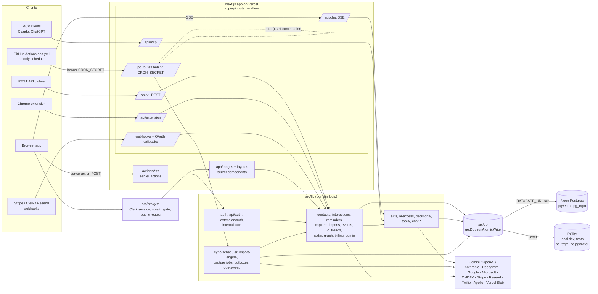

# Architecture

Orbit is a personal CRM: people are captured from messy input (notes, voice, photos, imports,
calendars, inboxes), stored as contacts with a timeline of interactions, and surfaced again as
follow-ups, briefs and answers to questions about your network.

One Next.js 16 App Router application serves the web app, the marketing site, a REST API, an MCP
server and the Chrome extension's API. It runs on Vercel and stores everything in Postgres.

## Diagram



## Layers

| Layer | Where | Rule |
|---|---|---|
| Edge | `src/proxy.ts` (Next 16's replacement for `middleware.ts`) | Clerk session, stealth/waitlist gate, public-route allowlist, `EXTENSION_ORIGIN` authorized parties. `/api/*` gets a JSON 401, pages redirect |
| Pages | `src/app/**/page.tsx` (server components) | Call `lib/*` loaders; no direct DB queries |
| Server actions | `src/actions/*.ts`, all `"use server"` | **Every export is a public endpoint.** Auth (`requireUserId` or a surface/admin guard) + validate + call lib + `revalidatePath`. No domain logic and no calls to other actions |
| Route handlers | `src/app/api/**/route.ts` | Only for what an action can't do: streaming, uploads, webhooks, OAuth callbacks, token URLs, REST v1, MCP, extension, internal jobs |
| Domain logic | `src/lib/**` | Takes `userId` explicitly; never reads the session (except in the guard modules) |
| Data | `src/db/schema.ts` (Drizzle model), `src/db/index.ts` (driver, migrator, atomic writes) | Every tenant query filters on `user_id` |
| UI | `src/components/**` | Never imports `@/db` values or server-only modules |

Route groups: `(site)` marketing and docs; `(clerk)/(auth|checkout|marketing)`;
`(clerk)/(app)/(main)/{capture,chat,contacts,dashboard,events,find,graph,imports,knowledge,meetings,outreach,radar,recruiters,reminders}`
plus onboarding and settings; `(clerk)/(admin)/admin/*`.

## Request flow

```
browser → proxy.ts → (app)/layout.tsx (onboarding gate, entitlements, surface visibility)
        → page.tsx → lib loaders → getDb() → Neon HTTP | PGlite
client component → server action → requireUserId() → lib (userId passed) → runAtomicWrite → revalidatePath
```

`requireUserId` (`lib/auth.ts`, built on `requireAuthenticatedUser`) returns `"demo-user"` in demo mode
(no Clerk publishable key **and** `NODE_ENV=development`, `lib/demo-account.ts`). Otherwise it reads the
Clerk session, makes sure `user_settings` exists, seeds local demo data on localhost, and throws
`AccountSuspendedError` / `AccountHeldError` (stealth hold). Layouts don't run for action POSTs, which is
why the gate lives here.

## Authentication schemes

| Caller | Mechanism | Code |
|---|---|---|
| Browser | Clerk session | `proxy.ts`, `lib/auth.ts` |
| `next dev` without Clerk keys | demo mode: every request is `demo-user` | `lib/demo-account.ts` |
| REST v1, MCP | hashed API keys (`api_keys`, kinds `api` / `mcp_url`); MCP OAuth | `lib/api/auth.ts`, `lib/mcp/oauth.ts` |
| Chrome extension | Clerk session from the extension origin (`EXTENSION_ORIGIN`); in dev a shared-secret header (`EXTENSION_DEV_SECRET`) | `lib/extension/auth.ts` |
| Schedulers and self-continuation | `Authorization: Bearer $CRON_SECRET` | `lib/internal-auth.ts` |
| Health deep view | `HEALTH_TOKEN` (`?token=` or bearer) | `lib/internal-auth.ts` |
| Admin | `ADMIN_USER_IDS` allowlist; unset means every `/admin` route 404s | `lib/admin.ts` |

## Background work

There is **no Vercel Cron**. `.github/workflows/ops.yml` curls internal routes on a schedule (see
[DEPLOYMENT.md](DEPLOYMENT.md#scheduled-jobs)). The routes fail closed without
`CRON_SECRET` (`lib/internal-auth.ts`); only `next dev` with no secret leaves them open. Long work is stored as DB job rows (`imports` +
`import_job_rows`, `capture_jobs`, `relationship_runs`, `radar_runs`, `email_sends`,
`connector_outbox`, `outbound_webhook_deliveries`). Workers claim rows with a lease, run inside a time
budget (`lib/time-budget.ts`), record a `cron_runs` row, and, when work remains, **POST back to
themselves inside `after()`** (`internalFetch`). The hourly cron is the backstop for a lost kick.

`lib/sync-scheduler.ts` (`runSyncPass`) claims due provider connections and runs Google/Microsoft
calendar and contacts, CalDAV, mailbox activity, the newer manifest connectors
(`lib/connectors/registry.ts`) and event sync. Everything lands through `lib/ingest/{events,people}.ts`.

Naming trap: `lib/background-jobs.ts` is the *browser* job widget, and `lib/jobs/` is *job postings*.

## AI pipeline

- **Access** (`lib/ai-access.ts`): decides between the user's own key and Orbit's managed key, and
  applies credits, entitlements, the managed-pool budget and pause, and the speech quota. It builds
  the SDK clients.
- **Calls** (`lib/ai.ts`): everything goes through `completeJson` / `completeMultimodalJson`, which
  write a `usage_events` row and use `ai_result_cache`. It also handles transcription
  (Deepgram → Whisper → Gemini), OCR, note parsing, embeddings, chat prompts and streaming, and web
  search.
- **Safety** (`lib/ai-security.ts`, `lib/mcp/sanitize.ts`): prompt-injection sanitising, secret
  redaction in streams.
- **Chat** (`app/api/chat/route.ts`, SSE): retrieval (`lib/chat-context.ts`), evidence gathering
  with deadlines (`lib/chat-gather.ts`), a tool loop (`lib/chat-tool-loop.ts`) and hybrid search
  (`lib/hybrid-search.ts`, pgvector + full text).
- **Tools** (`lib/tools/`): one registry shared by in-app chat and the MCP server.
- **Decisions** (`lib/decisions/`): a chain of Jev (TypeSafe classifier) → the account's LLM → a
  deterministic rule, used by capture, duplicates, calendar, notes, recruiters and chat routing.
  `decide()` never throws.
- Only `lib/ai*.ts` may import the provider SDKs.

## Integrations

Gmail and Google Calendar/Contacts/Drive (`lib/gmail.ts`, `lib/connectors/google-*`), Microsoft Graph
(`lib/outlook.ts`, `lib/connectors/microsoft-*`), CalDAV/iCloud (`lib/caldav/`), ICS in and out
(`lib/ics.ts`, `/api/calendar/[token]`), LinkedIn exports (`lib/linkedin-*`, `lib/import-adapters/`),
events (Luma, Eventbrite: `lib/events/`), Stripe (`lib/billing-stripe.ts`, `/api/webhooks/stripe`),
Resend (`lib/email/`), Twilio and Apollo (Outreach, gated), Deepgram (`lib/deepgram*`), and Vercel
Blob (avatars, photos). The provider code is moving from the older per-provider modules to the
`lib/connectors/` registry.

The Chrome extension (`extension/`, Vite MV3) shares only a type-only contract with the app,
`src/lib/extension/contract.ts`, through the `@contract` alias.

## Data model

119 tables in `src/db/schema.ts`. **Tenancy:** 86 tables carry `user_id text` (the Clerk user id).
There is no `users` table and no FK to one, so every query must filter by `user_id`. Account deletion
and the per-category "Delete data" run one list of deletes, `STEPS` in `lib/user-data.ts` (keyed by the
categories in `lib/data-categories.ts`), so a new user-scoped table needs a delete step there.

| Domain | Main tables |
|---|---|
| User | `user_settings` (one wide row per user: keys, plan, onboarding, preferences) |
| Contacts | `contacts` (the hub), `companies`, `contact_identities`, `contact_merges`, `duplicate_suggestions`, `tags`, `contact_tags`, `contact_profiles`, `contact_experiences`, `contact_career_moves`, `contact_briefs`, `contact_opportunities`, `contact_signals`, `contact_embeddings`, `memory_chunks` |
| Interactions and capture | `interactions`, `interaction_mentions`, `note_batches`, `capture_photos`, `action_items`, `capture_handoffs`, `capture_jobs`, `ignored_people` |
| Meetings and speech | `meeting_sessions`, `meeting_transcript_segments`, `speech_usage` |
| Reminders | `reminder_lists`, `reminders`, `suggested_reminders` |
| Relationship engine and Radar | `relationship_digests`, `relationship_runs`, `ai_suggestions`, `recommendations`, `radar_runs`, `recommendation_feedback`, `external_sources`, `external_items`, `external_item_companies`, `closeness_cohorts`, `user_goals`, `embedding_failures`, `recruiter_scan_state` |
| Imports | `imports`, `import_job_rows`, `import_files` |
| Calendar | `calendar_subscriptions`, `calendar_sources`, `calendar_events` |
| Connections | `gmail_connections`, `outlook_connections`, `apple_connections`, `cloud_note_sources`, `cloud_note_files`, `connector_connections`, `external_links`, `connector_outbox` |
| Outreach, recruiters, email | `outreach_campaigns` → `outreach_prospects` → `outreach_messages`, `recruiters` (shared, no owner), `user_recruiter_links`, `recruiter_messages`, `agent_send_requests`, `email_sends` |
| Chat and AI accounting | `chat_threads`, `chat_messages`, `usage_events`, `ai_batch_jobs`, `ai_result_cache` |
| Events (conferences) | `events`, `event_aliases`, `event_attendees`, `event_companies`, `target_companies`, `event_provider_connections` |
| Job postings | `job_feed_sources`, `job_postings`, `job_posting_matches` |
| Developer platform | `api_keys`, `api_idempotency_keys`, `webhook_endpoints`, `outbound_webhook_deliveries`, `extension_usage` |
| Billing and credits | `billing_events`, `gate_events`, `credit_grants`, `credit_accounts`, `credit_holds`, `plan_meter_usage`, `plan_upgrade_events`, `stripe_processed_events` |
| Admin and ops | `admin_audit_log`, `admin_provider_snapshots`, `cron_runs`, `rate_limit_buckets`, `ops_alert_state`, `webhook_deliveries`, `error_events`, `feedback`, `feedback_screenshots`, `page_views`, `data_purge_runs`, `site_settings`, `app_surface_flags`, `constellation_settings` |
| Founder finance (admin) | `startup_expenses`, `cash_snapshots`, `acquisition_spend`, `fundraising_rounds`, `fundraising_investors`, `non_dilutive_funding`, `infra_costs` |
| Marketing | `interest_list_signups`, `waitlist_poll_votes`, `broadcasts`, `broadcast_recipients` |
| Brand assets | `org_brand_colors`, `linkedin_avatars` |

"Event" means two things: a `NetworkEvent` interaction in `lib/ingest/events.ts`, and a conference
row in `events`.

### How the schema is applied

There are no generated migrations. `schema.ts` is the TypeScript query model. **The database is
built by the hand-written SQL in `src/db/index.ts`**: the `DDL` template, `SCALE_DDL` (generated
`search_tsv` columns, GIN and trigram indexes), the Neon `alters` list and the PGlite `ensureColumn`
calls. One column exists only there: `contact_embeddings.embedding_vector` (pgvector, created by
`migratePgvector`) with its HNSW index. That is why `drizzle-kit push` is refused: it would drop them.
`contacts.linkedin_slug` is a generated column declared in `schema.ts`, with its expression rewritten in
`SCALE_DDL`. Local PGlite has `pg_trgm` but no pgvector, so local vector search uses a JS fallback.

`reconcileSchema()` compares `schema_migrations` (version and fingerprint) with `SCHEMA_VERSION`. If
they differ, it takes a lease in `schema_migration_lock` and runs the idempotent sweep. It runs in
the Vercel build (`npm run db:migrate`) and lazily at runtime. `scripts/schema-ddl.lock.json` and
`npm run db:check` (`scripts/smoke-schema-ddl.ts`) fail CI when DDL changes without a version bump. The
fingerprint hashes `DDL`, `SCALE_DDL` and `alters` but **not** the `ensureColumn` calls or
`migratePgvector`, so remembering the bump is on you there.

Neon over HTTP has **no interactive transactions**: group writes with `runAtomicWrite` /
`runAtomicBatch` (`db.batch()` on Neon, `db.transaction()` on PGlite).

**Schema-change checklist:** `schema.ts` column → `DDL` → Neon `alters` → PGlite `ensureColumn` →
bump `SCHEMA_VERSION` + changelog → `npm run db:check`, then `npx tsx scripts/smoke-schema-ddl.ts --update` to
rewrite the lock → a delete step in `STEPS` (`lib/user-data.ts`) if the table is user-scoped → drops only after
a release with no readers.

## Local and demo mode

No `DATABASE_URL` means PGlite in `.data/pglite` (single writer: stop `next dev` before running
scripts). No Clerk keys on `next dev` means demo mode, with a seeded workspace (`lib/demo-data/`).
`ORBIT_DEMO_DATA=off` starts empty.

## Testing

- `scripts/smoke-*.ts`: about 540 standalone scripts run by `scripts/run-smoke.ts` against a
  throwaway PGlite. `--check` verifies the manifest; CI runs 3 shards.
- `e2e/*.spec.ts`: Playwright against `next dev` in demo mode (`ORBIT_DEMO_DATA=off`, so accounts start empty)
  with a stub AI server (`e2e/ai-stub-server.mjs`, wired in through the Gemini SDK's `GOOGLE_GEMINI_BASE_URL`).
- `npm run test:unit`: `node:test` unit tests (`src/**/*.test.ts`, `scripts/**/*.test.ts`) run through tsx.
- `npm run eval:retrieval`: retrieval quality on fixtures. AI evals are in `scripts/eval-ai.ts` and
  `docs/ai-evals/`.

## Decision records

See [`docs/adr/`](adr/README.md).

## Related references

- REST API: `GET /api/v1/openapi.json` on any deployment (`src/app/api/v1/openapi.json/route.ts`; it 404s while
  the site is in stealth mode).
- MCP and chat tools: [MCP.md](MCP.md), generated from `ORBIT_TOOLS`.
- Variables: [ENVIRONMENT.md](ENVIRONMENT.md). Deploys and jobs: [DEPLOYMENT.md](DEPLOYMENT.md).
